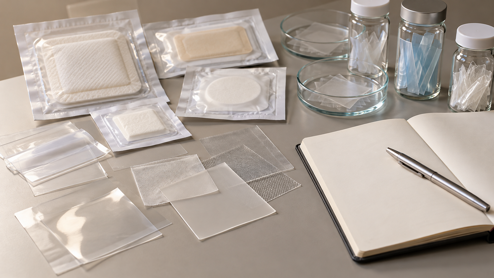

# Investigación de una barrera para proteger curas sacras

**Estado:** idea y pregunta de investigación atribuidas a Javier en un catálogo reconstruido. No constan prototipo propio, ensayo, patente ni solución clínica validada. Borrador del portfolio, pendiente de revisión. **Versión:** 2026-10-14-v7. **Fecha de redacción:** 2026-10-14. No publicado ni aprobado para subir.

## TL;DR

*Ilustración conceptual generada con IA; no es una captura ni prueba de uso.*

- **Propósito:** Investigar si existe o podría fabricarse una barrera que proteja curas sacras de contaminación fecal.
- **Aportación y enfoque:** Javier formula la idea y la pregunta de fabricación; no constan material, geometría o modo de uso elegidos.
- **Trabajo y evidencia:** Catálogo con referencia a una investigación anterior, cuya respuesta completa no se recuperó.
- **Resultados y límites:** No hay diseño, prototipo, ensayo ni novedad patentable acreditados. Falta recuperar comparadores y evaluar efectos y condiciones sin inventar conclusiones clínicas.

## Punto de partida

La recopilación recibida describe una pregunta de Javier: si podría existir o fabricarse una barrera, cerco o apósito que evitara que las deposiciones manchasen una cura situada en el sacro. La ficha conserva la tarea que le interesa explorar sin elegir un dispositivo ni afirmar que la propuesta funcionaría. Tampoco convierte la pregunta en prueba de una necesidad general, de un caso concreto o de una carencia del mercado.

Esta línea permite mostrar una forma de razonamiento: observar una situación, formular una posible intervención y preguntar qué soluciones o enfoques existen antes de desarrollarla. El conocimiento asistencial de Javier es un contexto para esa pregunta; no sustituye una descripción documentada del uso previsto. No se incluyen pacientes, imágenes de lesiones, prácticas de un centro ni episodios clínicos identificables como evidencia pública.

## Origen y alcance de la fuente

La fuente utilizada aquí es el catálogo de la conversación de negocios recibido el 14 de octubre de 2026. Atribuye la idea al usuario y localiza una investigación comparativa anterior mediante una referencia de mensaje del 8 de octubre. Esa localización es un dato de la reconstrucción: esta edición no ha recuperado la respuesta completa ni revalidado su contenido. La fecha de recepción del catálogo y la del antecedente citado no acreditan el inicio exacto de la idea.

El catálogo menciona comparadores comerciales y un estudio histórico. Esas menciones no permiten reconstruir indicaciones, resultados o diferencias técnicas. Se conservan como referencias pendientes en el registro privado; no se presentan aquí como un benchmark clínico realizado. Un reel compartido cerca de la petición corresponde a otro asunto y no se usa como origen del producto. La proximidad entre mensajes no basta para atribuir una relación.

## Qué propone Javier y qué no está decidido

El interés acreditado por la recopilación es explorar la existencia y posible fabricación de una barrera. No consta que Javier haya elegido geometría, material, adhesivo, modo de colocación, población o duración de uso. Esta ficha no añade esas decisiones en su nombre. Las variantes que sugiere el vocabulario de la pregunta sirven para delimitar qué información falta, sin convertirse en un diseño acordado.

Antes de comparar alternativas, esta edición propone describir con mayor precisión la función buscada. Habría que distinguir proteger una cura, controlar el contacto con una fuente de contaminación, facilitar una tarea o reducir la frecuencia de una intervención. Son posibles preguntas de análisis planteadas por el asistente. No se afirma que todas correspondan a la intención inicial de Javier ni que una única pieza deba resolverlas juntas.

## Investigación de soluciones y procedencia

Un siguiente paso propuesto sería recuperar la investigación anterior y separar sus fuentes. Una descripción comercial informa sobre lo que declara el fabricante; una publicación de investigación tiene condiciones y resultados propios; una observación clínica autorizada aportaría otro tipo de evidencia. La ficha no mezcla esos niveles para concluir que un producto sirve para una finalidad no comprobada. Tampoco atribuye a una marca un fracaso o una ventaja sin su fuente pertinente.

La comparación debería partir de una misma pregunta de uso. Si dos materiales o dispositivos cumplen funciones distintas, una tabla de características no permite tratarlos como sustitutos automáticamente. Esta propuesta editorial sugiere registrar qué función declara cada fuente, qué condiciones estudia, qué información no ofrece y qué pregunta sigue abierta. El registro sería una ayuda para razonar, no una recomendación de tratamiento ni una clasificación de productos para pacientes.

## Posibles preguntas de diseño

Esta edición propone estudiar si una barrera añadida introduciría condiciones nuevas que también habría que evaluar. Por ejemplo, la facilidad de colocación, de retirada y de observación son preguntas que podrían incorporarse a una investigación de uso. No se dan por satisfechas, no se traducen en instrucciones clínicas y no se presentan como especificaciones elegidas por Javier. Su inclusión en una versión de diseño requeriría fuentes y revisión adecuadas al ámbito.

La cuestión de fabricar una pieza puede descomponerse en idea, representación, muestra y evaluación. Un dibujo explica una forma; una muestra demuestra que esa forma puede producirse en unas condiciones; ninguno acredita por sí solo funcionamiento o seguridad clínica. La ficha no propone realizar pruebas con personas ni aplicar una solución no evaluada. Cualquier exploración posterior tendría que definir primero el tipo de evidencia que se quiere obtener y los límites del ensayo.

## Una comprobación inicial acotada

Como propuesta del asistente, una primera actividad documental podría elaborar un mapa de alternativas a partir de la respuesta histórica recuperada. Cada entrada conservaría referencia, fecha, función descrita y nivel de lectura real. Cuando falte el texto o solo exista una mención, se anotaría esa ausencia. La actividad ayudaría a decidir qué vale la pena investigar, sin reproducir imágenes, documentos completos o materiales de terceros en el repositorio público.

Otra posibilidad futura sería discutir una representación puramente conceptual de la tarea con profesionales autorizados para esa revisión. Antes habría que acordar qué pregunta se plantea y qué información se puede utilizar. La existencia de esa conversación tampoco demostraría eficacia o aceptación de un producto. Esta ficha no afirma que se haya celebrado, que existan participantes comprometidos ni que la propuesta vaya a comercializarse.

## Viabilidad como línea de producto

La fabricación y la viabilidad comercial son cuestiones distintas de la idea clínica. Habría que estudiar qué evidencia se necesita, qué trabajo de desarrollo implica, quién podría producir una muestra y bajo qué condiciones se evaluaría. No constan proveedores, presupuesto, pedido, acuerdo de colaboración ni financiación. Una posibilidad técnica mencionada en una investigación no se convierte aquí en capacidad industrial disponible.

La clasificación del eventual producto, sus requisitos y las vías de protección intelectual permanecen por verificar. No se afirma novedad patentable, autorización sanitaria ni una ruta regulatoria concreta. La pregunta de si algo ya existe exige distinguir semejanza visual, función prevista y características verificadas. Las decisiones empresariales necesitarían una investigación propia y no se deducen del hecho de redactar una tesis para el portfolio.

## Relación con el resto del portfolio

Esta línea se separa de Chiarezza, SmartHandover y los gemelos digitales porque parte de una posible intervención física, no de comunicar o representar información. La experiencia con herramientas digitales podría ayudar a organizar la investigación o mostrar un concepto. Esa relación no acredita un prototipo de dispositivo, competencia de fabricación ni evaluación de sus condiciones de uso. El objeto de la ficha es hacer visible la pregunta y el modo propuesto de contrastarla.

La versión pública conservaría la idea general, las diferencias entre tipos de evidencia y el estado de desarrollo. Los detalles de una eventual invención reservada, comunicaciones con fabricantes, fotografías asistenciales y datos de participantes permanecerían separados. La clasificación pública de la ficha no decide la publicidad de un diseño futuro. Javier revisará qué formulación representa su intención y qué parte propuesta por el asistente desea mantener.

## Fechas, herramientas y límites

Revisión y correcciones de esta versión (2026-10-14): Codex/OpenAI gpt-6-astra, identificado en los metadatos del turno; revisión independiente por otro agente con gpt-6-astra. Se conservan las atribuciones históricas siguientes.

Imagen conceptual vigente, añadida el 2026-10-14: preparación e incorporación con Codex/OpenAI gpt-6.1-sol (metadatos del turno); generación y correcciones con image_gen de OpenAI, cuyo modelo exacto no consta. Sustituye el esquema anterior, conservado en el historial. Revisión independiente: gpt-6-astra.

Apoyo visual añadido el 2026-10-14: esquema original elaborado con Codex/OpenAI gpt-6.1-sol (metadatos del turno), Python 3.12.14 y ReportLab 4.4.9, exportado como SVG. Explica la idea del TL;DR; no representa una prueba o resultado nuevo. Revisión independiente de esta edición: gpt-6-astra; alcance documentado por separado. Compatibilidad tipográfica del SVG corregida en esta edición.

Primera redacción histórica (versión 2026-10-14-v1), redactada el 14 de octubre de 2026, Europe/Madrid. Fuente disponible: catálogo reconstruido recibido ese día. Investigación previa situada en el 8 de octubre por la recopilación, con respuesta completa pendiente de recuperación. Inicio de la idea y modelos históricos no confirmados. No se atribuyen resultados clínicos a ese antecedente sin leerlo.

La redacción utiliza Codex, OpenAI, modelo gpt-6.1-sol verificado en los metadatos del turno. Se emplean Python 3.12.14, functions.exec, exec_command y apply_patch para lectura y preparación local. Se solicita revisión independiente de contenido con un subagente Codex gpt-6-astra; su alcance se registrará separado de cualquier evaluación clínica. No se han probado dispositivos, ejecutado ensayos ni configurado herramientas de fabricación.

La idea y la pregunta por existencia o fabricación se atribuyen a Javier según el catálogo. La descomposición del estudio, las preguntas adicionales y las actividades futuras son propuestas del asistente. Quedan pendientes la fuente original, los comparadores completos, el uso concreto que Javier quiere explorar y la evidencia necesaria para cualquier decisión posterior. Esta ficha no indica tratamiento ni autoriza publicación.
