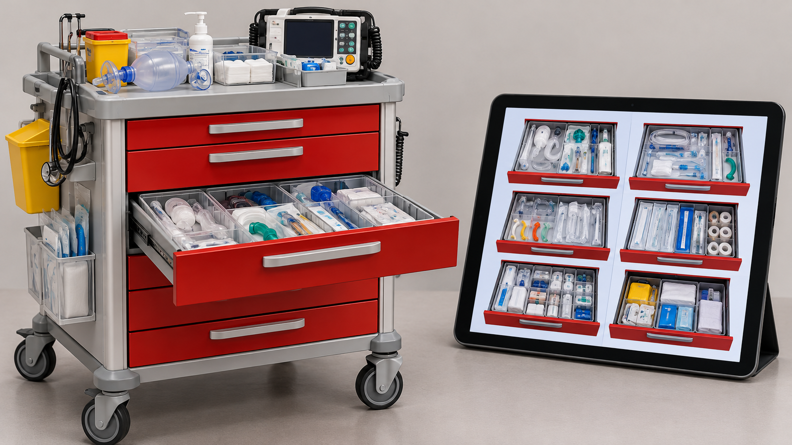

# Representación digital del carro de paradas para consulta y práctica

**Estado:** borrador local para revisión. **Versión:** 2026-10-14-v5. **Fecha de redacción:** 2026-10-14. No publicado ni aprobado para subir.

## TL;DR

*Ilustración conceptual generada con IA; no es una captura ni prueba de uso.*

- **Propósito:** Consultar y practicar la ubicación del material de un carro de paradas.
- **Aportación y enfoque:** Javier delimita la experiencia formativa y las particularidades que conoce; IA y herramientas ayudan a representarlas.
- **Trabajo y evidencia:** Maqueta, catálogo y actividades descritos en el README; una referencia procede de un protocolo de 2008.
- **Resultados y límites:** Fichas no equivalen a existencias físicas. Falta confirmar vigencia, disposición y derechos de recursos; no se acredita implantación ni competencia clínica.

## Punto de partida y pregunta de esta línea

Localizar material en un carro de paradas combina conocimiento de su organización y reconocimiento visual. El proyecto plantea una representación que permita consultar posiciones y practicar su identificación fuera de una intervención real. La pregunta es cómo presentar esa organización sin confundir una referencia documental con la comprobación de lo que contiene un carro concreto.

## Origen y propósito

La documentación disponible permite describir esta línea, pero no reconstruye de forma confirmada qué observación, publicación o experiencia la inició. El punto de partida puede ser una idea, una hipótesis, una aplicación o una práctica con herramientas; no se presupone que exista un problema que resolver. Si se recupera una referencia de origen, se distinguirán lo que plantea esa fuente y la adaptación realizada por Javier.

## Enfoque del proyecto y propuesta de esta versión

La propuesta utiliza vistas del carro, cajones y fichas relacionadas con material, junto con búsqueda y actividades de ubicación. El diseño diferencia el catálogo de referencias, las observaciones aportadas y la distribución documentada. Javier define el alcance formativo y las particularidades que conoce; las herramientas de IA ayudan a construir las representaciones. Las observaciones particulares deben conservar su procedencia y no generalizarse a otras unidades.

## Desarrollo y evidencia disponible

El README describe una maqueta formativa, un catálogo y actividades de práctica. La versión documental de octubre remite a un protocolo público de 2008 cuya vigencia institucional no se ha confirmado. Los números del catálogo cuentan fichas, no existencias físicas. En esta fase se han leído documentación y registros existentes, sin repetir todas las comprobaciones del desarrollo. La maqueta no acredita inventario presencial ni implantación hospitalaria.

## Preguntas y límites que permanecen abiertos

Una ubicación puede cambiar y una imagen puede no corresponder a la disposición vigente. La consulta debe mostrar la fuente y fecha de cada referencia, sin introducir cantidades, dosis o existencias no verificadas. Las fotografías oficiales y otros recursos requieren su atribución y revisión de derechos antes de publicación. La práctica de localizar material no acredita competencia clínica ni debe presentar animaciones como simulación de una técnica asistencial.

## Cómo podría comprobarse

Se propone validar con el servicio la correspondencia de las fichas y la vigencia de la distribución, dejando registrados desacuerdos y cambios. La prueba de interfaz debería comprobar consulta, navegación, legibilidad y accesibilidad. La actividad formativa puede evaluarse con tareas de localización definidas, indicando si la respuesta se basa en un protocolo o una observación. Un cambio de disposición exigiría nueva versión, fecha y responsable de revisión.

## Consultar una representación y comprobar un carro son tareas distintas

El proyecto convierte una distribución documentada y observaciones visuales en una maqueta para consulta y práctica. Una ficha puede ayudar a reconocer una referencia y encontrar su ubicación en esa representación. No confirma que el objeto esté en el carro físico, disponible o en condiciones de uso. Esa diferencia forma parte del diseño y debe conservarse al presentar el proyecto, especialmente porque la apariencia de un catálogo puede sugerir un inventario actual.

Javier distingue esta línea del almacén y de una guía hospitalaria. El acceso mediante enlace o QR permite llegar a una representación, pero no le añade vigencia ni autoridad clínica. La ficha pública puede explicar cómo se seleccionaron fuentes y cómo se muestran las ubicaciones sin reproducir cantidades o indicaciones de uso. La práctica propuesta se refiere a localizar y reconocer material. No evalúa una técnica asistencial ni prescribe la organización de un servicio a partir de una ilustración.

## Referencia documental y observación tienen procedencias diferentes

El README vigente remite a una distribución de un protocolo fechado y separa observaciones particulares. El catálogo incorpora referencias documentales y conserva elementos observados en material visual. Si ambas capas discrepan, el diseño necesita mostrar qué fuente sustenta cada dato. La edición de una imagen para seguir una distribución documental no demuestra que una fotografía posterior del carro real coincida con ella.

Como ejemplo editorial, una ficha podría presentar una ubicación de referencia y una observación aportada para una unidad, con fechas y estados separados. La actividad de práctica debería indicar qué capa determina su respuesta. Un objeto mencionado en un listado y uno reconocible en una fotografía tampoco aportan la misma evidencia visual. La ausencia de una ilustración no autoriza a generarla como identificación confirmada. La actualización requeriría comprobar la fuente pertinente y registrar qué cambió. Esta redacción conserva los límites del catálogo y no revalida la vigencia del protocolo utilizado.

## Navegar, buscar y practicar se pueden comprobar por separado

La maqueta incluye vistas, cajones, búsqueda y actividades de ubicación. Cada función resuelve una tarea de interfaz distinta: explorar una distribución, encontrar una referencia por nombre o responder una pregunta sobre posición. El diseño puede estudiarse mediante recorridos específicos, observando si la navegación conserva el contexto y si una respuesta utiliza la referencia que el ejercicio declara. Una animación o un sonido no acreditan simulación del equipo representado.

El asistente propone una comprobación con varios nombres de una misma referencia, una búsqueda sin resultado y un material cuya posición no esté explicitada. La interfaz tendría que comunicar el límite en lugar de inventar una ubicación. Otra comprobación revisaría foco, tamaño del contenido y recorrido con teclado o movimiento reducido. Los registros de pruebas del desarrollo son antecedentes que deben distinguirse de nuevas comprobaciones. Esta preparación no repite las rondas ni describe la práctica como entrenamiento clínico validado. El criterio observado sería el funcionamiento de la consulta en la configuración probada.

## El material visual requiere su propia revisión

El proyecto conserva fotografías de fuente institucional e ilustraciones generadas, además de antecedentes procedentes de vídeos aportados. La atribución de una fotografía no implica disponer de una licencia de redistribución libre. El dossier puede enlazar y describir su procedencia sin incorporar el archivo a un repositorio público candidato hasta revisar las condiciones pertinentes. Tampoco necesita publicar vídeos originales, voces o identificadores de equipos para explicar el mecanismo.

Las imágenes generadas tienen límites de reconocimiento y correspondencia. Si una ilustración omite o cambia un elemento, el diseño debe permitir distinguirla de una fotografía de referencia. Los prompts y resultados forman parte de la versión de recursos, con la herramienta y modelo que consten, sin asignar uno retrospectivamente cuando falte. La ficha no declara que todo el catálogo esté ilustrado: el registro del desarrollo contiene una ampliación visual pendiente. Esa información afecta a qué material se puede mostrar como terminado y qué permanece en preparación.

## Qué enseña el proceso de construcción

Esta línea permite mostrar una aplicación de información visual y documental a una tarea de consulta. El razonamiento incluye delimitar el alcance, clasificar evidencia, resolver ambigüedades y comprobar interacciones. Javier aporta el conocimiento del entorno y decisiones del proyecto; las herramientas ayudan a construir representaciones y código. El portfolio puede conservar correcciones y aspectos pendientes sin convertir la maqueta en un sistema de control de existencias.

El siguiente avance propuesto es contrastar la correspondencia con la distribución y fuentes que el servicio considere pertinentes, si se autoriza esa fase. La representación podría actualizarse con fecha y responsable de revisión. Para una demostración pública bastaría un contenido autorizado y claramente identificado como ejemplo de consulta. Cualquier uso durante la actividad asistencial necesita un alcance distinto de la práctica descrita. La entrega teórica mantiene esa separación y permite explicar cómo se diseñó la herramienta, qué evidencia incorpora y qué comprobaciones todavía no se han realizado.

## Referencias históricas recuperadas y aplicación propuesta

El catálogo histórico incluye una referencia al protocolo CHUA de carros de parada, con fecha antigua y vigencia clínica no confirmada. Añadirla a la bibliografía identifica un antecedente, sin actualizar por sí solo la disposición del carro o los contenidos de sus fichas. El asistente propone relacionar cada referencia con la revisión del servicio que corresponda, conservando diferencias y fecha. Esta incorporación no cambia cantidades, dosis o pautas ni demuestra una nueva comprobación física; se mantienen los límites formativos y de derechos del dossier.

## Procedencia de las posiciones

Propósito formativo y límites documentados; propuesta de actualización y evaluación en esta redacción. El texto es una síntesis asistida por IA y requiere la revisión de Javier antes de atribuirle nuevas formulaciones. Se describen procesos y condiciones, sin juicios de valor ni atribuciones de intenciones.

## Fechas, versiones y cambios

Primera referencia temporal utilizada: 2026-09-26. Fecha de creación de la maqueta declarada en el historial del README.

Se desarrolla el mecanismo específico, sus aplicaciones y ejemplos de comprobación. Las nuevas propuestas del asistente se mantienen diferenciadas de las decisiones de Javier. Se registra el modelo de este turno con su evidencia, sin cambiar las atribuciones anteriores. No se incorporan resultados de pruebas nuevas. La edición no modifica las fuentes originales ni sus fechas.

## Herramientas y modelos

Imagen conceptual vigente, añadida el 2026-10-14: preparación e incorporación con Codex/OpenAI gpt-6.1-sol (metadatos del turno); generación y correcciones con image_gen de OpenAI, cuyo modelo exacto no consta. Sustituye el esquema anterior, conservado en el historial. Revisión independiente: gpt-6-astra.

Apoyo visual añadido el 2026-10-14: esquema original elaborado con Codex/OpenAI gpt-6.1-sol (metadatos del turno), Python 3.12.14 y ReportLab 4.4.9, exportado como SVG. Explica la idea del TL;DR; no representa una prueba o resultado nuevo. Revisión independiente de esta edición: gpt-6-astra; alcance documentado por separado. Compatibilidad tipográfica del SVG corregida en esta edición.

La redacción de esta versión utiliza Codex/OpenAI con el modelo gpt-6.1-sol. Su identificación consta en los metadatos del turno utilizado para esta edición; las atribuciones de versiones anteriores se conservan con su evidencia original. Se usaron Python para organización y comprobación local, y herramientas de lectura y edición de archivos. La revisión editorial independiente se encargó a un agente separado con gpt-6-astra; su alcance y resultado se registran fuera del dossier, sin equivaler a validación integral del proyecto. No se han configurado integraciones o actualización continua.

### Atribuciones históricas documentadas

- Gemini: no_confirmado. README atribuye descripción inicial a Gemini, contrastada parcialmente.
- Revisión independiente: gpt-6-astra. Revisión anterior declarada en README; distinta de la presente revisión editorial.

## Fuentes y alcance de lectura

La base es la documentación interna identificada en el registro privado de fuentes de esta preparación. Se ha leído mediante extracción local y se han examinado fuentes y pasajes seleccionados; no es una auditoría sustantiva de todo el corpus. Las referencias externas de los antecedentes requieren verificación pertinente antes de reutilizar afirmaciones como hechos actuales. No se incluyen rutas privadas, documentos sensibles, conversaciones completas o material de terceros en este dossier.
