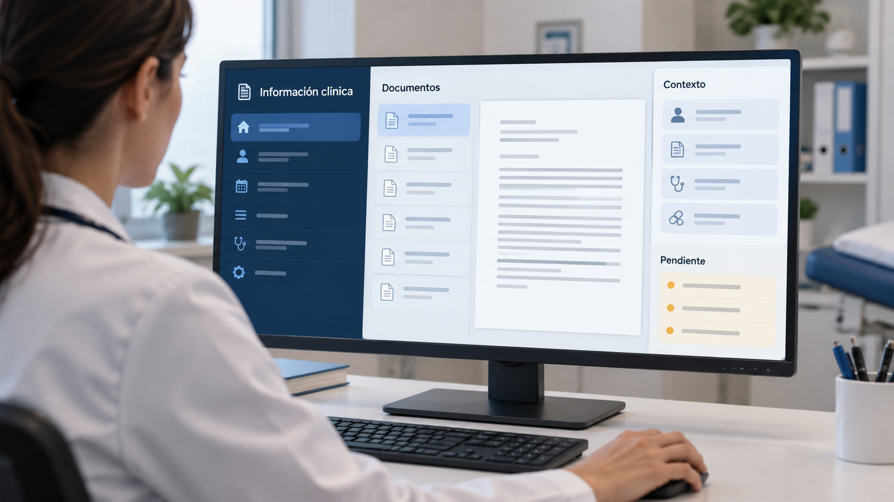

# Interfaz clínica e integración de información entre niveles asistenciales

**Edición editorial:** 2026-11-07-editorial-r1. **Elaborada en UTC:** 2026-11-07T19:50:09.616232Z.

**Estado histórico declarado del contenido:** borrador local para revisión. **Versión histórica:** 2026-10-14-v5. **Fecha de redacción histórica declarada:** 2026-10-14. La fuente histórica estaba disponible públicamente en el commit consultado; su publicación no valida el contenido.

**Alcance de esta edición:** corrección administrativa del estado documental. El desarrollo y las atribuciones que siguen se reproducen de la [versión histórica](https://github.com/NovusMotus/portfolio-tesis/blob/2cd2acbd44ae01f98481e383af2368bce2973b43/clinicos/ehr-interfaz/TESIS.md); sus expresiones «esta versión» se refieren a aquella edición. Se conservan las fechas declaradas, los límites y las propuestas, sin añadir logros ni reconstruir el inicio de la idea. La disponibilidad de esta edición se comprueba en el repositorio y en la PR que la incorpore.

**Aporte editorial:** Codex desktop / OpenAI / gpt-6.1-sol; transformación con Python 3.12.14. [Registro de esta versión](VERSION-2026-11-07-editorial-r1.json) · [Revisión editorial fechada](../../REVISION_EDITORIAL_2026-11-07-r1.json).

## TL;DR

*Ilustración conceptual generada con IA; no es una captura ni prueba de uso.*

- **Propósito:** Examinar navegación y transferencia de información entre niveles asistenciales.
- **Aportación y enfoque:** Javier plantea diseñar con profesionales, preservar servicios aprovechables y exigir pruebas de integración, más allá del aspecto de las pantallas.
- **Trabajo y evidencia:** Estudio, propuesta formal y presentación; sin acceso a historias clínicas en esta preparación.
- **Resultados y límites:** No hay aprobación, financiación ni integración acreditadas. Falta demostrar interoperabilidad y sustitución independiente de componentes.

## Punto de partida y pregunta de esta línea

El proponente describe tareas en las que la navegación, los registros dispersos y las transferencias entre aplicaciones requieren pasos adicionales. Son observaciones locales que deben contrastarse por versión, unidad y tarea. La cuestión planteada es qué parte de esa dificultad pertenece a la interfaz y qué parte a la integración de información, evitando atribuir causas generales antes de examinar el funcionamiento concreto.

## Origen y propósito

La documentación disponible permite describir esta línea, pero no reconstruye de forma confirmada qué observación, publicación o experiencia la inició. El punto de partida puede ser una idea, una hipótesis, una aplicación o una práctica con herramientas; no se presupone que exista un problema que resolver. Si se recupera una referencia de origen, se distinguirán lo que plantea esa fuente y la adaptación realizada por Javier.

## Enfoque del proyecto y propuesta de esta versión

La propuesta relaciona una interfaz adaptada al trabajo clínico con una historia compartida por los niveles pertinentes. No basta con cambiar el aspecto de las pantallas si persisten registros independientes sin conciliación. El enfoque de Javier es diseñar con los profesionales, preservar datos y servicios aprovechables, y exigir demostraciones de integración. Las alternativas técnicas deben compararse por su comportamiento verificable, incluida la posibilidad de sustituir componentes.

## Desarrollo y evidencia disponible

Existe un estudio, una propuesta formal y materiales de presentación. El resumen identifica la propuesta como v1.4 de octubre, destinada a valoración institucional. Los documentos no acreditan aprobación, financiación ni integración realizada. Esta redacción conserva la relación entre interfaz y datos, sin dar por demostrada disponibilidad de productos mencionados o compatibilidad con sistemas existentes. Tampoco se han accedido a historias clínicas para preparar el dossier.

## Preguntas y límites que permanecen abiertos

La compatibilidad declarada con un estándar no demuestra sustitución independiente de módulos. Una base compartida necesita reglas de procedencia, rectificación, acceso y fuente de autoridad durante la transición. La observación de una pantalla no permite deducir calidad de toda la implantación. Las referencias visuales externas son ejemplos de diseño con sus autores y permisos, no evidencia de integración. Las afirmaciones técnicas y jurídicas de documentos anteriores necesitan su verificación específica antes de presentarse como actuales.

## Cómo podría comprobarse

La propuesta puede concretarse mediante tareas ficticias que recorran primaria y especializada, con un registro de pasos, datos recuperados y discrepancias. También se propone una prueba de sustitución de un componente entre proveedores sin perder información pertinente. El prototipo inicial debe usar datos ficticios y mantener separado el acceso a sistemas asistenciales. La comparación serviría para elegir una vía de diseño, no para declarar una implantación a partir de una demostración.

## Una interfaz se entiende recorriendo una tarea

Javier relaciona la navegación cotidiana con el objetivo de disponer de información clínica pertinente entre niveles. Sus observaciones describen situaciones locales, no un diagnóstico de todas las instalaciones. Para estudiar una tarea habría que registrar desde dónde se inicia, qué dato se busca, qué sistema lo mantiene y qué pasos permiten consultarlo o incorporarlo. Ese recorrido ayuda a distinguir una dificultad de presentación de una dependencia de datos o permisos.

Como ejemplo propuesto por el asistente, un caso inventado podría mostrar una consulta en primaria y un resultado posterior en especializada. La tarea de revisión necesitaría conocer origen, momento y estado de ese resultado. Cambiar botones o reunir vistas puede facilitar acceso, pero no concilia registros por sí solo. La propuesta de una base compartida pretende preservar una historia con reglas comunes, aunque sus aplicaciones presenten vistas diferentes. No se afirma que esa arquitectura exista ahora ni que una alternativa técnica concreta la resuelva sin diagnóstico y pruebas.

## Base compartida, procedencia y rectificación

El diseño de Javier exige que los registros pertinentes se incorporen a una historia compartida, en lugar de dejar como resultado final dos historias independientes. Ese objetivo requiere definir fuentes de autoridad, identificación, versiones y reglas de actualización. Una copia de consulta puede ser útil durante una transición, pero necesita explicar qué cambios recibe y qué escrituras deben volver al sistema correspondiente. La disponibilidad de una pantalla agregada no acredita esa relación.

Un ensayo propuesto introduciría un dato corregido en un origen y observaría cómo aparece en la otra vista. Se conservarían autoría, momento del hecho y versión, evitando resolver diferencias con una sobrescritura silenciosa. Otra variante incluiría un registro duplicado y un dato cuya unidad cambia. Las pruebas usarían información ficticia con resultados de referencia definidos. No estudiarían solo la estética de la vista, sino qué información se mantiene y cómo se interpreta. Una decisión sobre la arquitectura necesitaría comparar ese comportamiento con sus costes y condiciones de operación.

## Interoperabilidad debe describirse para una implementación concreta

La especificación de HL7 FHIR define CapabilityStatement para describir capacidades de una implementación o requisitos de un sistema, vinculados a una versión. Eso permite precisar qué se declara, en lugar de interpretar la mera referencia al estándar como una lista completa de operaciones disponibles. [Documentación de HL7](https://hl7.org/fhir/capabilitystatement.html). La propuesta de prueba de esta ficha exige además observar el recorrido y sus condiciones; la declaración técnica no sustituye la comprobación.

El asistente propone comparar lectura, escritura, extracción y actualización para un conjunto delimitado de datos. Los perfiles, terminologías y derechos de acceso formarían parte de la descripción. Si dos componentes se sustituyen, la prueba tendría que conservar los registros y funciones pertinentes, con una vía de recuperación. Ese requisito de sustitución es una forma propuesta de examinar dependencia de proveedores, no una capacidad atribuida a productos mencionados en los antecedentes. No se da por disponible una API de escritura o una versión de cliente sin su evidencia específica.

## Diseñar con los profesionales y comparar alternativas

La propuesta considera varias vías para renovar el cliente y pide participación de quienes realizan las tareas. Un desarrollo interno, uno externo y una actualización del proveedor deberían compararse frente a los mismos requisitos. Su coste incluye mantenimiento, integración, formación y salida, además de construcción inicial. No se presume que una vía sea más económica por la procedencia de quien la realiza.

Una muestra de interfaz podría representar la vista del conjunto del servicio y la ficha individual con datos ficticios. Los participantes autorizados recorrerían tareas definidas y registrarían pasos, dudas y ayuda necesaria. Los resultados podrían mostrar diferencias entre perfiles o condiciones de uso sin atribuirlas automáticamente a la edad o competencia de las personas. La evaluación necesita considerar qué carga se desplaza a otro profesional. La colaboración propuesta con órganos de innovación no acredita que esos órganos existan o tengan un encargo. Las decisiones y recursos institucionales permanecen sujetos a su cauce correspondiente.

## Una transición necesita criterios de aceptación y reversión

El recorrido propuesto separa diagnóstico, prototipo ficticio, comparación y una posible fase autorizada. Cada avance necesita resultados observables antes de cambiar el entorno de producción. Una aceptación no consistiría solo en abrir una nueva pantalla: tendría que demostrar la información y funciones que se acuerden conservar. Durante la coexistencia se definirían reglas para actualizaciones, discrepancias y retirada de componentes, sin perder escrituras posteriores a un cambio.

El portfolio puede mostrar las preguntas de arquitectura y un caso de intercambio representado, con las decisiones de Javier diferenciadas de las pruebas añadidas por el asistente. El antecedente académico se relaciona con esta propuesta por el interés en continuidad, pero no le transfiere validación técnica. Tampoco se atribuyen contratos, ahorros o despliegues a la existencia de documentos de presentación. Esta preparación no accede a sistemas clínicos, solicita datos o ejecuta integraciones. Explica el planteamiento, sus condiciones y la evidencia que permitiría pasar de una propuesta a un desarrollo comprobado.

## Dos alternativas formuladas en el contexto recuperado

El catálogo recibido concreta una preferencia de Javier: estudiar un producto que un proveedor especializado mantenga y actualice, o un núcleo central propio y modular que pueda integrar componentes de terceros mediante estándares. La formulación permite comparar responsabilidad de mantenimiento, sustitución e integración frente a una misma tarea. Es una posición atribuida al contexto reconstruido, no una elección de proveedor, arquitectura aprobada o pliego publicado. Las referencias a otros sistemas son comparadores que requieren expedientes y comprobaciones propias antes de describir capacidades. Su estudio académico de FHIR y HL7 se distingue de una implantación productiva; esta preparación no acredita que haya integrado una historia clínica real.

## Procedencia de las posiciones

Planteamiento documentado por Javier; requisitos de prueba se presentan como propuesta, no como evaluación ejecutada. El texto es una síntesis asistida por IA y requiere la revisión de Javier antes de atribuirle nuevas formulaciones. Se describen procesos y condiciones, sin juicios de valor ni atribuciones de intenciones.

## Fechas, versiones y cambios

Primera referencia temporal utilizada: 2021. Antecedente académico declarado en la fuente; la formulación de 2026 es una propuesta posterior.

Se desarrolla el mecanismo específico, sus aplicaciones y ejemplos de comprobación. Las nuevas propuestas del asistente se mantienen diferenciadas de las decisiones de Javier. Se registra el modelo de este turno con su evidencia, sin cambiar las atribuciones anteriores. No se incorporan resultados de pruebas nuevas. La edición no modifica las fuentes originales ni sus fechas.

## Herramientas y modelos

Imagen conceptual vigente, añadida el 2026-10-14: preparación e incorporación con Codex/OpenAI gpt-6.1-sol (metadatos del turno); generación y correcciones con image_gen de OpenAI, cuyo modelo exacto no consta. Sustituye el esquema anterior, conservado en el historial. Revisión independiente: gpt-6-astra.

Apoyo visual añadido el 2026-10-14: esquema original elaborado con Codex/OpenAI gpt-6.1-sol (metadatos del turno), Python 3.12.14 y ReportLab 4.4.9, exportado como SVG. Explica la idea del TL;DR; no representa una prueba o resultado nuevo. Revisión independiente de esta edición: gpt-6-astra; alcance documentado por separado. Compatibilidad tipográfica del SVG corregida en esta edición.

La redacción de esta versión utiliza Codex/OpenAI con el modelo gpt-6.1-sol. Su identificación consta en los metadatos del turno utilizado para esta edición; las atribuciones de versiones anteriores se conservan con su evidencia original. Se usaron Python para organización y comprobación local, y herramientas de lectura y edición de archivos. La revisión editorial independiente se encargó a un agente separado con gpt-6-astra; su alcance y resultado se registran fuera del dossier, sin equivaler a validación integral del proyecto. No se han configurado integraciones o actualización continua.

### Atribuciones históricas documentadas

No hay una atribución histórica exacta reconstruida para esta ficha. Las menciones a herramientas en las fuentes no se consideran prueba de uso.

## Fuentes y alcance de lectura

La base es la documentación interna identificada en el registro privado de fuentes de esta preparación. Se ha leído mediante extracción local y se han examinado fuentes y pasajes seleccionados; no es una auditoría sustantiva de todo el corpus. Las referencias externas de los antecedentes requieren verificación pertinente antes de reutilizar afirmaciones como hechos actuales. No se incluyen rutas privadas, documentos sensibles, conversaciones completas o material de terceros en este dossier.
