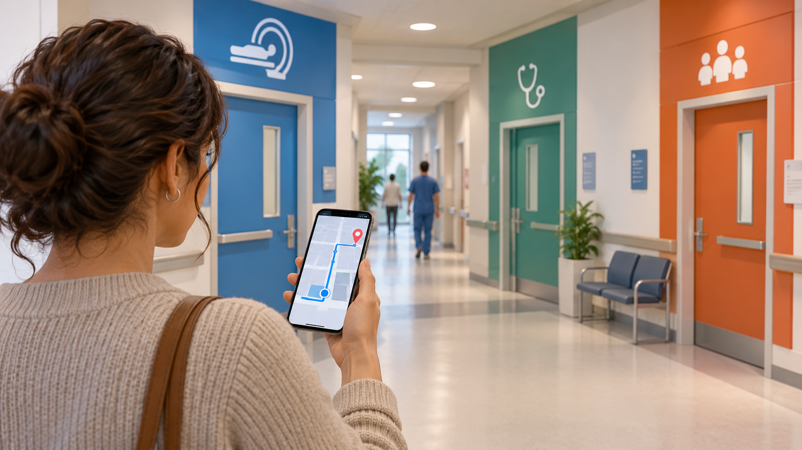

# Orientación accesible dentro de un hospital

**Edición editorial:** 2026-11-07-editorial-r1. **Elaborada en UTC:** 2026-11-07T19:50:09.616232Z.

**Estado histórico declarado del contenido:** borrador local para revisión. **Versión histórica:** 2026-10-14-v4. **Fecha de redacción histórica declarada:** 2026-10-14. La fuente histórica estaba disponible públicamente en el commit consultado; su publicación no valida el contenido.

**Alcance de esta edición:** corrección administrativa del estado documental. El desarrollo y las atribuciones que siguen se reproducen de la [versión histórica](https://github.com/NovusMotus/portfolio-tesis/blob/2cd2acbd44ae01f98481e383af2368bce2973b43/clinicos/orientacion-hospital/TESIS.md); sus expresiones «esta versión» se refieren a aquella edición. Se conservan las fechas declaradas, los límites y las propuestas, sin añadir logros ni reconstruir el inicio de la idea. La disponibilidad de esta edición se comprueba en el repositorio y en la PR que la incorpore.

**Aporte editorial:** Codex desktop / OpenAI / gpt-6.1-sol; transformación con Python 3.12.14. [Registro de esta versión](VERSION-2026-11-07-editorial-r1.json) · [Revisión editorial fechada](../../REVISION_EDITORIAL_2026-11-07-r1.json).

## TL;DR

*Ilustración conceptual generada con IA; no es una captura ni prueba de uso.*

- **Propósito:** Facilitar recorridos comprensibles y accesibles dentro de un hospital.
- **Aportación y enfoque:** Javier separa orientación, carro y almacén; la ficha propone comparar mapa, visita y guía por pasos según la tarea.
- **Trabajo y evidencia:** Necesidad recogida en una propuesta institucional, sin guía implementada localizada.
- **Resultados y límites:** No se acreditan mapas validados ni uso con pacientes. Falta comprobar destinos, obras, accesos y actualización; la demo urbana no es implantación hospitalaria.

## Punto de partida y pregunta de esta línea

Esta línea plantea cómo orientar a una persona entre servicios y puntos de un hospital. La pregunta depende del recorrido, necesidades de accesibilidad y vigencia de la información. El problema se describe como tarea de orientación, sin atribuir dificultades generales al centro ni a su personal.

## Origen y propósito

La documentación disponible permite describir esta línea, pero no reconstruye de forma confirmada qué observación, publicación o experiencia la inició. El punto de partida puede ser una idea, una hipótesis, una aplicación o una práctica con herramientas; no se presupone que exista un problema que resolver. Si se recupera una referencia de origen, se distinguirán lo que plantea esa fuente y la adaptación realizada por Javier.

## Enfoque del proyecto y propuesta de esta versión

El enfoque propuesto es representar destinos y recorridos con información pertinente para cada situación. Javier distingue la guía de orientación del carro y del almacén. Un mapa, una visita o una guía por pasos son alternativas que deberían compararse por tarea y disponibilidad de información. La experiencia en una demo urbana es un antecedente técnico, no una implementación hospitalaria.

## Desarrollo y evidencia disponible

El informe previo localiza esta necesidad en la propuesta institucional y no una guía hospitalaria implementada. El dossier mantiene ese estado y no adjudica integración, mapas validados o uso con pacientes. La preparación de una tesis hace visible el proyecto como propuesta, con sus fuentes y preguntas.

## Preguntas y límites que permanecen abiertos

Los recorridos, obras, horarios y accesos pueden cambiar. La representación debe permitir corregir información y conocer su fecha. Las rutas necesitan revisión de accesibilidad, señalización y condiciones del lugar. Los datos de personas que buscan un servicio o su ubicación precisa no se incorporan al dossier.

## Cómo podría comprobarse

Se propone elegir recorridos definidos y comprobar comprensión, accesibilidad y cambios necesarios con participantes autorizados. La comparación debe separar información incorrecta y dificultades de interfaz. Los mapas y fuentes deberán estar validados por responsables pertinentes antes de uso. Los resultados de un recorrido no se generalizan a todo el hospital.

## Un destino y un recorrido necesitan contexto

La propuesta de guía hospitalaria plantea ayudar a orientarse entre puntos y servicios. Un nombre de destino, una posición en un mapa y un recorrido disponible son informaciones distintas. Un diseño tendría que indicar cuál ofrece y qué condiciones pueden cambiarla. El punto de partida no exige atribuir un defecto general a un centro: basta con delimitar una tarea de orientación que interese explorar.

Javier separa esta línea del carro y del almacén. La documentación relaciona la guía futura con una experiencia técnica fuera del hospital, sin identificar un mapa hospitalario implementado. Ese antecedente puede aportar ideas de representación y navegación, pero no valida recorridos de otro lugar. La ficha pública puede utilizar plantas y destinos inventados para explicar el mecanismo. Los espacios, señalización y condiciones reales necesitarían sus fuentes, permisos y revisión antes de describirse como una guía disponible para personas que acuden a un servicio.

## Elegir una representación según la tarea de consulta

Un plano, una vista de puntos y una guía por pasos pueden ayudar en situaciones diferentes. La elección requiere conocer qué pregunta se quiere contestar: dónde está un destino, qué cambio de planta necesita o qué referencia visual confirma el recorrido. Una representación detallada puede resultar difícil de seguir y una muy breve puede omitir una condición importante. La comparación debería observar el uso, además de la apariencia.

Como ejemplo editorial, un espacio ficticio podría incluir dos plantas y accesos con condiciones distintas. La consulta mostraría origen y destino sin inferir la ubicación de una persona a partir de datos no aportados. Otra variante presentaría un nombre de servicio similar al de otro punto y pediría aclaración. La muestra no daría indicaciones sobre un hospital real ni utilizaría información del usuario para inferir su motivo de visita. Serviría para estudiar cómo se formula una ruta y cómo se comprueba que la persona comprende sus referencias.

## Accesibilidad y cambios del entorno

Un recorrido puede depender de escaleras, ascensores, accesos y horarios. Una guía no debería presentarlo como universal sin conocer esas condiciones. La información también cambia por obras, reorganización o cierre temporal. La fecha de revisión y la fuente de cada condición permitirían entender el alcance de la representación, sin garantizar que un dato siga vigente porque la aplicación se abre correctamente.

El asistente propone un caso ficticio en que una conexión entre plantas deja de estar disponible. La herramienta conservaría la condición o un estado pendiente y mostraría qué información se necesita para ofrecer una alternativa. Otra prueba observaría tamaño de texto, orientación y comprensión de referencias por participantes con necesidades distintas, sin presumirlas por edad. La representación de una ruta accesible tendría que comprobarse en el lugar correspondiente cuando se estudie una aplicación real. El ejercicio digital solo acredita las condiciones observadas de la interfaz y su contenido inventado.

## Mantener la guía requiere una fuente y una responsabilidad

Un mapa compartido necesita un procedimiento para actualizar destinos y recorridos. El diseño podría distinguir quien comunica una modificación y quien la confirma. Un aviso de un usuario permite detectar una posible discrepancia, pero no reemplaza una comprobación de la fuente pertinente. Si se modifica una ruta, debería conservarse qué cambió y desde cuándo se presenta de otra forma.

Como prueba propuesta, un destino inventado cambiaría de nombre mientras permanece en la misma zona. La consulta observaría si se encuentra con el término antiguo y cómo explica la actualización. Otra variante trasladaría un punto a otra planta y conservaría el historial de referencias. La demostración mostraría la lógica de mantenimiento, sin acreditar actualización en tiempo real de un hospital. También necesita delimitar qué datos de consultas se conservan y para qué; saber que alguien busca un destino no exige registrar su identidad o motivo asistencial en el dossier público.

## Qué puede mostrar una guía todavía no implantada

El portfolio puede explicar cómo un interés por representar espacios se adapta a una tarea de orientación, con sus condiciones propias. Una muestra ficticia haría visibles decisiones sobre destinos, referencias, actualización y acceso. El uso de tecnología 3D o de un enlace QR es una opción del diseño y no una prueba de utilidad. La elección de una representación más sencilla también puede responder al objetivo de la consulta.

El siguiente avance propuesto consiste en delimitar varios recorridos y fuentes, antes de estudiar una prueba autorizada de comprensión. La guía no se presentaría como señalización validada o servicio del centro por existir una demo fuera del ámbito hospitalario. Javier revisará las nuevas alternativas y decidirá qué parte mantiene de su enfoque. Los ejemplos de esta ampliación son del asistente y no rutas recorridas o aprobadas. La línea conserva su estado de propuesta y no se publica información de personas, instalaciones o accesos reales para simular un desarrollo concluido.

## Procedencia de las posiciones

Necesidad atribuida a Javier en fuente de revisión; alternativas y evaluación propuestas por el asistente. El texto es una síntesis asistida por IA y requiere la revisión de Javier antes de atribuirle nuevas formulaciones. Se describen procesos y condiciones, sin juicios de valor ni atribuciones de intenciones.

## Fechas, versiones y cambios

Primera referencia temporal utilizada: no confirmada. El inicio real y las fechas de cada aportación histórica no están reconstruidos. La fecha del archivo no sustituye la fecha de la idea.

Se desarrolla el mecanismo específico, sus aplicaciones y ejemplos de comprobación. Las nuevas propuestas del asistente se mantienen diferenciadas de las decisiones de Javier. Se registra el modelo de este turno con su evidencia, sin cambiar las atribuciones anteriores. No se incorporan resultados de pruebas nuevas. La edición no modifica las fuentes originales ni sus fechas.

## Herramientas y modelos

Imagen conceptual vigente, añadida el 2026-10-14: preparación e incorporación con Codex/OpenAI gpt-6.1-sol (metadatos del turno); generación y correcciones con image_gen de OpenAI, cuyo modelo exacto no consta. Sustituye el esquema anterior, conservado en el historial. Revisión independiente: gpt-6-astra.

Apoyo visual añadido el 2026-10-14: esquema original elaborado con Codex/OpenAI gpt-6.1-sol (metadatos del turno), Python 3.12.14 y ReportLab 4.4.9, exportado como SVG. Explica la idea del TL;DR; no representa una prueba o resultado nuevo. Revisión independiente de esta edición: gpt-6-astra; alcance documentado por separado. Compatibilidad tipográfica del SVG corregida en esta edición.

La redacción de esta versión utiliza Codex/OpenAI con el modelo gpt-6.1-sol. Su identificación consta en los metadatos del turno utilizado para esta edición; las atribuciones de versiones anteriores se conservan con su evidencia original. Se usaron Python para organización y comprobación local, y herramientas de lectura y edición de archivos. La revisión editorial independiente se encargó a un agente separado con gpt-6-astra; su alcance y resultado se registran fuera del dossier, sin equivaler a validación integral del proyecto. No se han configurado integraciones o actualización continua.

### Atribuciones históricas documentadas

No hay una atribución histórica exacta reconstruida para esta ficha. Las menciones a herramientas en las fuentes no se consideran prueba de uso.

## Fuentes y alcance de lectura

La base es la documentación interna identificada en el registro privado de fuentes de esta preparación. Se ha leído mediante extracción local y se han examinado fuentes y pasajes seleccionados; no es una auditoría sustantiva de todo el corpus. Las referencias externas de los antecedentes requieren verificación pertinente antes de reutilizar afirmaciones como hechos actuales. No se incluyen rutas privadas, documentos sensibles, conversaciones completas o material de terceros en este dossier.
