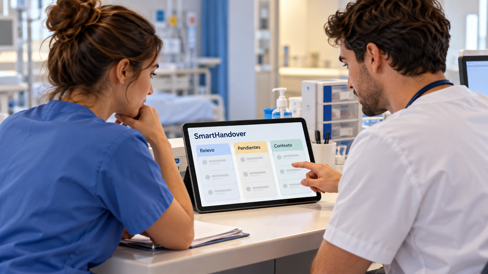

# SmartHandover y la continuidad de información entre turnos

**Edición editorial:** 2026-11-07-editorial-r1. **Elaborada en UTC:** 2026-11-07T19:50:09.616232Z.

**Estado histórico declarado del contenido:** borrador local para revisión. **Versión histórica:** 2026-10-14-v5. **Fecha de redacción histórica declarada:** 2026-10-14. La fuente histórica estaba disponible públicamente en el commit consultado; su publicación no valida el contenido.

**Alcance de esta edición:** corrección administrativa del estado documental. El desarrollo y las atribuciones que siguen se reproducen de la [versión histórica](https://github.com/NovusMotus/portfolio-tesis/blob/2cd2acbd44ae01f98481e383af2368bce2973b43/clinicos/smarthandover/TESIS.md); sus expresiones «esta versión» se refieren a aquella edición. Se conservan las fechas declaradas, los límites y las propuestas, sin añadir logros ni reconstruir el inicio de la idea. La disponibilidad de esta edición se comprueba en el repositorio y en la PR que la incorpore.

**Aporte editorial:** Codex desktop / OpenAI / gpt-6.1-sol; transformación con Python 3.12.14. [Registro de esta versión](VERSION-2026-11-07-editorial-r1.json) · [Revisión editorial fechada](../../REVISION_EDITORIAL_2026-11-07-r1.json).

## TL;DR

*Ilustración conceptual generada con IA; no es una captura ni prueba de uso.*

- **Propósito:** Organizar información y tareas pendientes en el relevo asistencial.
- **Aportación y enfoque:** Javier aporta el diseño del flujo y su contexto clínico; la construcción se apoya en IA.
- **Trabajo y evidencia:** Código y memoria descrita como MVP; esta preparación no ejecutó la aplicación ni sus pruebas.
- **Resultados y límites:** No se acredita uso asistencial, registro completado ni reducción de errores. Falta contrastar el flujo, los accesos y su utilidad con profesionales.

## Punto de partida y pregunta de esta línea

El relevo entre turnos requiere transmitir información que cambia durante la actividad asistencial. La propuesta aborda cómo organizar notas, observaciones y tareas pendientes para que quien recibe el relevo identifique su procedencia y su estado. No se presupone que un formato digital resuelva todos los problemas de continuidad; primero habría que identificar qué información se pierde o resulta difícil de consultar en una situación concreta.

## Origen y propósito

La documentación disponible permite describir esta línea, pero no reconstruye de forma confirmada qué observación, publicación o experiencia la inició. El punto de partida puede ser una idea, una hipótesis, una aplicación o una práctica con herramientas; no se presupone que exista un problema que resolver. Si se recupera una referencia de origen, se distinguirán lo que plantea esa fuente y la adaptación realizada por Javier.

## Enfoque del proyecto y propuesta de esta versión

La memoria propone un flujo digital estructurado para el traspaso de información y seguimiento de tareas. El enfoque consiste en relacionar cada registro con su contexto y diferenciar lo anotado de lo pendiente. La aportación de Javier se sitúa en el diseño del problema y del flujo asistencial, con construcción asistida por IA. Un formulario o una pantalla son representaciones del diseño; su correspondencia con el trabajo cotidiano necesita contraste con quienes lo realizan.

## Desarrollo y evidencia disponible

La carpeta contiene código y una memoria descriptiva identificada como MVP. La memoria incluye campos de identificación pendientes y materiales orientados a un eventual registro. Esos documentos no prueban que el registro se haya completado. En esta preparación no se han ejecutado la aplicación ni sus pruebas, ni se ha verificado uso asistencial. El texto público describe el propósito y el material existente, sin convertir objetivos de continuidad o seguridad en resultados medidos.

## Preguntas y límites que permanecen abiertos

El alcance descrito combina comunicación, registros y tareas, por lo que necesita límites claros sobre quién puede editar cada dato y qué sistema mantiene la información de referencia. La adopción depende del flujo de trabajo, la disponibilidad de equipos y la gestión de accesos. Los datos de pacientes y documentos identificativos no forman parte de este dossier. La documentación del proyecto debe revisarse antes de atribuir capacidades operativas o regulatorias.

## Cómo podría comprobarse

Se propone recorrer un relevo ficticio completo y observar qué información resulta recuperable, qué tareas cambian de responsable y cómo se detecta un registro desactualizado. Las incidencias deberían describirse por tarea y no únicamente por pantallas. Una evaluación posterior podría comparar completitud, tiempo y errores de interpretación en condiciones definidas. Esas medidas requerirían protocolo, participantes y autorización; todavía no se presentan como realizadas.

## El relevo es un recorrido de información y responsabilidad

La memoria describe una herramienta para relacionar pacientes, anotaciones y tareas durante cambios de turno. El interés de Javier puede expresarse como una pregunta sobre continuidad: qué recibe quien comienza, qué necesita comprobar y qué queda pendiente. Una anotación, una solicitud y una actuación completada representan estados diferentes. Una pantalla que los reúne debe permitir reconocerlos y no convertir una intención en un hecho registrado.

Como ejemplo editorial, un relevo totalmente ficticio podría incluir una tarea preparada, otra pendiente de confirmación y una nota rectificada. Quien recibe el turno necesitaría distinguir quién registró cada elemento, cuándo y con qué contexto. La comprobación observaría si recupera esa información y si identifica lo que requiere revisión. El caso no incorporaría medicamentos, dosis o decisiones de un paciente real. El flujo estudiaría transmisión y consulta, sin declarar que el mecanismo previene incidencias clínicas por el hecho de representarlas digitalmente.

## Roles y vistas deben corresponder a tareas definidas

La memoria propone vistas para distintos perfiles profesionales y una lista de pacientes del servicio. Esa diferencia de presentación no define por sí sola las responsabilidades de cada rol ni sus permisos. Para desarrollar el recorrido habría que especificar quién crea una tarea, quién la modifica, quién confirma un estado y qué información puede consultar. Las reglas deben comprobarse en operaciones concretas y no deducirse del nombre de una pantalla.

El asistente propone describir una misma tarea desde dos vistas ficticias. La comparación mostraría qué campos se comparten y qué acciones están disponibles en cada una. Si cambia el responsable durante el relevo, el registro conservaría el cambio y el estado anterior. La ubicación física no sustituiría la identidad en el diseño del caso. Una interfaz más breve podría omitir contexto necesario; otra más completa podría exigir pasos que no sirven a la tarea. La elección requiere observación del recorrido, sin asumir un formato universal para todas las unidades.

## Cronología, correcciones y cambios simultáneos

La lista cronológica propuesta necesita distinguir hora del hecho, hora del registro y momento de una modificación. Un registro tardío puede describir una actuación anterior; ordenarlo solo por la entrada puede cambiar su interpretación. El diseño debería permitir recuperar la información original y conocer la rectificación. Mantener versiones no garantiza que el contenido sea exacto, pero facilita revisar cómo se formuló y cambió.

Como prueba propuesta, dos usuarios ficticios podrían actualizar una misma tarea con estados incompatibles. La aplicación tendría que comunicar el conflicto o conservar una regla de resolución visible. Otra prueba introduciría una interrupción de conexión y una repetición del envío. El resultado observaría duplicados, pérdida de campos y claridad del estado pendiente. La memoria menciona trazabilidad como objetivo; esta redacción no la convierte en una propiedad demostrada del almacenamiento ni en evidencia de que esos casos ya hayan sido ensayados. Se conservaría configuración y resultado de cada nueva prueba.

## Límites entre una muestra y el sistema de referencia

Una muestra de relevo puede ayudar a explorar el proceso sin convertirse en la historia clínica de referencia. Antes de una aplicación real habría que determinar qué sistema mantiene cada dato, cómo se actualiza y qué ocurre cuando hay discrepancias. Un registro adicional puede facilitar consulta y también crear trabajo de conciliación. La evaluación necesita observar esa carga completa, incluida la actualización, en lugar de contar únicamente los pasos de una pantalla.

Las funciones de aviso o de situación urgente que aparecen en la memoria requieren alcance y comprobaciones propios. No se presentan como mecanismos aceptados para una emergencia por formar parte de un MVP. En la práctica ficticia, los avisos podrían ser mensajes sin conexión a un servicio. La muestra tendría que hacer visible esa condición para que su apariencia no sugiera un funcionamiento asistencial. El dossier no ejecuta órdenes, no conecta sistemas y no accede a historias reales. Describe las preguntas que permitirían decidir qué parte del flujo merece desarrollarse.

## La memoria y el código documentan una etapa de desarrollo

La memoria incorpora una versión, una fecha declarada y campos pendientes para un posible registro. Esos elementos permiten describir el antecedente documental; no verifican que se haya completado un trámite ni acreditan la autoría jurídica de cada componente. La aplicación y sus dependencias necesitan sus evidencias de procedencia. La ayuda de IA se reconoce como parte del desarrollo y no se transforma en programación autónoma del promotor.

El portfolio puede mostrar requisitos de relevo, una representación derivada de estados y los criterios de prueba. Para demostrar funcionamiento habría que recorrer la aplicación en un entorno separado con datos ficticios y conservar las observaciones. Para estudiar utilidad harían falta participantes y condiciones adicionales. Una mejora en tiempo no demostraría por sí sola mejor interpretación o continuidad; esos objetivos deben comprobarse por separado. Los escenarios y preguntas de esta ampliación son aportaciones del asistente. Javier revisará cuáles representan su intención y qué alcance quiere mantener antes de una publicación.

## Inicio declarado y memoria posterior del proyecto

Javier sitúa el inicio de SmartHandover en noviembre de 2025, al aclarar la cronología el 14 de octubre de 2026. La memoria conserva una fecha declarada de finalización del MVP del 28 de diciembre de 2025. Ambos datos describen momentos distintos: comienzo recordado por Javier y fecha documental del antecedente. La memoria no pasa a ser un documento de noviembre por recuperar ese recuerdo.

Esta distinción permite explicar la evolución sin inventar un primer commit, una prueba o un lanzamiento. La precisión de mes del inicio no se convierte en un día exacto y no acredita qué funciones existían entonces. Los modelos de las aportaciones iniciales siguen sin confirmarse. La versión actual registra la nueva atribución temporal y conserva las versiones anteriores, sin trasladar la fecha de redacción del portfolio a la creación de la idea.

## Procedencia de las posiciones

Diseño del proyecto resumido a partir de la memoria; evaluación propuesta por el asistente en este borrador. El texto es una síntesis asistida por IA y requiere la revisión de Javier antes de atribuirle nuevas formulaciones. Se describen procesos y condiciones, sin juicios de valor ni atribuciones de intenciones.

## Fechas, versiones y cambios

Inicio declarado por Javier: noviembre de 2025, con precisión de mes, según su aclaración del 14 de octubre de 2026. Referencia documental de la memoria: 28 de diciembre de 2025, como fecha de finalización declarada del MVP. No se confunden ambas fechas ni se considera que acrediten un lanzamiento o validación externa. Esta versión añade la cronología recuperada sin cambiar fuentes o versiones anteriores.

## Herramientas y modelos

Imagen conceptual vigente, añadida el 2026-10-14: preparación e incorporación con Codex/OpenAI gpt-6.1-sol (metadatos del turno); generación y correcciones con image_gen de OpenAI, cuyo modelo exacto no consta. Sustituye el esquema anterior, conservado en el historial. Revisión independiente: gpt-6-astra.

Apoyo visual añadido el 2026-10-14: esquema original elaborado con Codex/OpenAI gpt-6.1-sol (metadatos del turno), Python 3.12.14 y ReportLab 4.4.9, exportado como SVG. Explica la idea del TL;DR; no representa una prueba o resultado nuevo. Revisión independiente de esta edición: gpt-6-astra; alcance documentado por separado. Compatibilidad tipográfica del SVG corregida en esta edición.

La redacción de esta versión utiliza Codex/OpenAI con el modelo gpt-6.1-sol. Su identificación consta en los metadatos del turno utilizado para esta edición; las atribuciones de versiones anteriores se conservan con su evidencia original. Se usaron Python para organización y comprobación local, y herramientas de lectura y edición de archivos. La revisión editorial independiente se encargó a un agente separado con gpt-6-astra; su alcance y resultado se registran fuera del dossier, sin equivaler a validación integral del proyecto. No se han configurado integraciones o actualización continua.

### Atribuciones históricas documentadas

No hay una atribución histórica exacta reconstruida para esta ficha. Las menciones a herramientas en las fuentes no se consideran prueba de uso.

## Fuentes y alcance de lectura

La base es la documentación interna identificada en el registro privado de fuentes de esta preparación. Se ha leído mediante extracción local y se han examinado fuentes y pasajes seleccionados; no es una auditoría sustantiva de todo el corpus. Las referencias externas de los antecedentes requieren verificación pertinente antes de reutilizar afirmaciones como hechos actuales. No se incluyen rutas privadas, documentos sensibles, conversaciones completas o material de terceros en este dossier.
