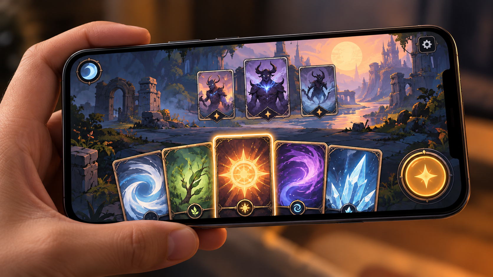

# Exploración de un juego de cartas y sus mecánicas propias

**Edición editorial:** 2026-11-07-editorial-r1. **Elaborada en UTC:** 2026-11-07T19:50:09.616232Z.

**Estado histórico declarado del contenido:** concepto e investigación atribuidos al catálogo reconstruido de la conversación de negocios. No se acredita aquí un juego de cartas implementado, campaña, comunidad de jugadores o modelo comercial probado. Borrador para revisión de Javier. **Versión histórica:** 2026-10-14-v8. **Fecha de redacción histórica declarada:** 2026-10-14. La fuente histórica estaba disponible públicamente en el commit consultado; su publicación no valida el contenido.

**Alcance de esta edición:** corrección administrativa del estado documental. El desarrollo y las atribuciones que siguen se reproducen de la [versión histórica](https://github.com/NovusMotus/portfolio-tesis/blob/2cd2acbd44ae01f98481e383af2368bce2973b43/creacion/juegos-cartas-mecanicas/TESIS.md); sus expresiones «esta versión» se refieren a aquella edición. Se conservan las fechas declaradas, los límites y las propuestas, sin añadir logros ni reconstruir el inicio de la idea. La disponibilidad de esta edición se comprueba en el repositorio y en la PR que la incorpore.

**Aporte editorial:** Codex desktop / OpenAI / gpt-6.1-sol; transformación con Python 3.12.14. [Registro de esta versión](VERSION-2026-11-07-editorial-r1.json) · [Revisión editorial fechada](../../REVISION_EDITORIAL_2026-11-07-r1.json).

## TL;DR

*Ilustración conceptual generada con IA; no es una captura ni prueba de uso.*

- **Propósito:** Explorar un juego de cartas para un jugador centrado en disfrute y monetización contenida.
- **Aportación y enfoque:** Javier fija esas preferencias; reglas, progresión y arquitectura propuestas por el asistente siguen abiertas.
- **Trabajo y evidencia:** Catálogo recibido; no se recuperó un documento completo de reglas específico.
- **Resultados y límites:** No se acredita partida construida, prueba con jugadores ni ingresos. Falta definir acciones y una muestra jugable; referencias a otros juegos no aportan derechos de reproducción.

## Punto de partida

El catálogo recibido recoge el interés de Javier por juegos móviles y por un juego de cartas orientado a disfrutar, con una experiencia singleplayer y monetización contenida. Las referencias a otros títulos funcionan como inspiración, no como elección de motor ni como evidencia de una mecánica propia terminada. Esta ficha estudia la relación entre la experiencia buscada y las decisiones necesarias para desarrollarla.

La idea no necesita comenzar con un problema de un juego existente. Puede partir de observar una interacción, imaginar un sistema o practicar herramientas de desarrollo. La recopilación no permite reconstruir una publicación única que iniciara este concepto ni el día de su primera formulación. El portfolio conserva esa incertidumbre y evita atribuir a Javier una crítica general de los jugadores, de un género o de los modelos de negocio ajenos.

## Qué recoge la fuente

La fuente disponible es el catálogo transferido el 14 de octubre de 2026. Atribuye al usuario preferencias por diversión, experiencia de un jugador y límites de monetización. También sitúa posibles premios en torneos o sorteos, sin promesas de rentabilidad. No se ha recuperado aquí el texto completo de todas las conversaciones creativas ni un documento de reglas específico para este juego de cartas.

El interés por organizar un estudio con agentes pertenece a una línea relacionada de Council y flujos de trabajo. Esa organización podría apoyar investigación, diseño o revisión, pero no acredita que ya exista un estudio operativo. Las imágenes, sprites, marcos de tarjetas o retratos conservados en otros contextos son activos creativos que necesitan identificación y procedencia propias. Su existencia no prueba un sistema jugable ni una baraja final.

## Interpretación de las preferencias de Javier

Una experiencia singleplayer permite estudiar la interacción con escenarios y reglas sin suponer desde el principio un servicio multijugador continuo. Es una lectura editorial de la preferencia recogida, no una arquitectura aceptada. La ficha no decide si habrá coleccionismo, progresión, historia, partidas independientes o campaña. Esas opciones requieren que Javier concrete qué actividad quiere que el jugador disfrute y qué trabajo está dispuesto a desarrollar.

La expresión monetización contenida todavía necesita una definición operativa del proyecto. Esta edición propone separar precio de acceso, contenido adicional, recurrencia y efectos sobre las reglas. No atribuye a Javier una combinación concreta de esos elementos. La mención a premios tampoco se convierte en una mecánica de ganancias ni en un rendimiento esperado para participantes. Las condiciones de cualquier formato comercial o competitivo se investigarían por separado.

## Del concepto a reglas observables

Como propuesta del asistente, el primer documento de diseño podría describir una partida breve: situación inicial, información disponible, decisiones del jugador, respuesta del sistema y condición de cierre. Esta descripción permitiría identificar qué aporta cada carta y qué parte del resultado depende de las decisiones. No se ha redactado o ejecutado aquí esa partida. La propuesta busca hacer contrastable el concepto antes de ampliar su producción.

El sistema necesitaría diferenciar reglas generales y efectos particulares. Una misma palabra puede significar una acción, un recurso o una condición, y su uso consistente ayudaría a revisar las interacciones. La ficha plantea conservar esas definiciones y sus cambios. No elige cifras de daño, probabilidades, coste o duración como decisiones de Javier; tampoco infiere equilibrio a partir de una tabla elaborada por una IA.

## Un alcance de ensayo posible

Una muestra futura podría utilizar un conjunto pequeño de cartas y una situación ficticia con reglas explícitas. El asistente propone que esa muestra permita completar una secuencia de decisiones y registrar dudas de interpretación. No se fija un tamaño de baraja ni se promete que una prueba limitada represente la experiencia final. Javier tendría que elegir qué aspecto del concepto desea ensayar y qué cambios conservar después.

La evaluación podría distinguir comprender una regla, recordar información y tomar una decisión interesante según la valoración del jugador. Esas preguntas no se resuelven solo porque el programa termine una partida sin errores. También habría que separar un fallo de interfaz de una interacción que las reglas permiten pero que no refleja la intención creativa. Esta edición no ha realizado sesiones de juego ni recogido valoraciones humanas.

## Papel de agentes y herramientas

Revisión y correcciones de esta versión (2026-10-14): Codex/OpenAI gpt-6-astra, identificado en los metadatos del turno; revisión independiente por otro agente con gpt-6-astra. Se conservan las atribuciones históricas siguientes.

Imagen conceptual vigente, añadida el 2026-10-14: preparación e incorporación con Codex/OpenAI gpt-6.1-sol (metadatos del turno); generación y correcciones con image_gen de OpenAI, cuyo modelo exacto no consta. Sustituye el esquema anterior, conservado en el historial. Revisión independiente: gpt-6-astra.

Apoyo visual añadido el 2026-10-14: esquema original elaborado con Codex/OpenAI gpt-6.1-sol (metadatos del turno), Python 3.12.14 y ReportLab 4.4.9, exportado como SVG. Explica la idea del TL;DR; no representa una prueba o resultado nuevo. Revisión independiente de esta edición: gpt-6-astra; alcance documentado por separado. Compatibilidad tipográfica del SVG corregida en esta edición.

El uso de agentes podría distribuir tareas como revisar reglas, buscar contradicciones en un documento, preparar una representación visual o registrar pruebas. Son posibilidades propuestas en esta ficha. La asignación de nombres o funciones a agentes no acredita una automatización completa ni elimina la necesidad de revisar sus salidas. Un texto generado puede añadir una regla que Javier no haya elegido y debe conservar su atribución.

Si posteriormente se programa una muestra, el registro debería indicar qué hizo Javier, qué aportó cada asistente, las herramientas empleadas y el modelo exacto que conste para cada intervención. Un cambio de herramienta o de modelo tendría su propia versión. En esta reconstrucción no se identifica el modelo histórico de los debates sobre el juego. Tampoco se presume que las herramientas usadas en Ciencia perdida se hayan utilizado aquí.

## Referencias y material creativo

Las referencias a juegos existentes orientan una intención, pero requieren precisar qué elemento inspira: interacción, presentación, progresión o forma de distribuir contenido. Esta ficha no afirma haber analizado exhaustivamente esos títulos ni incorpora sus gráficos, cartas, música o personajes. Una referencia compartida y una investigación realizada son estados distintos que deben permanecer visibles en el catálogo de fuentes.

Los activos generados con IA necesitan vincularse a su prompt, herramienta, fecha y condiciones de uso conocidas. Las hojas de animación y los marcos mencionados por la recopilación no se atribuyen automáticamente a esta línea. Antes de incluirlos habría que localizar sus archivos y determinar si Javier los considera parte del proyecto. La tesis puede explicar el concepto sin redistribuir materiales ajenos o activos de otra obra.

## Relación con otros juegos del portfolio

LidIA y Ciencia perdida conservan sus propios universos, decisiones e historial. La idea de un juego de cartas no recibe las funcionalidades de esas demos por compartir un interés en producción creativa con IA. La ficha se mantiene como concepto independiente mientras no conste una decisión de vincularlos. Las mecánicas de personaje o de mecanografía de otro juego no se trasladan a este sin una fuente que lo acredite.

La metodología de Council puede servir como antecedente para distribuir revisión, pero su uso concreto tampoco está acreditado aquí. Una futura comparación podría observar si un flujo de trabajo facilita conservar decisiones o produce contradicciones entre documentos. Esa propuesta no supone que un estudio multiagente ya haya desarrollado el juego ni que existan métricas de productividad. La organización y el producto requieren evidencias distintas.

## Referencias históricas recuperadas y aplicación propuesta

La bibliografía añade referencias históricas a cartas, portales, mundos interactivos y herramientas de prototipado. No aportan un documento de reglas propio ni demuestran una partida construida por Javier. Como propuesta del asistente, podrían utilizarse para contrastar una decisión delimitada del juego, registrando qué se toma como inspiración y qué se descarta cuando Javier lo decida. Los anuncios de premios o ingresos no se convierten en rendimiento esperado. Recursos y mecánicas de terceros necesitan su revisión de derechos antes de reutilización.

## Fechas, contribuciones y pendientes

Primera redacción: versión 2026-10-14-v1, preparada el 14 de octubre de 2026, Europe/Madrid. Antecedente disponible: catálogo reconstruido recibido ese día. Inicio exacto del concepto y modelos históricos no confirmados. Las preferencias por experiencia singleplayer, diversión y monetización contenida se atribuyen a Javier según esa fuente. La partida breve, el alcance de prueba y los criterios de revisión son propuestas nuevas del asistente.

La redacción utiliza Codex, OpenAI, modelo gpt-6.1-sol verificado en los metadatos del turno. Python 3.12.14, functions.exec, exec_command y apply_patch se usan para preparar y comprobar archivos locales. La revisión independiente de esta ficha se solicita a un subagente Codex gpt-6-astra. No se ha creado aquí un motor, probado una partida o medido el atractivo del concepto; la maquetación del portfolio se registra aparte.

Quedan pendientes la formulación original, las reglas elegidas, el alcance de una eventual muestra y los activos que realmente pertenecen a esta línea. No constan ventas, comunidad, torneos celebrados o resultados económicos. La versión pública mostraría intención, decisiones y límites; código, reglas comerciales reservadas o recursos sin derechos comprobados se clasificarían por separado. La publicación requiere revisión y aprobación de Javier.
