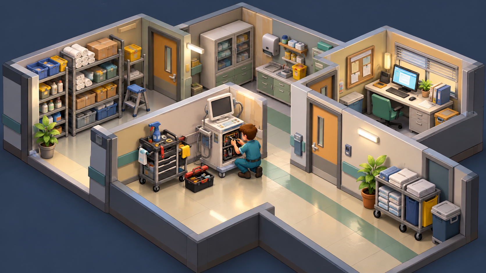

# Triaje y la representación de mantenimiento y recursos en un juego de sistemas

**Edición editorial:** 2026-11-07-editorial-r1. **Elaborada en UTC:** 2026-11-07T19:50:09.616232Z.

**Estado histórico declarado del contenido:** borrador local para revisión. **Versión histórica:** 2026-10-14-v5. **Fecha de redacción histórica declarada:** 2026-10-14. La fuente histórica estaba disponible públicamente en el commit consultado; su publicación no valida el contenido.

**Alcance de esta edición:** corrección administrativa del estado documental. El desarrollo y las atribuciones que siguen se reproducen de la [versión histórica](https://github.com/NovusMotus/portfolio-tesis/blob/2cd2acbd44ae01f98481e383af2368bce2973b43/creacion/triaje-colapso/TESIS.md); sus expresiones «esta versión» se refieren a aquella edición. Se conservan las fechas declaradas, los límites y las propuestas, sin añadir logros ni reconstruir el inicio de la idea. La disponibilidad de esta edición se comprueba en el repositorio y en la PR que la incorpore.

**Aporte editorial:** Codex desktop / OpenAI / gpt-6.1-sol; transformación con Python 3.12.14. [Registro de esta versión](VERSION-2026-11-07-editorial-r1.json) · [Revisión editorial fechada](../../REVISION_EDITORIAL_2026-11-07-r1.json).

## TL;DR

*Ilustración conceptual generada con IA; no es una captura ni prueba de uso.*

- **Propósito:** Representar recursos, mantenimiento y consecuencias diferidas en un juego de sistemas.
- **Aportación y enfoque:** Javier propone dilemas entre áreas y progresión hacia gestión; las reglas seleccionan relaciones, sin simular toda la realidad sanitaria.
- **Trabajo y evidencia:** GDD y revisión estática previa de un prototipo clicker con mejoras, desgaste y recuperación.
- **Resultados y límites:** Roles y turnos del diseño amplio no estaban implementados en el motor inspeccionado. No se acredita publicación ni evaluación con jugadores; no se repitió la ejecución aquí.

## Punto de partida y pregunta de esta línea

El documento de diseño plantea un juego sobre la relación entre recursos, mantenimiento, carga de trabajo y efectos diferidos de las decisiones. El problema narrativo consiste en representar esas relaciones mediante una mecánica comprensible. El escenario de deterioro pertenece a la ficción del juego; no se presenta como descripción verificada de un sistema sanitario concreto.

## Origen y propósito

La documentación disponible permite describir esta línea, pero no reconstruye de forma confirmada qué observación, publicación o experiencia la inició. El punto de partida puede ser una idea, una hipótesis, una aplicación o una práctica con herramientas; no se presupone que exista un problema que resolver. Si se recupera una referencia de origen, se distinguirán lo que plantea esa fuente y la adaptación realizada por Javier.

## Enfoque del proyecto y propuesta de esta versión

El diseño combina progresión incremental con consecuencias acumulativas que pueden reducir capacidad o desplazar cargas. Javier propone situaciones y dilemas entre áreas, y un recorrido hacia funciones de gestión. La hipótesis de diseño es que las decisiones visibles permitan comprender compromisos entre efectos inmediatos y posteriores. El balance de recursos y las reglas necesitan una representación explícita para que el jugador pueda relacionar acciones y consecuencias.

## Desarrollo y evidencia disponible

Existe un GDD y recursos asociados. Además, el informe de portfolio del 6 de octubre de 2026 documenta una inspección estática de un prototipo en JavaScript, HTML y CSS: bucle clicker, tres mejoras, producción, desgaste, bloqueo y recuperación. Ese informe distingue esas funciones del diseño más amplio del GDD; roles, turnos de quince minutos y gerente no figuraban implementados en el motor inspeccionado. Es un antecedente documental de revisión, no una ejecución o prueba nueva en esta preparación. No acredita juego publicado ni evaluación con jugadores. Los parámetros de diseño no se convierten en observaciones sobre sistemas sanitarios reales.

## Preguntas y límites que permanecen abiertos

Una regla de juego selecciona relaciones y deja otras fuera. El jugador puede interpretar una mecánica como una afirmación sobre el mundo real si no se identifica su finalidad. La evaluación debe distinguir claridad de la regla, interés narrativo y validez del modelo de sistema. Los dilemas ficticios no son instrucciones asistenciales. Los recursos visuales requieren revisión de contenido y licencia antes de acompañar la edición pública.

## Cómo podría comprobarse

Se propone probar una ronda corta con un conjunto reducido de recursos y observar si los participantes pueden explicar qué produjo cada cambio. Las decisiones y sus efectos se registrarían para revisar balance y claridad. El debriefing debería permitir distinguir lo simulado de lo que no representa el juego. La ampliación a nuevas áreas exigiría una versión documentada, sin generalizar efectos de una mecánica a un sistema sanitario.

## Del recurso aislado a sus efectos en el tiempo

El documento de diseño relaciona recursos, mantenimiento y consecuencias acumulativas en un juego de sistemas. La continuación propuesta identificaría cada recurso ficticio por estado, acción que lo modifica y efecto posterior. Una misma acción podría producir un efecto inmediato y otro diferido según la regla elegida. Esas relaciones se describirían como mecánicas del juego, no como datos de un sistema sanitario concreto.

Un ejemplo de ensayo podría limitarse a dos áreas inventadas y una decisión de mantenimiento. Se escribirían los estados iniciales y las transiciones esperadas antes de interpretar el recorrido. La pregunta sería si el jugador puede reconocer qué cambió y qué acción contribuyó a ello. El ejemplo es una propuesta del asistente, no una ronda ejecutada ni una regla aceptada por Javier. La ficha mantiene la exploración del GDD y hace identificables los supuestos que un posible prototipo necesita representar.

## Hacer visibles los compromisos de una decisión

La propuesta de interfaz distinguiría recurso disponible, compromiso ya adquirido y consecuencia pendiente. Si un efecto ocurre después, el juego podría conservar una referencia a la decisión que lo inició. Esa relación permitiría explicar un cambio sin depender únicamente de un contador final. La representación no presupone que el diseño actual ya tenga esa función ni que una forma de mostrarla sea preferida por los jugadores.

La comparación podría estudiar si una regla se entiende mejor con una explicación, un historial de acciones o una visualización del estado. Se mantendría igual la mecánica para que el contraste no mezcle cambios de regla y presentación. Una transición que parece clara en el GDD puede necesitar otra comprobación cuando se juega. El interés narrativo y el comportamiento matemático se tratarían como preguntas diferentes. No se utilizaría la ficción para valorar profesiones, instituciones o decisiones asistenciales reales.

## Progresión y deterioro necesitan límites documentados

El diseño combina avance con posibles pérdidas o desplazamientos de capacidad. La continuación propuesta describiría qué situaciones puede alcanzar el sistema y qué opciones de recuperación conserva. Antes de ampliar áreas se comprobaría un conjunto reducido de transiciones con estados conocidos. Una regla que produce un resultado previsto en ese conjunto no validaría todo el balance del juego.

Los valores y tiempos elegidos tendrían la condición de parámetros de diseño hasta que se estudien mediante el contraste pertinente. No representarían mediciones de actividad sanitaria. Si una corrección cambia la dificultad, el historial indicaría si se ha modificado el recurso inicial, la transición o la información que ve el jugador. El método evita atribuir un efecto a la decisión del jugador cuando procede de un cambio no identificado en la versión. Esta preparación no ejecuta una simulación ni recalcula todo el GDD.

## Un ensayo corto con registro y conversación posterior

La prueba propuesta observaría una ronda definida y recogería cómo se explican los cambios. El registro conservaría versión, decisiones y estados para comparar la interpretación del jugador con las reglas del ensayo. Una conversación posterior preguntaría qué relaciones cree haber aprendido y cuáles pertenecen a la ficción. Esa distinción no se sustituiría por una puntuación de rendimiento.

Los criterios de revisión podrían localizar una consecuencia poco visible, una excepción no descrita o una atribución al mundo real que excede el diseño. La respuesta sería acotar el hallazgo y proponer una modificación. No se deduciría de una reacción individual que el juego demuestra una causa real o que todos los participantes comprenden el sistema. El ensayo permanece pendiente. La versión pública no incorpora recursos visuales sin revisión de contenido y derechos ni se presenta como material de formación acreditado.

## Una investigación de mecánicas que admite revisión

La aportación conservada incluye un GDD y recursos asociados, junto al antecedente de inspección estática del prototipo recogido en el informe del 6 de octubre de 2026. Esa inspección describe algunas funciones programadas y límites respecto al diseño completo; no equivale a una ejecución actual. Esta ampliación desarrolla un posible protocolo para examinar transiciones, presentación y comprensión. Los ejemplos y criterios nuevos son propuestas del asistente sujetas a revisión de Javier. No se acredita juego comercial, pruebas con jugadores o exactitud de una representación del sistema sanitario.

Una actualización podría comprobar el funcionamiento del prototipo existente, corregir una regla o conservar una observación de ensayo. Cada cambio explicaría su efecto sobre el diseño y mantendría el antecedente. El portfolio puede mostrar cómo se transforma una idea sobre recursos y mantenimiento en un modelo de juego, sin utilizar sus dilemas como instrucciones profesionales ni su narración como juicio sobre instituciones. Las herramientas y modelos se registrarán por aportación real, con las fechas que consten.

## Procedencia de las posiciones

Tema y reglas del GDD resumidos descriptivamente; evaluación propuesta en esta versión. El texto es una síntesis asistida por IA y requiere la revisión de Javier antes de atribuirle nuevas formulaciones. Se describen procesos y condiciones, sin juicios de valor ni atribuciones de intenciones.

## Fechas, versiones y cambios

Primera referencia temporal utilizada: no confirmada. El inicio real y las fechas de cada aportación histórica no están reconstruidos. La fecha del archivo no sustituye la fecha de la idea.

Se añaden los desarrollos: Del recurso aislado a sus efectos en el tiempo; Hacer visibles los compromisos de una decisión; Progresión y deterioro necesitan límites documentados; Un ensayo corto con registro y conversación posterior; Una investigación de mecánicas que admite revisión. Las propuestas nuevas se atribuyen al asistente y se registra el modelo de este turno sin alterar las atribuciones anteriores. No se incorporan resultados de pruebas nuevas. La edición no modifica las fuentes originales ni sus fechas.

## Herramientas y modelos

Imagen conceptual vigente, añadida el 2026-10-14: preparación e incorporación con Codex/OpenAI gpt-6.1-sol (metadatos del turno); generación y correcciones con image_gen de OpenAI, cuyo modelo exacto no consta. Sustituye el esquema anterior, conservado en el historial. Revisión independiente: gpt-6-astra.

Apoyo visual añadido el 2026-10-14: esquema original elaborado con Codex/OpenAI gpt-6.1-sol (metadatos del turno), Python 3.12.14 y ReportLab 4.4.9, exportado como SVG. Explica la idea del TL;DR; no representa una prueba o resultado nuevo. Revisión independiente de esta edición: gpt-6-astra; alcance documentado por separado. Compatibilidad tipográfica del SVG corregida en esta edición.

La redacción de esta versión utiliza Codex/OpenAI con el modelo gpt-6.1-sol. Su identificación consta en los metadatos del turno utilizado para esta edición; las atribuciones de versiones anteriores se conservan con su evidencia original. Se usaron Python para organización y comprobación local, y herramientas de lectura y edición de archivos. La revisión editorial independiente se encargó a un agente separado con gpt-6-astra; su alcance y resultado se registran fuera del dossier, sin equivaler a validación integral del proyecto. No se han configurado integraciones o actualización continua.

### Atribuciones históricas documentadas

No hay una atribución histórica exacta reconstruida para esta ficha. Las menciones a herramientas en las fuentes no se consideran prueba de uso.

## Fuentes y alcance de lectura

La base es la documentación interna identificada en el registro privado de fuentes de esta preparación. Se ha leído mediante extracción local y se han examinado fuentes y pasajes seleccionados; no es una auditoría sustantiva de todo el corpus. Las referencias externas de los antecedentes requieren verificación pertinente antes de reutilizar afirmaciones como hechos actuales. No se incluyen rutas privadas, documentos sensibles, conversaciones completas o material de terceros en este dossier.
