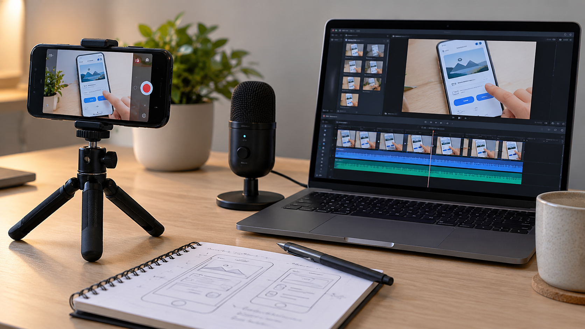

# Vídeos y demostraciones para explicar el estado de un proyecto

**Edición editorial:** 2026-11-07-editorial-r1. **Elaborada en UTC:** 2026-11-07T19:50:09.616232Z.

**Estado histórico declarado del contenido:** borrador local para revisión. **Versión histórica:** 2026-10-14-v7. **Fecha de redacción histórica declarada:** 2026-10-14. La fuente histórica estaba disponible públicamente en el commit consultado; su publicación no valida el contenido.

**Alcance de esta edición:** corrección administrativa del estado documental. El desarrollo y las atribuciones que siguen se reproducen de la [versión histórica](https://github.com/NovusMotus/portfolio-tesis/blob/2cd2acbd44ae01f98481e383af2368bce2973b43/creacion/videos-prototipos/TESIS.md); sus expresiones «esta versión» se refieren a aquella edición. Se conservan las fechas declaradas, los límites y las propuestas, sin añadir logros ni reconstruir el inicio de la idea. La disponibilidad de esta edición se comprueba en el repositorio y en la PR que la incorpore.

**Aporte editorial:** Codex desktop / OpenAI / gpt-6.1-sol; transformación con Python 3.12.14. [Registro de esta versión](VERSION-2026-11-07-editorial-r1.json) · [Revisión editorial fechada](../../REVISION_EDITORIAL_2026-11-07-r1.json).

## TL;DR

*Ilustración conceptual generada con IA; no es una captura ni prueba de uso.*

- **Propósito:** Explicar ideas y funciones sin confundir una demostración audiovisual con uso real.
- **Aportación y enfoque:** El método relaciona cada pieza con proyecto, versión y propósito; la autoría concreta de imagen, voz y edición requiere sus registros.
- **Trabajo y evidencia:** Vídeos de distintas líneas y un informe previo que los inventaría y delimita el alcance de la revisión.
- **Resultados y límites:** No se visionó íntegramente todo el conjunto ni se auditaron todas las pistas. Falta revisar condiciones mostradas, derechos y posibles pasos ocultos antes de publicarlos.

## Punto de partida y pregunta de esta línea

Una demostración audiovisual puede mostrar una idea, un prototipo o una función, y esos estados necesitan identificarse para que el espectador interprete lo que ve. El problema es conservar el contexto cuando el material visual resume un desarrollo más amplio. Una animación o montaje no acredita por sí solo funcionamiento del producto o resultados de uso.

## Origen y propósito

La documentación disponible permite describir esta línea, pero no reconstruye de forma confirmada qué observación, publicación o experiencia la inició. El punto de partida puede ser una idea, una hipótesis, una aplicación o una práctica con herramientas; no se presupone que exista un problema que resolver. Si se recupera una referencia de origen, se distinguirán lo que plantea esa fuente y la adaptación realizada por Javier.

## Enfoque del proyecto y propuesta de esta versión

El enfoque es relacionar cada pieza con un proyecto, una versión y un propósito: explicar un problema, recorrer una interfaz o mostrar un comportamiento observado. La aportación de Javier puede diferenciarse de la generación de imagen, voz o edición. Los recursos deben tener procedencia y las condiciones de una demostración deben estar identificadas. La exposición se organiza alrededor de una pregunta que el espectador pueda contrastar.

## Desarrollo y evidencia disponible

La carpeta contiene vídeos vinculados a varias líneas de proyecto. El informe previo inventaría archivos audiovisuales y declara que no realizó un visionado continuo; la revisión de imágenes descrita allí no equivale a revisar las pistas de vídeo. En esta fase no se han visionado íntegramente todos los vídeos ni auditado todas sus pistas. Por ello la tesis documenta la función de esos materiales en el trabajo, sin aprobarlos como recursos públicos o convertirlos en pruebas de uso real.

## Preguntas y límites que permanecen abiertos

La edición puede ocultar condiciones, pasos o fallos que importan para interpretar una demostración. Las voces, música, capturas e imágenes necesitan revisión de privacidad y derechos. Los datos visibles pueden ser identificables aunque no estén en el guion. La corrección de un texto no comprueba lo que aparece en pantalla. Un mensaje conceptual puede mantenerse como tal sin presentar el producto como implantado.

## Cómo podría comprobarse

Se propone una revisión por pieza que relacione guion, imagen, audio y afirmaciones. El registro debe indicar duración, versión, fuentes y si el comportamiento mostrado está reproducido o simulado. La lectura pública puede probarse preguntando qué estado atribuye el espectador al proyecto. Los cambios de montaje y atribución se conservarían por versión antes de incorporar el vídeo a un portfolio.

## Precisar qué afirmación permite mostrar una pieza

El informe de portfolio relaciona materiales audiovisuales con varias líneas de trabajo y recoge límites de revisión. Esta versión propone que cada pieza empiece por su propósito: explicar una idea, recorrer una representación o mostrar un comportamiento comprobado. Esa finalidad determinaría qué afirmaciones necesita el guion y qué evidencia las sostiene. Una animación conceptual puede cumplir una función explicativa sin convertirse en prueba de funcionamiento del producto.

La ficha de pieza indicaría proyecto, versión, duración y condiciones de elaboración. Si un comportamiento está simulado, conservaría ese estado. Si se muestra una captura de una función real, se identificaría qué recorrido y entorno se observó. No se extendería una comprobación a funciones que no aparecen. La propuesta es del asistente y no acredita que todos los vídeos existentes tengan estas fichas o hayan sido visionados íntegramente en esta fase.

## Relacionar guion, imagen, audio y edición

La revisión propuesta recorrería cada afirmación junto con lo que se ve y se escucha. Un texto prudente puede acompañarse de una imagen que sugiere un estado distinto, por lo que ambos requieren contraste. También se identificarían recursos generados, capturas, locución, música y montaje, con procedencia y condiciones pertinentes. Una herramienta mencionada en un nombre de archivo no demostraría qué modelo produjo el recurso.

El ejemplo ficticio podría mostrar una interfaz sin conexión real y una voz que explica su propósito. La revisión comprobaría que la pieza se interpreta como demostración conceptual y no como servicio implantado. No se utilizarían datos privados o personas reales para ilustrarlo. Las pistas visuales y sonoras tendrían aprobación propia antes de publicación. Esta preparación no extrae conclusiones sobre derechos de todos los recursos ni transforma la revisión de un guion en una auditoría de sus imágenes.

## Conservar lo que el montaje deja fuera

Un recorrido editado puede omitir preparación, espera o una parte del comportamiento. La propuesta documental identificaría qué se ha seleccionado y qué condiciones quedan fuera. La duración reducida de una pieza no mediría automáticamente el tiempo de la tarea representada. Si un corte cambia la interpretación de una función, el guion o la indicación de estado tendría que precisarlo.

Para estudiar una demostración se podría comparar una versión continua del recorrido ficticio con un montaje que conserva sus etapas relevantes. La pregunta sería si ambos sostienen la misma afirmación. El contraste no se ha ejecutado y no valida los vídeos existentes. Su utilidad sería detectar cuándo la edición mejora la explicación y cuándo elimina información necesaria para interpretarla. Una discrepancia se registraría por pieza y versión, sin declarar que todo el proyecto está verificado o no por un único montaje.

## Probar qué estado atribuye el espectador al proyecto

El ensayo propuesto mostraría una pieza aprobada para esa prueba y preguntaría qué cree que existe, qué acción observó y qué información falta. Esas respuestas permitirían examinar comprensión de la presentación. No medirían por sí solas utilidad del producto, recepción general o intención de compra. El material y las preguntas se fijarían antes de interpretar el resultado, manteniendo el alcance de la muestra.

Si se confunde una simulación con una función ejecutada, la revisión podría cambiar una indicación de estado, una imagen o una frase. El registro describiría el cambio y su motivo. No se atribuye ese hallazgo a una prueba real de Javier en esta preparación. La aprobación para publicar seguiría siendo una decisión distinta del ensayo. No se suben vídeos, se modifican perfiles ni se envían piezas a terceros como parte de esta ficha conceptual.

## Documentar una demostración como parte del desarrollo

La evidencia disponible son archivos audiovisuales y un informe previo de inventario con límites de revisión declarados. Esta ampliación propone fichas y comprobaciones para relacionar cada pieza con la afirmación que presenta. No acredita visionado integral de todas las pistas, aprobación de derechos o resultados de uso. Javier revisará las formulaciones nuevas y qué materiales desea mostrar.

Una actualización podría incorporar una revisión completa de una pieza, corregir su montaje o recuperar la herramienta y modelo utilizados. El historial conservaría la versión anterior y el motivo del cambio. El portfolio completo puede utilizar vídeos como apoyo a las tesis y proyectos públicos aprobados, mientras que los recursos privados quedan fuera. Cada pieza mantendría identificable su origen y estado, evitando presentar el formato audiovisual como una evidencia más amplia que el comportamiento realmente documentado.

## Referencias históricas recuperadas y aplicación propuesta

El material recibido conserva referencias a vídeos por escenas, animación, recursos reutilizables, creación 3D y revisión visual. Son ejemplos externos, no piezas propias adicionales ni herramientas cuyo uso por Javier esté probado. El asistente propone que una nueva prueba declare su objetivo, condiciones de producción y fallos visibles, y conserve la comparación con la versión anterior. El índice registra los periodos de recopilación; los límites audiovisuales originales permanecen privados y no se sustituyen por una afirmación de visionado íntegro actual.

## Procedencia de las posiciones

Síntesis de la función documental de la carpeta; procedimiento editorial propuesto por el asistente. El texto es una síntesis asistida por IA y requiere la revisión de Javier antes de atribuirle nuevas formulaciones. Se describen procesos y condiciones, sin juicios de valor ni atribuciones de intenciones.

## Fechas, versiones y cambios

Primera referencia temporal utilizada: no confirmada. El inicio real y las fechas de cada aportación histórica no están reconstruidos. La fecha del archivo no sustituye la fecha de la idea.

Se añaden los desarrollos: Precisar qué afirmación permite mostrar una pieza; Relacionar guion, imagen, audio y edición; Conservar lo que el montaje deja fuera; Probar qué estado atribuye el espectador al proyecto; Documentar una demostración como parte del desarrollo. Las propuestas nuevas se atribuyen al asistente y se registra el modelo de este turno sin alterar las atribuciones anteriores. No se incorporan resultados de pruebas nuevas. La edición no modifica las fuentes originales ni sus fechas.

## Herramientas y modelos

Imagen conceptual vigente, añadida el 2026-10-14: preparación e incorporación con Codex/OpenAI gpt-6.1-sol (metadatos del turno); generación y correcciones con image_gen de OpenAI, cuyo modelo exacto no consta. Sustituye el esquema anterior, conservado en el historial. Revisión independiente: gpt-6-astra.

Apoyo visual añadido el 2026-10-14: esquema original elaborado con Codex/OpenAI gpt-6.1-sol (metadatos del turno), Python 3.12.14 y ReportLab 4.4.9, exportado como SVG. Explica la idea del TL;DR; no representa una prueba o resultado nuevo. Revisión independiente de esta edición: gpt-6-astra; alcance documentado por separado. Compatibilidad tipográfica del SVG corregida en esta edición.

La redacción anterior se preparó con Codex/OpenAI gpt-6.1-sol. La revisión y las correcciones de esta versión, fechadas el 2026-10-14, utilizan Codex/OpenAI gpt-6-astra, identificado en los metadatos del turno. Las atribuciones y versiones anteriores se conservan con su evidencia original. Se usaron Python para organización y comprobación local, y herramientas de lectura y edición de archivos. La revisión editorial independiente se encargó a un agente separado con gpt-6-astra; su alcance y resultado se registran fuera del dossier, sin equivaler a validación integral del proyecto. No se han configurado integraciones o actualización continua.

### Atribuciones históricas documentadas

No hay una atribución histórica exacta reconstruida para esta ficha. Las menciones a herramientas en las fuentes no se consideran prueba de uso.

## Fuentes y alcance de lectura

La base es la documentación interna identificada en el registro privado de fuentes de esta preparación. Se ha leído mediante extracción local y se han examinado fuentes y pasajes seleccionados; no es una auditoría sustantiva de todo el corpus. Las referencias externas de los antecedentes requieren verificación pertinente antes de reutilizar afirmaciones como hechos actuales. No se incluyen rutas privadas, documentos sensibles, conversaciones completas o material de terceros en este dossier.
