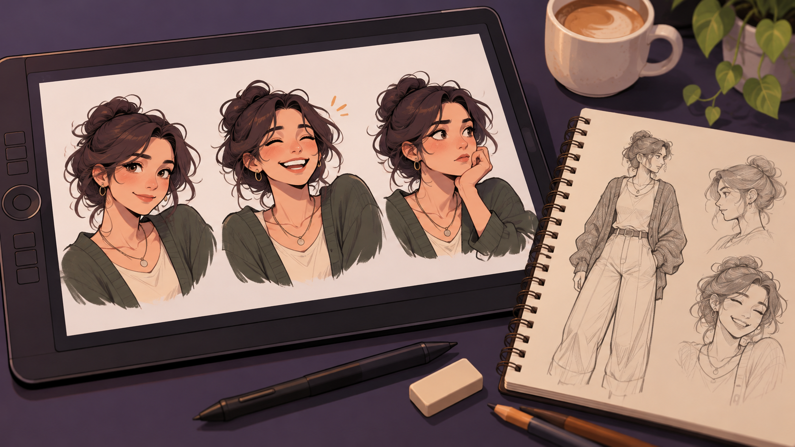

# Zeclana y la consistencia de un personaje en comunicación digital

**Estado:** borrador local para revisión. **Versión:** 2026-10-14-v5. **Fecha de redacción:** 2026-10-14. No publicado ni aprobado para subir.

## TL;DR

*Ilustración conceptual generada con IA de un personaje propuesto para explicar la consistencia visual; no es el diseño histórico acreditado de Zeclana.*

- **Propósito:** Mantener coherencia de personaje y expresiones entre piezas digitales.
- **Aportación y enfoque:** Javier selecciona, modifica o descarta variantes; la IA genera recursos y el criterio de diseño organiza el conjunto.
- **Trabajo y evidencia:** Contexto, playbook, textos e imágenes conservados.
- **Resultados y límites:** Las cuentas y publicaciones declaradas no se comprobaron de nuevo. Falta revisar consistencia y derechos pieza a pieza; no se atribuyen ingresos ni actividad comercial acreditada.

## Punto de partida y pregunta de esta línea

El proyecto plantea cómo mantener un personaje, una identidad visual y un repertorio de expresiones reconocibles entre piezas de comunicación. La pregunta es qué reglas permiten que nuevas variantes conserven la relación con el concepto inicial. Esta ficha trata el diseño creativo; la inversión, el estado de cuentas o el comportamiento de un token son ámbitos separados.

## Origen y propósito

La documentación disponible permite describir esta línea, pero no reconstruye de forma confirmada qué observación, publicación o experiencia la inició. El punto de partida puede ser una idea, una hipótesis, una aplicación o una práctica con herramientas; no se presupone que exista un problema que resolver. Si se recupera una referencia de origen, se distinguirán lo que plantea esa fuente y la adaptación realizada por Javier.

## Enfoque del proyecto y propuesta de esta versión

El material define rasgos del personaje y una regla de adaptación mínima de expresiones. Javier decide qué variantes conserva, modifica o descarta. Las herramientas de IA apoyan la generación, pero la selección y coherencia del conjunto dependen de criterios de diseño explícitos. Un repertorio de piezas puede organizarse por tipo de situación y estado de aprobación, conservando el motivo de los cambios.

## Desarrollo y evidencia disponible

Hay contexto, un playbook, textos e imágenes. Esos archivos documentan construcción y selección de recursos. Las afirmaciones de cuentas configuradas o publicaciones presentes en el contexto son declaraciones históricas que no se han comprobado de nuevo. No se presentan ingresos, rendimientos ni actividad comercial como resultado de la marca. La revisión actual se limita a preparar su exposición teórica sin datos de cuentas.

## Preguntas y límites que permanecen abiertos

La consistencia visual necesita comprobar las piezas, no solo conservar un prompt. Algunas adaptaciones pueden utilizar recursos de terceros con condiciones propias. La recepción de una pieza por una comunidad es una cuestión distinta de la coherencia del personaje. Las expresiones de promoción financiera requieren tratamiento separado y no forman parte de la tesis creativa. Las preferencias de diseño se describen como decisiones del proyecto, sin clasificarlas como mejores que otras en general.

## Cómo podría comprobarse

Se propone un conjunto de piezas comparables para revisar reconocimiento, correspondencia con las reglas y diferencias entre versiones. La documentación debería registrar herramienta, modelo y selección humana de cada recurso. Una prueba con espectadores necesitaría definir qué se pregunta y cómo se interpreta. El resultado serviría para ajustar el lenguaje visual, sin inferir demanda, notoriedad o rendimiento financiero a partir de unas respuestas.

## Definir qué rasgos se conservan y cuáles pueden variar

El contexto y el playbook reúnen criterios para un personaje y sus expresiones. La continuación propuesta separaría rasgos de identidad, variantes admitidas y decisiones pendientes. Una nueva pieza podría cambiar gesto, escena o texto sin que todos los rasgos cambien a la vez. La ficha de diseño indicaría qué se pretende conservar y por qué se selecciona una variante. No se afirma que todas las piezas existentes cumplan esos criterios.

El repertorio podría organizarse por función comunicativa, como reacción, presentación o explicación, con ejemplos creados para la práctica. La comparación se haría entre piezas destinadas a una función similar. El objetivo sería comprender la relación entre la regla y su resultado, sin clasificar un estilo como superior en general. Javier decide qué conserva o modifica; los criterios y ensayos añadidos en esta versión son propuestas del asistente, no nuevas decisiones creativas aceptadas.

## De la instrucción de generación a la pieza seleccionada

La propuesta de registro relacionaría una instrucción, la herramienta utilizada, el resultado y la selección posterior. Un mismo texto de generación puede producir variantes diferentes; por eso conservar el prompt no demuestra consistencia del conjunto. La ficha de cada pieza indicaría qué se corrigió y qué condición motivó el cambio. Los modelos se atribuirían a la intervención concreta, sin deducirlos del nombre CLAUDE.md o de una mención genérica a IA.

La edición humana, una generación nueva y una adaptación de un recurso ajeno tendrían estados distintos. La procedencia permitiría identificar qué material necesita comprobarse antes de publicación. Esta preparación no revisa visualmente todas las imágenes ni valida su licencia por estar guardadas en el proyecto. Tampoco reproduce datos de cuentas o configuraciones. El análisis se mantiene en el diseño del personaje y su lenguaje visual, separado de cualquier actividad económica o financiera relacionada.

## Revisar una colección y no solo una muestra elegida

El contraste propuesto reuniría un conjunto definido de piezas y sus criterios de selección. Se observarían rasgos que cambian, reglas difíciles de aplicar y excepciones. Una pieza escogida por su coherencia no demostraría que todo el repertorio la conserva. El registro indicaría qué conjunto se examinó y qué imágenes siguen pendientes. La muestra pública sería limitada al material aprobado por contenido y derechos.

Un ejercicio podría comparar una variante de referencia con otra que modifica un rasgo previsto como estable. La revisión preguntaría si puede identificarse la diferencia y si la regla estaba suficientemente descrita. El resultado permitiría ajustar una condición de diseño, no demostrar reconocimiento o aceptación general. Esa evaluación de consistencia sería distinta de observar la recepción de una pieza por una comunidad, que requeriría pregunta, muestra y evidencias propias.

## Distinguir coherencia, comprensión y recepción

Una posible prueba con espectadores se diseñaría según lo que se quiera conocer. Reconocer el mismo personaje, interpretar una expresión y preferir una pieza son preguntas diferentes. El material mostrado y la tarea se definirían antes de interpretar respuestas. No se utilizaría una reacción individual como prueba de notoriedad o de crecimiento de una cuenta. Esta preparación no realiza ese contraste ni publica nuevas piezas.

La revisión también conservaría qué contexto necesita una expresión. Una pieza que se entiende dentro del repertorio puede necesitar otra explicación cuando aparece aislada. El ensayo ficticio podría estudiar esa diferencia de contexto sin usar datos de comunidad reales. Las respuestas se limitarían a su alcance y no se relacionarían con rendimiento de un activo o demanda comercial. El método propuesto permite investigar comunicación del personaje manteniendo separados esos planos.

## Una línea creativa con historial de decisiones

La evidencia conservada es contexto, playbook y recursos de diseño. La fecha declarada en un antecedente constituye una referencia documental, no prueba de toda la actividad externa mencionada. La ampliación propone registros y contrastes para explicar cómo se seleccionan variantes. No acredita cuentas activas, publicaciones actuales o resultados económicos. Javier revisará qué aportaciones desea incorporar.

Una próxima versión podría recuperar la procedencia de una pieza, corregir una regla o documentar una revisión visual acotada. El cambio conservaría fecha, herramienta y modelo comprobables. La tesis pública candidata mostraría el proceso creativo autorizado sin divulgar accesos o vincular consistencia visual con inversión. La implementación o recursos reservados permanecerían en su destino privado. El portfolio puede incluir la exploración como diseño en desarrollo con independencia de su recepción o uso comercial.

## Procedencia de las posiciones

Reglas creativas atribuidas a Javier en el playbook; revisión y evaluación futuras propuestas en esta ficha. El texto es una síntesis asistida por IA y requiere la revisión de Javier antes de atribuirle nuevas formulaciones. Se describen procesos y condiciones, sin juicios de valor ni atribuciones de intenciones.

## Fechas, versiones y cambios

Primera referencia temporal utilizada: 2026-09-09. Fecha de escritura declarada en el contexto; no verificación de actividad externa.

Se añaden los desarrollos: Definir qué rasgos se conservan y cuáles pueden variar; De la instrucción de generación a la pieza seleccionada; Revisar una colección y no solo una muestra elegida; Distinguir coherencia, comprensión y recepción; Una línea creativa con historial de decisiones. Las propuestas nuevas se atribuyen al asistente y se registra el modelo de este turno sin alterar las atribuciones anteriores. No se incorporan resultados de pruebas nuevas. La edición no modifica las fuentes originales ni sus fechas.

## Herramientas y modelos

Imagen conceptual vigente, añadida el 2026-10-14: preparación e incorporación con Codex/OpenAI gpt-6.1-sol (metadatos del turno); generación y correcciones con image_gen de OpenAI, cuyo modelo exacto no consta. Sustituye el esquema anterior, conservado en el historial. Revisión independiente: gpt-6-astra.

Apoyo visual añadido el 2026-10-14: esquema original elaborado con Codex/OpenAI gpt-6.1-sol (metadatos del turno), Python 3.12.14 y ReportLab 4.4.9, exportado como SVG. Explica la idea del TL;DR; no representa una prueba o resultado nuevo. Revisión independiente de esta edición: gpt-6-astra; alcance documentado por separado. Compatibilidad tipográfica del SVG corregida en esta edición.

La redacción de esta versión utiliza Codex/OpenAI con el modelo gpt-6.1-sol. Su identificación consta en los metadatos del turno utilizado para esta edición; las atribuciones de versiones anteriores se conservan con su evidencia original. Se usaron Python para organización y comprobación local, y herramientas de lectura y edición de archivos. La revisión editorial independiente se encargó a un agente separado con gpt-6-astra; su alcance y resultado se registran fuera del dossier, sin equivaler a validación integral del proyecto. No se han configurado integraciones o actualización continua.

### Atribuciones históricas documentadas

No hay una atribución histórica exacta reconstruida para esta ficha. Las menciones a herramientas en las fuentes no se consideran prueba de uso.

## Fuentes y alcance de lectura

La base es la documentación interna identificada en el registro privado de fuentes de esta preparación. Se ha leído mediante extracción local y se han examinado fuentes y pasajes seleccionados; no es una auditoría sustantiva de todo el corpus. Las referencias externas de los antecedentes requieren verificación pertinente antes de reutilizar afirmaciones como hechos actuales. No se incluyen rutas privadas, documentos sensibles, conversaciones completas o material de terceros en este dossier.
