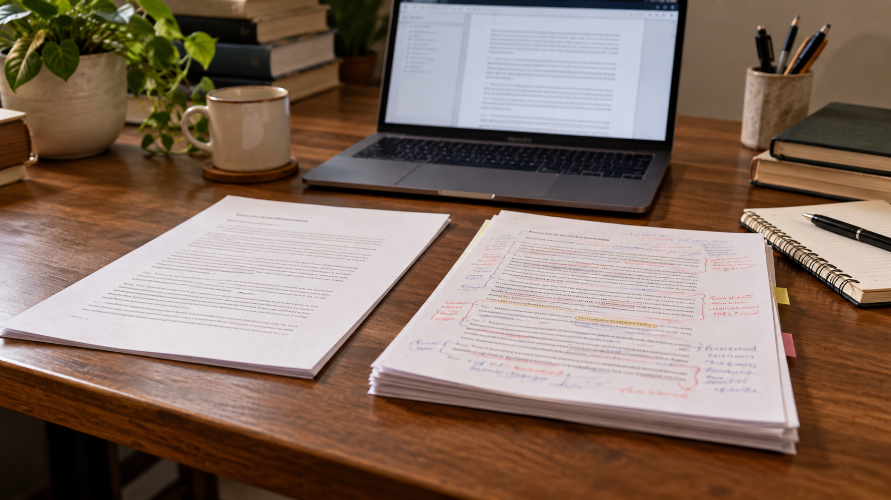

# Evolución documental de la investigación sobre una vía doctoral

**Estado:** borrador local para revisión. **Versión:** 2026-10-14-v6. **Fecha de redacción:** 2026-10-14. No publicado ni aprobado para subir.

## TL;DR

*Ilustración conceptual generada con IA; no es una captura ni prueba de uso.*

- **Propósito:** Entender cómo cambió una investigación sobre una vía doctoral entre sus documentos.
- **Aportación y enfoque:** El asistente propone distinguir añadidos, correcciones y alcance; los motivos personales de Javier solo se atribuyen cuando constan.
- **Trabajo y evidencia:** Estudio inicial y documento posterior conservados, con pasajes seleccionados examinados.
- **Resultados y límites:** Más apartados no prueban mayor calidad. Falta comparar fuentes y requisitos y revalidar condiciones; no se acredita candidatura o admisión.

## Punto de partida y pregunta de esta línea

Esta línea conserva el estudio inicial de una vía doctoral y lo relaciona con un documento posterior identificado como final. La pregunta es cómo registrar los cambios de afirmaciones, fuentes y alcance entre ambos. La palabra final en un nombre de archivo no acredita que toda la información esté comprobada o vigente. La ficha desarrolla un método de comparación documental, sin convertir una revisión de opciones en admisión académica o decisión de Javier.

## Origen y propósito

La documentación disponible permite describir esta línea, pero no reconstruye de forma confirmada qué observación, publicación o experiencia la inició. El punto de partida puede ser una idea, una hipótesis, una aplicación o una práctica con herramientas; no se presupone que exista un problema que resolver. Si se recupera una referencia de origen, se distinguirán lo que plantea esa fuente y la adaptación realizada por Javier.

## Enfoque del proyecto y propuesta de esta versión

El enfoque editorial propuesto es comparar fuentes, requisitos, alternativas descartadas y datos que quedaron pendientes. Para cada variable habría que especificar qué dato se busca, qué fuente podría acreditarlo y qué decisión depende de él. Las alternativas deben referirse a la misma tarea y condiciones, para que una diferencia no proceda solo de comparar productos o situaciones distintos. Este método se ofrece como ayuda para desarrollar el dossier: Javier revisará qué parte corresponde a su enfoque y qué propuestas nuevas desea conservar.

## Desarrollo y evidencia disponible

Existe un informe de investigación conservado en la carpeta de trabajo. En esta fase se ha leído mediante extracción local y se han inspeccionado pasajes seleccionados; no se ha revalidado su bibliografía completa ni reproducido todas las comprobaciones que declara. El dossier es una síntesis inicial del problema y de cómo investigarlo. No acredita una actividad comercial, candidatura, inversión o implantación por la existencia de ese informe. Los datos personales y proyecciones del documento permanecen privados.

## Preguntas y límites que permanecen abiertos

Los datos pueden depender de una fecha, un producto o una muestra concreta. Una página comercial describe lo que declara su proveedor y no aporta por sí sola prueba de demanda, funcionamiento o resultado. Los cálculos necesitan entradas y supuestos identificados. Una fuente no localizada no demuestra que una actividad no exista. Las afirmaciones jurídicas, fiscales, médicas o de rendimiento requieren verificación pertinente antes de presentarse en una edición pública como hechos.

## Cómo podría comprobarse

El siguiente contraste propuesto es una comparación explícita de afirmaciones y fuentes entre versiones, sin convertir la revisión documental en una admisión académica. La prueba debe registrar condiciones, fuentes y criterios de comparación antes de interpretar el resultado. Si faltan datos, se mantiene la pregunta abierta y se indica qué cambiaría la decisión. Las versiones posteriores explicarán qué se añadió, corrigió o retiró y qué herramienta o modelo intervino. Ninguna prueba futura se describe en esta ficha como ejecutada.

## Identificar versiones antes de explicar una evolución

Los antecedentes contienen un estudio inicial y otro posterior de la misma exploración. La estructura de ambos puede ayudar a localizar asuntos, pero su número de apartados no mide calidad o verificación. Esta versión propone identificar cada documento por contenido, referencia y alcance de lectura. Las fechas históricas solo se atribuirían cuando constan; copiar o renombrar un archivo no demuestra cuándo se escribió cada afirmación.

La comparación tendría una unidad definida: una afirmación concreta, no todo el documento tratado como un único cambio. Se registraría su formulación anterior y posterior, y qué fuente sustenta cada una. Si una idea desaparece de la versión posterior, esa ausencia no se interpretaría automáticamente como rechazo de Javier. Podría deberse a una reducción de alcance o a una pregunta todavía abierta. La propuesta permite investigar la evolución sin reconstruir intenciones que no estén documentadas.

## Distinguir añadidos, correcciones y cambios de alcance

El registro propuesto clasificaría cada diferencia por su función. Un añadido incorpora información que no estaba representada; una corrección cambia una afirmación por nueva evidencia o por un error identificado; un cambio de alcance delimita mejor qué se compara. Esas categorías no se utilizarían para declarar superior una versión por tener más texto. La ficha conservaría el motivo que consta y marcaría sin confirmar el que no puede recuperarse.

Como ejemplo ficticio, una fuente que describe un requisito para un programa determinado podría corregir una generalización inicial. El registro mostraría qué parte cambia y qué preguntas siguen sin resolver. No se adopta aquí ningún requisito concreto de los informes como vigente. Si una selección del asistente no fue aceptada por Javier, permanecería como propuesta. El historial separaría decisiones del usuario y reformulaciones de herramientas, evitando atribuir toda conclusión posterior al promotor.

## La trazabilidad necesita la referencia pertinente

Para cada diferencia se buscaría la fuente que permite revisarla y su correspondencia con la afirmación. Una referencia general sobre estudios internacionales puede iniciar una búsqueda, pero no sustituye una condición de un programa concreto. Si la versión posterior menciona una fuente nueva, se registraría qué dato aporta y qué no demuestra. Esta preparación no revalida todas las fuentes ni afirma que el documento posterior cierre las cuestiones que enumera.

La comparación también identificaría afirmaciones repetidas sin nueva comprobación. Su permanencia en dos documentos no sería evidencia independiente. Si cambian plazos o contexto, una afirmación anterior puede necesitar una nueva consulta sin que su formulación original fuera incorrecta para su fecha. La propuesta conserva esa diferencia entre corrección y actualización. Los datos personales de elegibilidad, recursos o preferencias se mantendrían en el registro privado, fuera de la explicación pública candidata.

## Un ensayo documental para comprobar el método

La prueba propuesta utilizaría dos textos ficticios con diferencias conocidas: un añadido, una corrección, una omisión y una fuente que no sustenta el alcance atribuido. Se observaría si el registro identifica cada caso y conserva lo que no puede decidirse. Los criterios se fijarían antes de revisar el resultado. Este ensayo no está ejecutado y no acredita que todas las diferencias de los informes reales hayan sido catalogadas.

Un contraste posterior podría aplicar el método a una sección autorizada de los antecedentes y documentar sus límites. El resultado indicaría qué afirmaciones se compararon, qué fuentes se consultaron y qué interpretación quedó pendiente. No se presentaría una comparación parcial como revisión completa de la vía doctoral. Tampoco se tomaría un cambio editorial como prueba de una respuesta de una institución o de una decisión académica. Cada evento conservaría una evidencia propia.

## Mostrar cómo cambia una investigación

La aportación de esta línea es conservar antecedentes de una exploración y proponer una forma de explicar su evolución. La ficha complementa el dossier sobre condiciones de una vía doctoral: se centra en versiones y cambios, sin sustituir sus preguntas sobre encaje y acceso. Los ejemplos y criterios de esta edición son propuestas del asistente, pendientes de revisión de Javier.

Una próxima versión podría documentar diferencias reales de una sección, recuperar su fecha o corregir la atribución de una conclusión. Mantendría los modelos históricos sin confirmar si no hay evidencia. El portfolio podría mostrar así qué información cambia el enfoque y qué parte del estudio permanece abierta. No necesita publicar documentos privados completos ni presentar un archivo denominado final como acreditación de una candidatura, admisión o financiación que esta preparación no ha verificado.

## Procedencia de las posiciones

Pregunta derivada del tema del informe; método de contraste propuesto por el asistente, pendiente de aceptación o modificación por Javier. El texto es una síntesis asistida por IA y requiere la revisión de Javier antes de atribuirle nuevas formulaciones. Se describen procesos y condiciones, sin juicios de valor ni atribuciones de intenciones.

## Fechas, versiones y cambios

Referencias temporales del antecedente: El encabezado del antecedente declara ejecución parcial el 27 de julio de 2026 y ausencia de verificación final en esa ejecución. No acredita inicio de la idea ni validación actual. No se utiliza mtime como fecha de autoría.

Se añaden los desarrollos: Identificar versiones antes de explicar una evolución; Distinguir añadidos, correcciones y cambios de alcance; La trazabilidad necesita la referencia pertinente; Un ensayo documental para comprobar el método; Mostrar cómo cambia una investigación. Las propuestas nuevas se atribuyen al asistente y se registra el modelo de este turno sin alterar las atribuciones anteriores. No se incorporan resultados de pruebas nuevas. La edición no modifica las fuentes originales ni sus fechas.

## Herramientas y modelos

Imagen conceptual vigente, añadida el 2026-10-14: preparación e incorporación con Codex/OpenAI gpt-6.1-sol (metadatos del turno); generación y correcciones con image_gen de OpenAI, cuyo modelo exacto no consta. Sustituye el esquema anterior, conservado en el historial. Revisión independiente: gpt-6-astra.

Apoyo visual añadido el 2026-10-14: esquema original elaborado con Codex/OpenAI gpt-6.1-sol (metadatos del turno), Python 3.12.14 y ReportLab 4.4.9, exportado como SVG. Explica la idea del TL;DR; no representa una prueba o resultado nuevo. Revisión independiente de esta edición: gpt-6-astra; alcance documentado por separado. Compatibilidad tipográfica del SVG corregida en esta edición.

La redacción anterior se preparó con Codex/OpenAI gpt-6.1-sol. La revisión y las correcciones de esta versión, fechadas el 2026-10-14, utilizan Codex/OpenAI gpt-6-astra, identificado en los metadatos del turno. Las atribuciones y versiones anteriores se conservan con su evidencia original. Se usaron Python para organización y comprobación local, y herramientas de lectura y edición de archivos. La revisión editorial independiente se encargó a un agente separado con gpt-6-astra; su alcance y resultado se registran fuera del dossier, sin equivaler a validación integral del proyecto. No se han configurado integraciones o actualización continua.

### Atribuciones históricas documentadas

No hay una atribución histórica exacta reconstruida para esta ficha. Las menciones a herramientas en las fuentes no se consideran prueba de uso.

## Fuentes y alcance de lectura

La base es la documentación interna identificada en el registro privado de fuentes de esta preparación. Se ha leído mediante extracción local y se han examinado fuentes y pasajes seleccionados; no es una auditoría sustantiva de todo el corpus. Las referencias externas de los antecedentes requieren verificación pertinente antes de reutilizar afirmaciones como hechos actuales. No se incluyen rutas privadas, documentos sensibles, conversaciones completas o material de terceros en este dossier.
