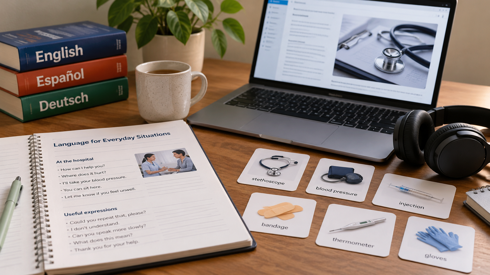

# Idioma, requisitos y contexto en una transición profesional internacional

**Edición editorial:** 2026-11-07-editorial-r1. **Elaborada en UTC:** 2026-11-07T19:50:09.616232Z.

**Estado histórico declarado del contenido:** borrador local para revisión. **Versión histórica:** 2026-10-14-v6. **Fecha de redacción histórica declarada:** 2026-10-14. La fuente histórica estaba disponible públicamente en el commit consultado; su publicación no valida el contenido.

**Alcance de esta edición:** corrección administrativa del estado documental. El desarrollo y las atribuciones que siguen se reproducen de la [versión histórica](https://github.com/NovusMotus/portfolio-tesis/blob/2cd2acbd44ae01f98481e383af2368bce2973b43/desarrollo-profesional/idioma-healthtech/TESIS.md); sus expresiones «esta versión» se refieren a aquella edición. Se conservan las fechas declaradas, los límites y las propuestas, sin añadir logros ni reconstruir el inicio de la idea. La disponibilidad de esta edición se comprueba en el repositorio y en la PR que la incorpore.

**Aporte editorial:** Codex desktop / OpenAI / gpt-6.1-sol; transformación con Python 3.12.14. [Registro de esta versión](VERSION-2026-11-07-editorial-r1.json) · [Revisión editorial fechada](../../REVISION_EDITORIAL_2026-11-07-r1.json).

## TL;DR

*Ilustración conceptual generada con IA; no es una captura ni prueba de uso.*

- **Propósito:** Explorar neerlandés y posibles vías profesionales en tecnología sanitaria en Países Bajos.
- **Aportación y enfoque:** La edición propone distinguir tareas de comunicación y requisitos concretos; no fija por Javier un nivel o destino profesional.
- **Trabajo y evidencia:** Informe conservado de investigación, examinado mediante extracción.
- **Resultados y límites:** No hay acceso a un puesto ni nivel lingüístico acreditados. Falta comprobar ofertas, fuentes y fechas y decidir una tarea de aprendizaje pertinente.

## Punto de partida y pregunta de esta línea

El antecedente explora el aprendizaje de neerlandés en relación con posibles vías profesionales en tecnología sanitaria en Países Bajos. Esta ficha desarrolla cómo vincular una finalidad de aprendizaje con requisitos documentados y tareas de un puesto. No adopta ofertas, salarios o condiciones antiguas como vigentes, ni supone que una formación garantice acceso a empleo. El interés es comparar preguntas sobre idioma y trabajo sin publicar circunstancias personales del candidato.

## Origen y propósito

La documentación disponible permite describir esta línea, pero no reconstruye de forma confirmada qué observación, publicación o experiencia la inició. El punto de partida puede ser una idea, una hipótesis, una aplicación o una práctica con herramientas; no se presupone que exista un problema que resolver. Si se recupera una referencia de origen, se distinguirán lo que plantea esa fuente y la adaptación realizada por Javier.

## Enfoque del proyecto y propuesta de esta versión

El enfoque editorial propuesto es comparar puestos, idioma requerido, ubicación del trabajo, aprendizaje y requisitos de acceso. Para cada variable habría que especificar qué dato se busca, qué fuente podría acreditarlo y qué decisión depende de él. Las alternativas deben referirse a la misma tarea y condiciones, para que una diferencia no proceda solo de comparar productos o situaciones distintos. Este método se ofrece como ayuda para desarrollar el dossier: Javier revisará qué parte corresponde a su enfoque y qué propuestas nuevas desea conservar.

## Desarrollo y evidencia disponible

Existe un informe de investigación conservado en la carpeta de trabajo. En esta fase se ha leído mediante extracción local y se han inspeccionado pasajes seleccionados; no se ha revalidado su bibliografía completa ni reproducido todas las comprobaciones que declara. El dossier es una síntesis inicial del problema y de cómo investigarlo. No acredita una actividad comercial, candidatura, inversión o implantación por la existencia de ese informe. Los datos personales y proyecciones del documento permanecen privados.

## Preguntas y límites que permanecen abiertos

Los datos pueden depender de una fecha, un producto o una muestra concreta. Una página comercial describe lo que declara su proveedor y no aporta por sí sola prueba de demanda, funcionamiento o resultado. Los cálculos necesitan entradas y supuestos identificados. Una fuente no localizada no demuestra que una actividad no exista. Las afirmaciones jurídicas, fiscales, médicas o de rendimiento requieren verificación pertinente antes de presentarse en una edición pública como hechos.

## Cómo podría comprobarse

El siguiente contraste propuesto es un conjunto de ofertas fechado con requisitos comparables; sin datos privados del candidato ni previsiones salariales no revalidadas. La prueba debe registrar condiciones, fuentes y criterios de comparación antes de interpretar el resultado. Si faltan datos, se mantiene la pregunta abierta y se indica qué cambiaría la decisión. Las versiones posteriores explicarán qué se añadió, corrigió o retiró y qué herramienta o modelo intervino. Ninguna prueba futura se describe en esta ficha como ejecutada.

## Definir para qué tarea se estudia un idioma

La continuación propuesta distinguiría propósito de aprendizaje, tareas de comunicación y requisito declarado por una vía profesional. Leer documentación, participar en una reunión y explicar una situación son ejemplos de tareas diferentes; no se consideran equivalentes por compartir un idioma. La ficha identificaría qué tarea interesa y con qué información se relaciona. No establece un nivel lingüístico suficiente para un puesto concreto.

Un ejercicio ficticio podría consistir en comprender una descripción de producto y formular preguntas sobre su funcionamiento. El objetivo sería estudiar una práctica delimitada, sin presentarla como evaluación de competencia clínica o de acceso profesional. Javier decidirá qué finalidad de aprendizaje quiere explorar. Las tareas y criterios añadidos aquí son propuestas del asistente. La investigación puede seguir como práctica de una herramienta o de un idioma aunque la opción laboral no esté definida todavía.

## Comparar requisitos con fuentes y fechas propias

La tabla propuesta registraría puesto o vía, tarea, requisito lingüístico declarado, fuente y fecha. Se diferenciaría un requisito obligatorio de una preferencia o de una interpretación del lector. Si una oferta no especifica una condición, no se deduciría automáticamente que no existe. La comparación conservaría preguntas abiertas y no trasladaría la exigencia de un puesto a todos los empleos de un sector o país.

Los requisitos de formación, reconocimiento profesional o ubicación del trabajo tendrían registros separados cuando sean pertinentes. Esta ficha no afirma condiciones administrativas actuales ni orienta sobre un trámite concreto. Las ofertas y fuentes del informe antecedente no se consideran revalidadas por aparecer en la carpeta. Antes de utilizar una condición en una decisión real habría que comprobar su vigencia y alcance, sin convertir una comparación histórica en una lista de vacantes disponibles.

## Relacionar práctica y evidencia de aprendizaje

Una práctica podría describirse por material utilizado, tarea propuesta, ayuda recibida y resultado observado. Si una herramienta traduce o genera parte del texto, esa intervención se mantendría visible. El resultado asistido no demostraría por sí solo que la persona puede realizar la tarea sin la misma ayuda. La propuesta busca documentar qué se ensaya, sin atribuir niveles o capacidades que no han sido evaluados en esta preparación.

El ejemplo ficticio podría incluir una duda de comprensión y una reformulación posterior. Se observaría si se identifica el punto confuso y qué cambió con la ayuda. Una corrección de vocabulario sería distinta de una decisión sobre el contenido profesional. La práctica no utilizaría datos de pacientes, empresas o candidaturas reales. Herramienta, modelo y fecha se registrarían en cada intervención que llegue a realizarse, manteniendo sin confirmar los antecedentes que carecen de evidencia.

## Estudiar esfuerzo y pertinencia sin prometer un resultado

La comparación propuesta separaría tiempo dedicado, progreso observado en tareas delimitadas y pertinencia de esas tareas para una finalidad documentada. No asignaría una duración de aprendizaje universal ni supondría que completar un curso garantiza trabajo. Un cambio de finalidad podría requerir revisar la comparación: aprender para lectura y aprender para una interacción profesional concreta son preguntas con alcances diferentes.

La prueba metodológica utilizaría un conjunto ficticio de requisitos y dos prácticas con ayuda distinta. Se comprobaría si el registro evita presentar resultados incomparables como el mismo nivel de dominio. El ensayo no se ha ejecutado. Si se estudia después una oferta real, su revisión tendría fecha y fuente actuales. Esta edición no recomienda un programa formativo, una mudanza o un empleo y no reproduce previsiones económicas del documento privado.

## Una exploración profesional que conserva sus límites

La evidencia disponible es un informe de investigación, no una candidatura, formación completada o competencia certificada. La ampliación propone un método para relacionar finalidad, tareas y requisitos, sin atribuir sus ejemplos a hechos de Javier. El dossier puede mostrar cómo se examina una posible transición profesional y cómo se separan incógnitas de evidencias.

Un próximo hito podría precisar la tarea de aprendizaje, recuperar una referencia de origen o documentar una práctica autorizada. La versión indicaría qué se añadió y qué herramienta intervino, sin reconstruir modelos históricos a partir de menciones genéricas. La explicación pública mantendría privados los datos personales y dejaría abiertas las condiciones no verificadas. Así el portfolio puede incluir la exploración lingüística como proceso de investigación y aprendizaje, con independencia de que la vía laboral llegue a desarrollarse.

## Procedencia de las posiciones

Pregunta derivada del tema del informe; método de contraste propuesto por el asistente, pendiente de aceptación o modificación por Javier. El texto es una síntesis asistida por IA y requiere la revisión de Javier antes de atribuirle nuevas formulaciones. Se describen procesos y condiciones, sin juicios de valor ni atribuciones de intenciones.

## Fechas, versiones y cambios

Referencias temporales del antecedente: El informe declara fecha de referencia 29 de julio de 2026. No acredita comienzo de la idea ni vigencia actual de ofertas o requisitos. No se utiliza mtime como fecha de autoría.

Se añaden los desarrollos: Definir para qué tarea se estudia un idioma; Comparar requisitos con fuentes y fechas propias; Relacionar práctica y evidencia de aprendizaje; Estudiar esfuerzo y pertinencia sin prometer un resultado; Una exploración profesional que conserva sus límites. Las propuestas nuevas se atribuyen al asistente y se registra el modelo de este turno sin alterar las atribuciones anteriores. No se incorporan resultados de pruebas nuevas. La edición no modifica las fuentes originales ni sus fechas.

## Herramientas y modelos

Imagen conceptual vigente, añadida el 2026-10-14: preparación e incorporación con Codex/OpenAI gpt-6.1-sol (metadatos del turno); generación y correcciones con image_gen de OpenAI, cuyo modelo exacto no consta. Sustituye el esquema anterior, conservado en el historial. Revisión independiente: gpt-6-astra.

Apoyo visual añadido el 2026-10-14: esquema original elaborado con Codex/OpenAI gpt-6.1-sol (metadatos del turno), Python 3.12.14 y ReportLab 4.4.9, exportado como SVG. Explica la idea del TL;DR; no representa una prueba o resultado nuevo. Revisión independiente de esta edición: gpt-6-astra; alcance documentado por separado. Compatibilidad tipográfica del SVG corregida en esta edición.

La redacción anterior se preparó con Codex/OpenAI gpt-6.1-sol. La revisión y las correcciones de esta versión, fechadas el 2026-10-14, utilizan Codex/OpenAI gpt-6-astra, identificado en los metadatos del turno. Las atribuciones y versiones anteriores se conservan con su evidencia original. Se usaron Python para organización y comprobación local, y herramientas de lectura y edición de archivos. La revisión editorial independiente se encargó a un agente separado con gpt-6-astra; su alcance y resultado se registran fuera del dossier, sin equivaler a validación integral del proyecto. No se han configurado integraciones o actualización continua.

### Atribuciones históricas documentadas

No hay una atribución histórica exacta reconstruida para esta ficha. Las menciones a herramientas en las fuentes no se consideran prueba de uso.

## Fuentes y alcance de lectura

La base es la documentación interna identificada en el registro privado de fuentes de esta preparación. Se ha leído mediante extracción local y se han examinado fuentes y pasajes seleccionados; no es una auditoría sustantiva de todo el corpus. Las referencias externas de los antecedentes requieren verificación pertinente antes de reutilizar afirmaciones como hechos actuales. No se incluyen rutas privadas, documentos sensibles, conversaciones completas o material de terceros en este dossier.
