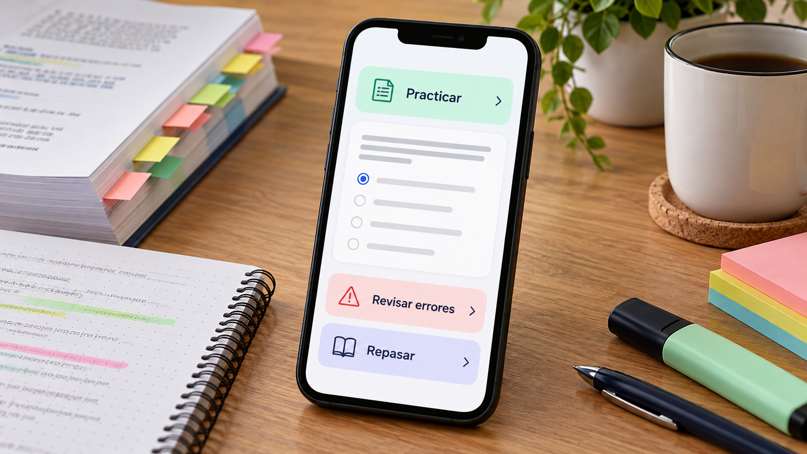

# Repaso diario y trazabilidad de errores en preparación de oposiciones

**Edición editorial:** 2026-11-07-editorial-r1. **Elaborada en UTC:** 2026-11-07T19:50:09.616232Z.

**Estado histórico declarado del contenido:** borrador local para revisión. **Versión histórica:** 2026-10-14-v4. **Fecha de redacción histórica declarada:** 2026-10-14. La fuente histórica estaba disponible públicamente en el commit consultado; su publicación no valida el contenido.

**Alcance de esta edición:** corrección administrativa del estado documental. El desarrollo y las atribuciones que siguen se reproducen de la [versión histórica](https://github.com/NovusMotus/portfolio-tesis/blob/2cd2acbd44ae01f98481e383af2368bce2973b43/educacion/oposiciones-enfermeria/TESIS.md); sus expresiones «esta versión» se refieren a aquella edición. Se conservan las fechas declaradas, los límites y las propuestas, sin añadir logros ni reconstruir el inicio de la idea. La disponibilidad de esta edición se comprueba en el repositorio y en la PR que la incorpore.

**Aporte editorial:** Codex desktop / OpenAI / gpt-6.1-sol; transformación con Python 3.12.14. [Registro de esta versión](VERSION-2026-11-07-editorial-r1.json) · [Revisión editorial fechada](../../REVISION_EDITORIAL_2026-11-07-r1.json).

## TL;DR

*Ilustración conceptual generada con IA; no es una captura ni prueba de uso.*

- **Propósito:** Convertir temario y preguntas de enfermería en práctica diaria con seguimiento de errores.
- **Aportación y enfoque:** Javier propone sesiones breves y preguntas relacionadas con el progreso, separando contenido común y módulos por servicio de salud.
- **Trabajo y evidencia:** Diseño, investigación y material de temario localizado.
- **Resultados y límites:** No hay aplicación, banco verificado ni usuarios. Falta revisar vigencia y respuestas, comprobar retención y contrastar demanda; no se atribuyen mejores resultados de examen.

## Punto de partida y pregunta de esta línea

La propuesta examina cómo transformar un temario y un banco de preguntas en una práctica diaria que atienda a lo que una persona recuerda, confunde o necesita repasar. La pregunta de producto no es solo cuántos ítems están disponibles, sino qué actividad se presenta y cómo se comprueba su relación con el examen. El estudio se limita inicialmente al contexto de preparación de enfermería descrito por el proyecto.

## Origen y propósito

La documentación disponible permite describir esta línea, pero no reconstruye de forma confirmada qué observación, publicación o experiencia la inició. El punto de partida puede ser una idea, una hipótesis, una aplicación o una práctica con herramientas; no se presupone que exista un problema que resolver. Si se recupera una referencia de origen, se distinguirán lo que plantea esa fuente y la adaptación realizada por Javier.

## Enfoque del proyecto y propuesta de esta versión

Javier plantea sesiones breves de repaso, seguimiento de errores y una selección de preguntas relacionada con el progreso. La propuesta diferencia contenido común y módulos dependientes del servicio de salud. El tutor, la recuperación de información y un posible decisor tipado son componentes distintos del diseño. El contenido de una pregunta y su respuesta requieren una referencia verificable; no basta con generarlos automáticamente.

## Desarrollo y evidencia disponible

Existe un documento de diseño, investigaciones de mercado y material de temario localizado. El borrador declara que no hay aplicación construida, banco verificado ni usuarios. Identifica esta línea como un producto diferente del tutor escolar y de la reforma institucional. Las previsiones comerciales o menciones a herramientas en las fuentes no se presentan aquí como cifras confirmadas, integración realizada o mejora demostrada de resultados de examen.

## Preguntas y límites que permanecen abiertos

El recuerdo de una respuesta específica no siempre se traslada a una pregunta distinta. La vigencia del contenido y las diferencias entre convocatorias exigen control de versiones. Un clasificador no sustituye la revisión de la respuesta correcta ni el criterio de un docente. La frecuencia de uso puede describir participación sin demostrar aprendizaje. Los expedientes de opositores y sus resultados personales no forman parte de la edición pública.

## Cómo podría comprobarse

Se propone una primera unidad temática revisada, con errores identificables y una prueba posterior diferente. El seguimiento debería comparar actividad, respuesta y retención, evitando reutilizar las preguntas del entrenamiento como única medida. La elección de una convocatoria objetivo requiere decisión y datos actuales. Las hipótesis de canal, precio y demanda se evaluarían aparte de la eficacia educativa, sin inferir una a partir de la otra.

## Reactivar y mantener conocimientos de un temario

Javier sitúa esta aplicación como complemento de una preparación que ya tiene contenido y objetivos de examen. El producto plantea practicar la recuperación de lo estudiado, identificar confusiones y volver a los temas que necesitan repaso. Esa intención lo diferencia de la primera explicación de una materia y del tutor escolar. Una sesión breve no reemplaza por sí sola la elaboración del temario ni permite asumir que todos los usuarios parten del mismo conocimiento.

El diseño combina una dosis diaria, temas de la semana y preguntas anteriores. El usuario podría informar qué está estudiando para relacionar la práctica con su recorrido. La selección no dependería únicamente de acertar o fallar el último ítem: también tendría que registrar qué contenido se preguntó, qué ayuda se utilizó y cuándo se practicó. La política de selección es parte del desarrollo pendiente. Esta ficha conserva el propósito de Javier sin atribuir una mejora en tiempo de preparación, nota o acceso a una plaza.

## Acierto, explicación y confianza describen cosas diferentes

La propuesta incorpora tres respuestas de confianza y una justificación breve en parte de la sesión. Una persona puede acertar con una explicación incompatible, o fallar después de identificar una relación pertinente y confundirse en un detalle. Separar esas observaciones permite plantear ayudas distintas. No convierte una explicación escrita en una medida completa de competencia ni permite inferir automáticamente el motivo del error.

Como ejemplo editorial, una pregunta ficticia sobre un texto normativo inventado podría incluir dos opciones con condiciones parecidas. El usuario elegiría una, señalaría su confianza y explicaría qué condición considera decisiva. La revisión compararía esa explicación con el pasaje de referencia. Si falla con confianza alta, la aplicación podría proponer revisar esa distinción; si acierta sin poder explicarla, ofrecer otra pregunta equivalente. La decisión de responder o dejar en blanco dependería de las bases y condiciones de cada examen. La aplicación no asumiría una penalización universal a partir de un antecedente.

## El banco y sus fuentes deben poder corregirse

El borrador diferencia el listado oficial de temas del contenido desarrollado de cada materia. Un epígrafe permite organizar el alcance, pero no aporta por sí solo la respuesta a cualquier pregunta de ese bloque. El diseño necesita un registro por ítem: tema, formulación, opciones, respuesta, fundamento y versión. Una explicación visible debe corresponder a la pregunta concreta y a una fuente pertinente, no solo a un párrafo que comparte algunas palabras.

La generación asistida puede proponer borradores, mientras que publicar un banco requiere revisar su coherencia y las fuentes que se decidan utilizar. Si cambia una respuesta, la corrección tendría que distinguir entre una fuente actualizada y un error de la versión anterior. El mecanismo de comunicar incidencias permitiría conservar qué se corrigió y cuándo. Para los contenidos clínicos no se introducirían afirmaciones a partir del conocimiento del modelo sin referencias y revisión específica. Esta ampliación describe requisitos del banco; no acredita que ya exista un banco verificado o distribuible.

## Cómo mostraría una primera aplicación

Un primer ejercicio de desarrollo, propuesto por el asistente, podría utilizar una unidad pequeña con contenido inventado y reglas conocidas. Ese entorno permitiría comprobar selección, feedback y registro de versiones sin convertir el prototipo en asesoramiento clínico ni presentar material ajeno como propio. Una segunda fase podría sustituirlo por contenido autorizado y revisado de una unidad real, con sus criterios y responsables.

La muestra incluiría preguntas respondidas con distinta confianza, una respuesta corregida después de publicarse y una semana en que el usuario cambia de temas. El recorrido mostraría qué se conserva, qué se vuelve a preguntar y cómo se explica la selección. El registro de turnos de trabajo propuesto por Javier afecta al diseño de continuidad: una pausa no se interpretaría como falta de interés o conocimiento. Tampoco se premiaría la velocidad de respuesta como sustituto del dominio. El resultado documentaría funciones observadas y decisiones pendientes, con un modelo identificado por cada generación o revisión.

## Evaluar el método y estudiar un canal por separado

La aplicación propone trabajar con academias y contempla otras vías, pero una academia destinataria no equivale a un acuerdo. Para estudiar la utilidad educativa habría que definir tareas posteriores distintas de las utilizadas durante el entrenamiento. La actividad diaria y el rendimiento en una comprobación son indicadores separados. Si se comparan grupos, también hay que registrar condiciones de acceso, preparación y tiempo dedicado, en lugar de atribuir cualquier diferencia a la aplicación.

La investigación de un producto requiere además conocer cómo se integra en el trabajo de la academia o de quien estudia por libre. Esa conversación trataría alcance, mantenimiento y contenido, sin prometer un resultado de examen. Una muestra pequeña podría orientar correcciones del flujo y detectar ítems problemáticos, pero no demostrar que se aprueba antes. El portfolio permitiría mostrar la traducción de la experiencia y la idea de Javier a decisiones de producto: una dosis delimitada, confianza, explicación, fuentes y control del banco. Las reglas concretas de evaluación y los ejemplos nuevos permanecen propuestas de esta redacción.

## Procedencia de las posiciones

Propuesta de Javier resumida sin cifras comerciales no revalidadas; esquema de comprobación propuesto en esta edición. El texto es una síntesis asistida por IA y requiere la revisión de Javier antes de atribuirle nuevas formulaciones. Se describen procesos y condiciones, sin juicios de valor ni atribuciones de intenciones.

## Fechas, versiones y cambios

Primera referencia temporal utilizada: 2026-09-17. Referencia de diseño en contextos; propuesta formal fechada 10-10-2026.

Se desarrolla el mecanismo específico, sus aplicaciones y ejemplos de comprobación. Las nuevas propuestas del asistente se mantienen diferenciadas de las decisiones de Javier. Se registra el modelo de este turno con su evidencia, sin cambiar las atribuciones anteriores. No se incorporan resultados de pruebas nuevas. La edición no modifica las fuentes originales ni sus fechas.

## Herramientas y modelos

Imagen conceptual vigente, añadida el 2026-10-14: preparación e incorporación con Codex/OpenAI gpt-6.1-sol (metadatos del turno); generación y correcciones con image_gen de OpenAI, cuyo modelo exacto no consta. Sustituye el esquema anterior, conservado en el historial. Revisión independiente: gpt-6-astra.

Apoyo visual añadido el 2026-10-14: esquema original elaborado con Codex/OpenAI gpt-6.1-sol (metadatos del turno), Python 3.12.14 y ReportLab 4.4.9, exportado como SVG. Explica la idea del TL;DR; no representa una prueba o resultado nuevo. Revisión independiente de esta edición: gpt-6-astra; alcance documentado por separado. Compatibilidad tipográfica del SVG corregida en esta edición.

La redacción de esta versión utiliza Codex/OpenAI con el modelo gpt-6.1-sol. Su identificación consta en los metadatos del turno utilizado para esta edición; las atribuciones de versiones anteriores se conservan con su evidencia original. Se usaron Python para organización y comprobación local, y herramientas de lectura y edición de archivos. La revisión editorial independiente se encargó a un agente separado con gpt-6-astra; su alcance y resultado se registran fuera del dossier, sin equivaler a validación integral del proyecto. No se han configurado integraciones o actualización continua.

### Atribuciones históricas documentadas

No hay una atribución histórica exacta reconstruida para esta ficha. Las menciones a herramientas en las fuentes no se consideran prueba de uso.

## Fuentes y alcance de lectura

La base es la documentación interna identificada en el registro privado de fuentes de esta preparación. Se ha leído mediante extracción local y se han examinado fuentes y pasajes seleccionados; no es una auditoría sustantiva de todo el corpus. Las referencias externas de los antecedentes requieren verificación pertinente antes de reutilizar afirmaciones como hechos actuales. No se incluyen rutas privadas, documentos sensibles, conversaciones completas o material de terceros en este dossier.
