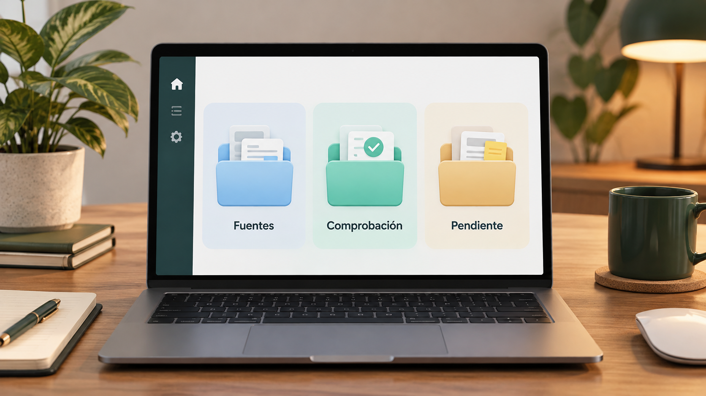

# Organización de datos y decisiones en una aplicación financiera privada

**Estado:** borrador local para revisión. **Versión:** 2026-10-14-v4. **Fecha de redacción:** 2026-10-14. No publicado ni aprobado para subir.

## TL;DR

*Ilustración conceptual generada con IA; no es una captura ni prueba de uso.*

- **Propósito:** Reunir información financiera sin confundir fuentes, saldos, movimientos y decisiones.
- **Aportación y enfoque:** Javier define necesidades y reglas de uso privado; la construcción y revisión usan asistencia de IA.
- **Trabajo y evidencia:** Código, documentación e importaciones de una aplicación privada; despliegue y capacidades no verificados íntegramente aquí.
- **Resultados y límites:** Una conexión pendiente no acredita sincronización. Falta comprobar procedencia y persistencia; cuentas, saldos y registros no se exponen en la tesis pública.

## Punto de partida y pregunta de esta línea

La aplicación plantea cómo reunir información de distintas fuentes financieras y evitar confundir saldos, movimientos, compromisos y decisiones. El problema de diseño es conservar la procedencia del dato, identificar lo que falta y permitir correcciones sin duplicar información. Esta tesis no expone la situación económica del propietario ni recomienda activos o acciones sobre su patrimonio.

## Origen y propósito

La documentación disponible permite describir esta línea, pero no reconstruye de forma confirmada qué observación, publicación o experiencia la inició. El punto de partida puede ser una idea, una hipótesis, una aplicación o una práctica con herramientas; no se presupone que exista un problema que resolver. Si se recupera una referencia de origen, se distinguirán lo que plantea esa fuente y la adaptación realizada por Javier.

## Enfoque del proyecto y propuesta de esta versión

El enfoque consiste en separar captura, normalización, comprobación y presentación. Una actualización debería distinguir lo leído en una fuente de lo estimado o declarado por el usuario. Las conexiones y automatizaciones deben indicar qué hacen y qué queda sin persistir. Javier aporta las necesidades y reglas de uso privado; las herramientas de IA apoyan construcción y revisión. El diseño necesita registrar cambios sin convertir una demostración en datos económicos reales.

## Desarrollo y evidencia disponible

Existe código, documentación y materiales de trabajo de una aplicación privada. Las capacidades declaradas en README no se han verificado íntegramente en esta fase ni se ha comprobado el despliegue actual. El inventario identifica registros e importaciones que se mantienen fuera del dossier. La tesis resume una línea de diseño de información, sin publicar ejemplos procedentes de cuentas o presentar conexiones pendientes como sincronización efectiva.

## Preguntas y límites que permanecen abiertos

Una actualización visible puede no estar guardada o corresponder a una fuente anterior. La suma de importes puede duplicar operaciones si no hay identificadores y reglas de conciliación. El historial y las credenciales de conexión deben permanecer separados del contenido público. Las estimaciones fiscales o de rentabilidad necesitan sus bases y no se validan mediante la interfaz. Los registros privados no se utilizan aquí como ejemplos de cartera.

## Cómo podría comprobarse

Se propone evaluar la aplicación con un conjunto ficticio que contenga operaciones repetidas, cambios, fuentes incompletas y correcciones. Cada cálculo debería poder rastrearse hasta su entrada. La persistencia se comprobaría después de recargar y no solo tras pulsar guardar. Los cambios de reglas, herramientas y modelos se registrarían por versión. Las pruebas de un flujo no acreditarían todas las conexiones o decisiones financieras.

## Separar una operación, un estado y una decisión

La documentación de la aplicación reúne información de patrimonio, historial y reglas de uso. Esta versión propone organizar la explicación con tres objetos. Una operación describe un evento registrado; un estado resume información para una fecha; una decisión recoge un criterio adoptado por la persona. Como ejemplo ficticio, una transferencia entre dos registros propios podría generar varias entradas sin representar varias aportaciones nuevas. La aplicación tendría que conservar esa relación antes de calcular una suma. No se utiliza una transferencia real del propietario.

La distinción también serviría para separar una cantidad leída en una fuente de una estimación o de un objetivo. Mostrar esos objetos en una misma pantalla no los hace equivalentes. La propuesta de diseño indicaría tipo de dato, procedencia y fecha junto a cada resultado relevante. El README acredita que estas cuestiones forman parte del trabajo documental; esta preparación no comprueba todas las vistas ni considera implantado este diseño por describirlo aquí.

## Un recorrido de importación que permita detectar duplicados

El flujo propuesto empezaría conservando una entrada identificada y su origen, y produciría un registro normalizado sin borrar la fuente. Se definiría qué campos permiten relacionar dos lecturas del mismo evento. La coincidencia de cantidad o fecha no debería convertirse automáticamente en identidad: se establecería una regla explícita y se registrarían casos dudosos. La información necesaria para esa relación permanecería en el entorno privado. La ficha pública utilizaría identificadores ficticios sin vínculo con cuentas.

Una prueba propuesta repetiría la misma importación y después añadiría una versión corregida de una entrada. El resultado esperado se definiría antes: conservar un único evento cuando procede, identificar la corrección y explicar qué cambia en los cálculos. Si el criterio no permite resolver una coincidencia, el sistema debería mantenerla pendiente en vez de atribuir certeza. Este recorrido describe cómo comprobar una parte de la aplicación, no un ensayo ya ejecutado sobre sus datos o conectores actuales.

## Persistencia y actualización necesitan evidencias distintas

La continuación del análisis distinguiría leer una fuente, transformar el dato, guardarlo y recuperarlo después. Una pantalla que muestra el resultado de una lectura no demuestra que ese resultado se haya almacenado. Para comprobar persistencia se propone guardar un conjunto ficticio, cerrar o recargar la vista pertinente y consultar de nuevo el registro, conservando las condiciones del ensayo. El comportamiento de ese caso no acreditaría el de todas las importaciones.

También se especificaría qué ocurre si una actualización falla a mitad del recorrido. La fecha del último dato confirmado debería seguir siendo identificable, y el fallo no se presentaría como un saldo actualizado. Una corrección podría modificar una entrada o una regla; el registro distinguiría ambos cambios. La propuesta busca que una explicación de continuidad se apoye en evidencia de cada etapa. No se accede aquí a proveedores, credenciales o al despliegue para comprobar una sincronización real.

## Una muestra de interfaz puede explicar la incertidumbre

Para el portfolio se propone una muestra completamente ficticia con un dato confirmado, otro estimado y una conciliación pendiente. La tarea de observación sería comprobar si quien la consulta reconoce esas diferencias y puede localizar la procedencia de un cálculo. La muestra no utilizaría proporciones ni cantidades de la situación económica real. Tampoco se presentaría como evaluación profesional de decisiones financieras. Su función sería mostrar el diseño de información y sus límites.

Una pantalla adicional podría recorrer una discrepancia: entrada original, regla aplicada, resultado y explicación del punto sin resolver. La pregunta sería si el recorrido permite revisar el dato, sin presuponer que la interfaz actual ya lo hace. Se comprobarían comprensión y comportamiento por separado. La ayuda de IA quedaría atribuida a construcción o revisión concreta, evitando convertir la generación de una vista en programación autónoma o en verificación de la información presentada.

## Qué avance mostraría una versión posterior

La evidencia disponible es código y documentación de una aplicación privada. Esta ampliación desarrolla un método de explicación y prueba, propuesto por el asistente para revisión de Javier. No acredita saldos correctos, conectores operativos ni uso continuo de todas las funciones. El contenido reservado de la aplicación queda en el repositorio privado propuesto; la tesis pública candidata puede describir estos recorridos al nivel de detalle autorizado.

Un siguiente hito podría recuperar un ensayo con datos ficticios o añadir una regla de conciliación comprobada. La versión indicaría qué pregunta se resolvió, qué entorno se utilizó y qué herramientas intervinieron realmente. El historial conservaría tanto la corrección del dato como la de una regla cuando correspondan. La fecha de esta redacción no se utiliza para reconstruir el comienzo de la idea ni el modelo de intervenciones antiguas que no tengan evidencia.

## Procedencia de las posiciones

Síntesis del propósito y la estructura privada de la aplicación; criterios de prueba propuestos por esta redacción. El texto es una síntesis asistida por IA y requiere la revisión de Javier antes de atribuirle nuevas formulaciones. Se describen procesos y condiciones, sin juicios de valor ni atribuciones de intenciones.

## Fechas, versiones y cambios

Primera referencia temporal utilizada: no confirmada. El inicio real y las fechas de cada aportación histórica no están reconstruidos. La fecha del archivo no sustituye la fecha de la idea.

Se añaden los desarrollos: Separar una operación, un estado y una decisión; Un recorrido de importación que permita detectar duplicados; Persistencia y actualización necesitan evidencias distintas; Una muestra de interfaz puede explicar la incertidumbre; Qué avance mostraría una versión posterior. Las propuestas nuevas se atribuyen al asistente y se registra el modelo de este turno sin alterar las atribuciones anteriores. No se incorporan resultados de pruebas nuevas. La edición no modifica las fuentes originales ni sus fechas.

## Herramientas y modelos

Imagen conceptual vigente, añadida el 2026-10-14: preparación e incorporación con Codex/OpenAI gpt-6.1-sol (metadatos del turno); generación y correcciones con image_gen de OpenAI, cuyo modelo exacto no consta. Sustituye el esquema anterior, conservado en el historial. Revisión independiente: gpt-6-astra.

Apoyo visual añadido el 2026-10-14: esquema original elaborado con Codex/OpenAI gpt-6.1-sol (metadatos del turno), Python 3.12.14 y ReportLab 4.4.9, exportado como SVG. Explica la idea del TL;DR; no representa una prueba o resultado nuevo. Revisión independiente de esta edición: gpt-6-astra; alcance documentado por separado. Compatibilidad tipográfica del SVG corregida en esta edición.

La redacción de esta versión utiliza Codex/OpenAI con el modelo gpt-6.1-sol. Su identificación consta en los metadatos del turno utilizado para esta edición; las atribuciones de versiones anteriores se conservan con su evidencia original. Se usaron Python para organización y comprobación local, y herramientas de lectura y edición de archivos. La revisión editorial independiente se encargó a un agente separado con gpt-6-astra; su alcance y resultado se registran fuera del dossier, sin equivaler a validación integral del proyecto. No se han configurado integraciones o actualización continua.

### Atribuciones históricas documentadas

No hay una atribución histórica exacta reconstruida para esta ficha. Las menciones a herramientas en las fuentes no se consideran prueba de uso.

## Fuentes y alcance de lectura

La base es la documentación interna identificada en el registro privado de fuentes de esta preparación. Se ha leído mediante extracción local y se han examinado fuentes y pasajes seleccionados; no es una auditoría sustantiva de todo el corpus. Las referencias externas de los antecedentes requieren verificación pertinente antes de reutilizar afirmaciones como hechos actuales. No se incluyen rutas privadas, documentos sensibles, conversaciones completas o material de terceros en este dossier.
