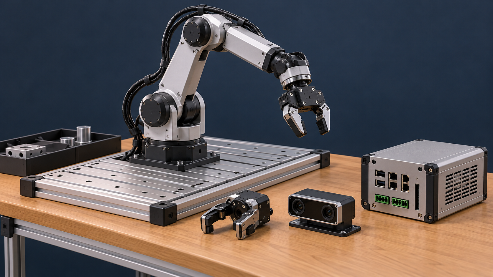

# Dependencias y cadena de valor en investigación sobre robótica

**Edición editorial:** 2026-11-07-editorial-r1. **Elaborada en UTC:** 2026-11-07T19:50:09.616232Z.

**Estado histórico declarado del contenido:** borrador local para revisión. **Versión histórica:** 2026-10-14-v5. **Fecha de redacción histórica declarada:** 2026-10-14. La fuente histórica estaba disponible públicamente en el commit consultado; su publicación no valida el contenido.

**Alcance de esta edición:** corrección administrativa del estado documental. El desarrollo y las atribuciones que siguen se reproducen de la [versión histórica](https://github.com/NovusMotus/portfolio-tesis/blob/2cd2acbd44ae01f98481e383af2368bce2973b43/finanzas/robotica-cadena-valor/TESIS.md); sus expresiones «esta versión» se refieren a aquella edición. Se conservan las fechas declaradas, los límites y las propuestas, sin añadir logros ni reconstruir el inicio de la idea. La disponibilidad de esta edición se comprueba en el repositorio y en la PR que la incorpore.

**Aporte editorial:** Codex desktop / OpenAI / gpt-6.1-sol; transformación con Python 3.12.14. [Registro de esta versión](VERSION-2026-11-07-editorial-r1.json) · [Revisión editorial fechada](../../REVISION_EDITORIAL_2026-11-07-r1.json).

## TL;DR

*Ilustración conceptual generada con IA; no es una captura ni prueba de uso.*

- **Propósito:** Investigar componentes, integraciones y dependencias dentro de sistemas robóticos.
- **Aportación y enfoque:** El asistente propone mapear funciones y sustitutos en un sistema ficticio; no atribuye construcción de un robot a Javier.
- **Trabajo y evidencia:** Informe de empresas y componentes conservado, con pasajes seleccionados leídos.
- **Resultados y límites:** No se acredita exclusividad de piezas ni integración real. Falta identificar versiones y compatibilidad; catálogo alternativo no demuestra sustitución efectiva.

## Punto de partida y pregunta de esta línea

El informe antecedente explora empresas y componentes vinculados a robótica. La ficha estudia cómo pasar de una referencia tecnológica a un mapa de funciones, relaciones y alternativas documentadas. No adopta las etiquetas de monopolio o las selecciones del informe como hechos comprobados. La cuestión es qué evidencia permitiría describir una dependencia para un caso concreto, sin inferir rendimiento financiero de la importancia atribuida a una tecnología.

## Origen y propósito

La documentación disponible permite describir esta línea, pero no reconstruye de forma confirmada qué observación, publicación o experiencia la inició. El punto de partida puede ser una idea, una hipótesis, una aplicación o una práctica con herramientas; no se presupone que exista un problema que resolver. Si se recupera una referencia de origen, se distinguirán lo que plantea esa fuente y la adaptación realizada por Javier.

## Enfoque del proyecto y propuesta de esta versión

El enfoque editorial propuesto es comparar componentes, integraciones, sustitutos, acceso a clientes y documentos de las actividades. Para cada variable habría que especificar qué dato se busca, qué fuente podría acreditarlo y qué decisión depende de él. Las alternativas deben referirse a la misma tarea y condiciones, para que una diferencia no proceda solo de comparar productos o situaciones distintos. Este método se ofrece como ayuda para desarrollar el dossier: Javier revisará qué parte corresponde a su enfoque y qué propuestas nuevas desea conservar.

## Desarrollo y evidencia disponible

Existe un informe de investigación conservado en la carpeta de trabajo. En esta fase se ha leído mediante extracción local y se han inspeccionado pasajes seleccionados; no se ha revalidado su bibliografía completa ni reproducido todas las comprobaciones que declara. El dossier es una síntesis inicial del problema y de cómo investigarlo. No acredita una actividad comercial, candidatura, inversión o implantación por la existencia de ese informe. Los datos personales y proyecciones del documento permanecen privados.

## Preguntas y límites que permanecen abiertos

Los datos pueden depender de una fecha, un producto o una muestra concreta. Una página comercial describe lo que declara su proveedor y no aporta por sí sola prueba de demanda, funcionamiento o resultado. Los cálculos necesitan entradas y supuestos identificados. Una fuente no localizada no demuestra que una actividad no exista. Las afirmaciones jurídicas, fiscales, médicas o de rendimiento requieren verificación pertinente antes de presentarse en una edición pública como hechos.

## Cómo podría comprobarse

El siguiente contraste propuesto es un mapa de dependencias con fuentes, alternativas y límites de la inferencia; sin cifras de cartera o recomendaciones. La prueba debe registrar condiciones, fuentes y criterios de comparación antes de interpretar el resultado. Si faltan datos, se mantiene la pregunta abierta y se indica qué cambiaría la decisión. Las versiones posteriores explicarán qué se añadió, corrigió o retiró y qué herramienta o modelo intervino. Ninguna prueba futura se describe en esta ficha como ejecutada.

## Del sistema robótico a sus funciones y relaciones

El antecedente recoge una búsqueda por componentes y empresas. Para continuarla se propone empezar por un sistema ficticio con funciones definidas: recibir información, procesarla y realizar una acción. Después se identificarían los elementos necesarios para esas funciones y la relación entre ellos. El ejemplo no describe un producto comercial validado ni un equipo construido. Su propósito sería distinguir una categoría tecnológica de una pieza identificada dentro de una aplicación.

Cada relación del mapa tendría su propia pregunta: qué aporta el elemento, cómo se integra y qué documentación sostiene la descripción. Un nombre conocido de proveedor no sustituiría esa evidencia. Si el informe menciona una categoría de componente, se conservaría ese alcance en vez de atribuirla a todos los productos de una empresa. La nueva estructura es una propuesta del asistente para ordenar la investigación; no reconstruye contratos de suministro ni relaciones comerciales que no estén documentadas.

## Documentar una dependencia sin asumir exclusividad

La comparación propuesta preguntaría si existen alternativas identificadas para la misma función y qué condiciones exige sustituir un elemento. Se distinguirían compatibilidad declarada, integración observada y ausencia de información. No localizar un sustituto durante una búsqueda no demostraría que no exista. De igual modo, encontrar un catálogo alternativo no demostraría que permita sustituir una pieza en el sistema estudiado. El mapa conservaría ambas limitaciones.

El término dependencia se utilizaría para una relación definida y sustentada, sin convertirlo automáticamente en poder de mercado. La ficha no calcula cuotas, barreras o exclusividad de empresas reales y no adopta las etiquetas del antecedente. Una afirmación de ese tipo necesitaría alcance de mercado y evidencia propios. Aquí se propone identificar qué información podría resolver la relación técnica y qué parte de una inferencia más amplia sigue pendiente, evitando trasladar conclusiones entre planos distintos.

## Separar tecnología, actividad de empresa e inversión

La investigación se organizaría en tres preguntas: qué función tecnológica se estudia, qué actividad documentada realiza una empresa y qué hipótesis financiera se ha planteado. La evidencia de una no se utilizaría como demostración automática de las otras. Un componente relevante en el ejemplo ficticio no acredita que un proveedor concreto reciba pedidos, aumente sus resultados o ofrezca una inversión adecuada. Esta tesis no selecciona activos ni publica datos de cartera.

La ficha de evidencia podría vincular un documento de producto a su afirmación concreta y un documento de actividad a otra distinta. Se conservaría fecha, versión y limitaciones de ambas referencias. Si una noticia inspira la exploración, se identificaría lo que dice y la adaptación de Javier cuando exista fuente; no se inventa aquí esa referencia inicial. Los cálculos y selecciones de informes anteriores permanecen como antecedentes sin revalidación completa, no como una recomendación vigente.

## Cómo contrastar un mapa con un caso definido

La prueba propuesta recorrería una función del sistema ficticio y dos alternativas documentables. Se observaría qué entradas necesita cada una, qué integración declara y qué cambia en el recorrido. Antes de comparar, se fijaría el uso y el alcance del contraste. Una alternativa con información insuficiente quedaría pendiente, sin recibir una etiqueta concluyente. El ensayo no se ha ejecutado y no verifica compatibilidad de productos reales.

También se revisaría qué relaciones del mapa carecen de fuente o dependen de una inferencia. Esas relaciones podrían representarse con un estado explícito. Si se recupera documentación nueva, la siguiente versión indicaría qué enlace cambia y por qué. El resultado útil sería un mapa revisable con preguntas identificadas, no una clasificación absoluta de empresas. Esta separación permite explicar investigación tecnológica dentro del ámbito financiero sin convertir un gráfico de dependencias en una predicción sobre precios o rendimientos.

## Aportación y límites de la línea de investigación

La evidencia disponible es un informe que reúne referencias y propuestas, leído en estructura y pasajes seleccionados. La ampliación desarrolla un método para revisar funciones, relaciones y saltos de inferencia. Los ejemplos y criterios añadidos pertenecen al asistente y requieren revisión de Javier. No se presentan verificación de todo el sector, cuota de mercado acreditada ni resultados de una inversión.

Una actualización podría recuperar la publicación de origen, delimitar una función o corregir un enlace del mapa. El historial conservaría qué dato se añadió y qué conclusión dejó de sostenerse, con fecha y herramienta utilizada. La tesis pública candidata no necesitaría mostrar cantidades privadas para explicar ese proceso. Puede reflejar cómo una referencia sobre robótica conduce a investigar componentes y alternativas, manteniendo separadas la curiosidad tecnológica y cualquier decisión patrimonial que no forma parte de este dossier.

## Procedencia de las posiciones

Pregunta derivada del tema del informe; método de contraste propuesto por el asistente, pendiente de aceptación o modificación por Javier. El texto es una síntesis asistida por IA y requiere la revisión de Javier antes de atribuirle nuevas formulaciones. Se describen procesos y condiciones, sin juicios de valor ni atribuciones de intenciones.

## Fechas, versiones y cambios

Referencia temporal del antecedente: 23 de septiembre de 2026, según la fecha declarada en el documento original. Esa fecha no acredita el inicio de la idea ni la ejecución o verificación de las operaciones que describe; no se utiliza mtime como fecha de autoría.

Se añaden los desarrollos: Del sistema robótico a sus funciones y relaciones; Documentar una dependencia sin asumir exclusividad; Separar tecnología, actividad de empresa e inversión; Cómo contrastar un mapa con un caso definido; Aportación y límites de la línea de investigación. Las propuestas nuevas se atribuyen al asistente y se registra el modelo de este turno sin alterar las atribuciones anteriores. No se incorporan resultados de pruebas nuevas. La edición no modifica las fuentes originales ni sus fechas.

## Herramientas y modelos

Imagen conceptual vigente, añadida el 2026-10-14: preparación e incorporación con Codex/OpenAI gpt-6.1-sol (metadatos del turno); generación y correcciones con image_gen de OpenAI, cuyo modelo exacto no consta. Sustituye el esquema anterior, conservado en el historial. Revisión independiente: gpt-6-astra.

Apoyo visual añadido el 2026-10-14: esquema original elaborado con Codex/OpenAI gpt-6.1-sol (metadatos del turno), Python 3.12.14 y ReportLab 4.4.9, exportado como SVG. Explica la idea del TL;DR; no representa una prueba o resultado nuevo. Revisión independiente de esta edición: gpt-6-astra; alcance documentado por separado. Compatibilidad tipográfica del SVG corregida en esta edición.

La redacción anterior se preparó con Codex/OpenAI gpt-6.1-sol. La revisión y las correcciones de esta versión, fechadas el 2026-10-14, utilizan Codex/OpenAI gpt-6-astra, identificado en los metadatos del turno. Las atribuciones y versiones anteriores se conservan con su evidencia original. Se usaron Python para organización y comprobación local, y herramientas de lectura y edición de archivos. La revisión editorial independiente se encargó a un agente separado con gpt-6-astra; su alcance y resultado se registran fuera del dossier, sin equivaler a validación integral del proyecto. No se han configurado integraciones o actualización continua.

### Atribuciones históricas documentadas

No hay una atribución histórica exacta reconstruida para esta ficha. Las menciones a herramientas en las fuentes no se consideran prueba de uso.

## Fuentes y alcance de lectura

La base es la documentación interna identificada en el registro privado de fuentes de esta preparación. Se ha leído mediante extracción local y se han examinado fuentes y pasajes seleccionados; no es una auditoría sustantiva de todo el corpus. Las referencias externas de los antecedentes requieren verificación pertinente antes de reutilizar afirmaciones como hechos actuales. No se incluyen rutas privadas, documentos sensibles, conversaciones completas o material de terceros en este dossier.
