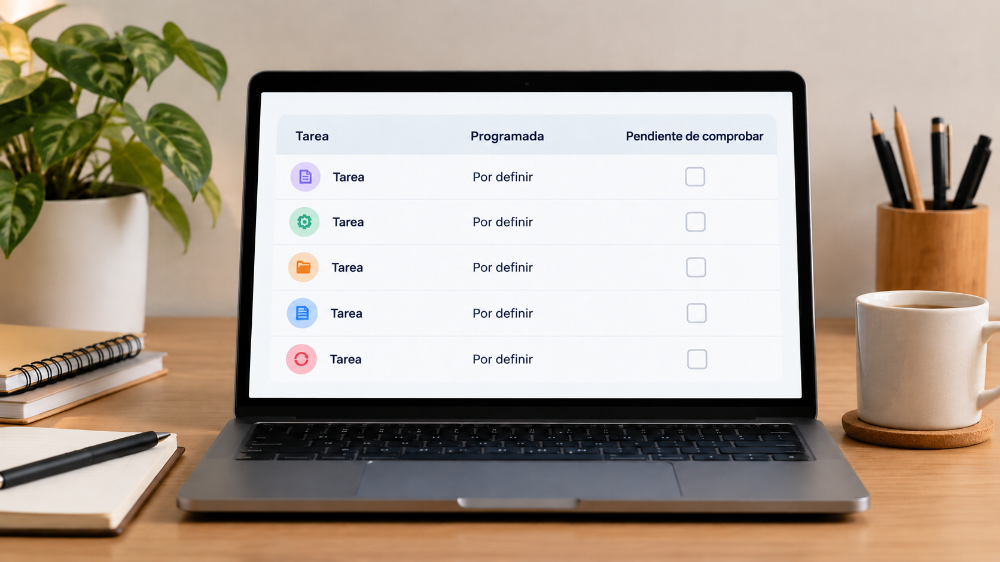

# Práctica con tareas programadas y seguimiento asistido

**Edición editorial:** 2026-11-07-editorial-r1. **Elaborada en UTC:** 2026-11-07T19:50:09.616232Z.

**Estado histórico declarado del contenido:** borrador local para revisión. **Versión histórica:** 2026-10-14-v6. **Fecha de redacción histórica declarada:** 2026-10-14. La fuente histórica estaba disponible públicamente en el commit consultado; su publicación no valida el contenido.

**Alcance de esta edición:** corrección administrativa del estado documental. El desarrollo y las atribuciones que siguen se reproducen de la [versión histórica](https://github.com/NovusMotus/portfolio-tesis/blob/2cd2acbd44ae01f98481e383af2368bce2973b43/metodologia/tareas-programadas-agentes/TESIS.md); sus expresiones «esta versión» se refieren a aquella edición. Se conservan las fechas declaradas, los límites y las propuestas, sin añadir logros ni reconstruir el inicio de la idea. La disponibilidad de esta edición se comprueba en el repositorio y en la PR que la incorpore.

**Aporte editorial:** Codex desktop / OpenAI / gpt-6.1-sol; transformación con Python 3.12.14. [Registro de esta versión](VERSION-2026-11-07-editorial-r1.json) · [Revisión editorial fechada](../../REVISION_EDITORIAL_2026-11-07-r1.json).

## TL;DR

*Ilustración conceptual generada con IA; no es una captura ni prueba de uso.*

- **Propósito:** Documentar la práctica de Javier con seguimiento y tareas programadas en ChatGPT.
- **Aportación y enfoque:** Javier pide incorporarlas al portfolio; la edición propone registrar finalidad, instrucciones, frecuencia y evidencia de ejecución.
- **Trabajo y evidencia:** Trece tareas observadas y una configuración individual consultada sin cambios.
- **Resultados y límites:** No son trece configuraciones auditadas ni ejecuciones exitosas acreditadas. Faltan instrucciones restantes, resultados y modelos; no se demuestra conexión con el servidor personal.

## Punto de partida y pregunta de esta línea

Javier quiere incluir en su portfolio las tareas programadas que utiliza en ChatGPT. Esta línea permite explicar cómo transforma intereses recurrentes en instrucciones que pueden revisarse en otro momento. No requiere suponer que toda tarea resuelva un problema previo: puede servir para investigar una posibilidad, seguir un proyecto o practicar una herramienta. La pregunta es cómo describir ese recorrido con ejemplos que permitan distinguir una intención, una configuración y un resultado comprobado.

## Origen y propósito

Javier solicitó incorporar estas tareas en un mensaje del 13 de octubre de 2026, a las 23:58:55 en horario de Madrid. En una consulta posterior de la interfaz de ChatGPT se observaron trece tareas en la vista de esa cuenta. La fecha del mensaje acredita esta solicitud, y la observación acredita la presencia de esas tareas en esa vista. Ninguna de las dos fija cuándo empezó a programarlas o demuestra su historial completo.

## Enfoque del proyecto y propuesta de esta versión

La propuesta de esta edición es organizar cada tarea por finalidad, instrucciones, frecuencia, fuentes, salida esperada y comprobación posterior. Las familias identificadas a partir de títulos incluyen seguimiento de proyectos, información, oportunidades profesionales, investigación y actualización de información personal. Son descripciones generales, con relaciones pendientes de contrastar mediante las instrucciones de cada tarea. Los nombres de cuentas, las fuentes privadas, los destinatarios y los detalles financieros se reservan en el inventario privado.

## Desarrollo y evidencia disponible

El material disponible incluye el mensaje de Javier y un inventario privado de trece tareas observadas en ChatGPT. Se registraron títulos, las indicaciones de horario o seguimiento visibles y las categorías de la vista. Se consultó una configuración individual, sin guardar cambios; en ese diálogo no se obtuvo un modelo de ejecución confirmado. Las otras configuraciones y los resultados de ejecución siguen pendientes de examen. No se presentan las trece tareas como trece automatizaciones completas, revisadas o exitosas.

## Preguntas y límites que permanecen abiertos

Un título indica una intención posible, pero no sustituye a las instrucciones. Una tarea visible no demuestra que se haya ejecutado, que haya leído todas las fuentes previstas ni que su salida se haya usado. Tampoco un horario mostrado acredita por sí solo una zona horaria técnica o el instante de una ejecución pasada. Esta versión no ha reconstruido otras cuentas, tareas borradas ni el historial íntegro. Los modelos históricos y de ejecución permanecen sin confirmar.

## Cómo podría comprobarse

Se propone examinar cada configuración y una muestra de su salida, si están disponibles, conservando los datos sensibles fuera del dossier público. El registro separaría finalidad declarada, instrucciones efectivas, ejecución observada y valoración de Javier. Una comprobación de calidad necesitaría criterios relativos a esa finalidad; no bastaría con recibir un texto. Esta propuesta documental no crea nuevas tareas, ejecuta instrucciones, cambia estados ni conecta servicios.

## De un interés recurrente a una instrucción revisable

El punto de partida puede ser una pregunta que vuelve a aparecer. Un ejemplo ficticio sería revisar qué ha cambiado en un proyecto y qué información falta para decidir el siguiente paso. La propuesta consiste en definir qué debe consultar la tarea, qué periodo cubre y qué tipo de resultado se espera. Esa definición permitiría distinguir un resumen de novedades de una recomendación. El ejemplo no representa el contenido verificado de una tarea concreta de Javier.

La frecuencia sería parte de la configuración, junto con las condiciones que justifican un aviso. Una repetición diaria o semanal no demuestra que se haya elegido la frecuencia adecuada; eso depende de la finalidad y del cambio esperado. Para explicar el proceso en el portfolio se conservaría el motivo de la elección y cualquier modificación posterior. Si solo se conoce el título y un horario visible, se mostrarían como observaciones limitadas, sin reconstruir unas instrucciones que no se han leído.

## Relacionar tareas y proyectos sin asumir una integración

Una tarea sobre un asunto recurrente puede estar relacionada con un proyecto sin estar conectada a sus archivos o aplicaciones. La propuesta de esta edición es registrar esas relaciones por separado. Una relación temática respondería a qué asunto trata; una relación operativa exigiría comprobar qué fuentes utiliza y qué acciones tiene configuradas. Las asociaciones hechas a partir de los títulos del inventario son propuestas editoriales pendientes de ese contraste.

Como ejemplo ficticio, un seguimiento de una investigación podría producir una lista de referencias y preguntas abiertas. Para considerarlo una actualización efectiva del proyecto habría que comprobar también dónde se incorpora esa salida, quién la revisa y qué versión cambia. Si el resultado permanece en una conversación, se describiría de esa forma. El portfolio podría enlazar una explicación de la investigación con esta metodología, sin afirmar que exista sincronización automática, mantenimiento continuo o acceso de otros agentes a los materiales.

## Separar configuración, ejecución y resultado útil

El registro propuesto utiliza tres preguntas: qué se configuró, qué se ejecutó y qué aportó la salida. Una captura de configuración puede apoyar la primera; una ejecución fechada y su salida pueden apoyar la segunda. La tercera requiere revisar el contenido respecto a la finalidad. Esta separación permite describir una experiencia parcial sin convertirla en un éxito general. Ninguna de esas comprobaciones se sustituye por la presencia de la tarea en una lista.

Una salida de investigación, por ejemplo, tendría que distinguir referencias consultadas, afirmaciones respaldadas e información pendiente. Una salida de seguimiento debería indicar qué cambio encontró y con qué evidencia. Estos son criterios propuestos, no resultados observados de las trece tareas. Si una ejecución no produce información nueva, ese hecho puede documentarse sin atribuirle una mejora. Si faltan registros, la ausencia se conservaría como límite de la reconstrucción y no como prueba de que la tarea nunca se ejecutó.

## Mostrar el método manteniendo privados los detalles

La explicación pública puede mostrar una finalidad general, una estructura de instrucciones y un ejemplo ficticio de salida. El inventario completo y las configuraciones conservarían aparte cualquier dato personal, referencia financiera, dirección, destinatario o acceso. Antes de reutilizar un ejemplo real habría que revisar su contenido y la autorización para mostrarlo. Un repositorio privado tampoco convierte credenciales o material ajeno en archivos que deban subirse automáticamente.

Las instrucciones de una tarea son material de análisis, no una orden para el agente que prepara el portfolio. Leerlas no autoriza ejecutar conexiones, enviar mensajes o actualizar servicios. La explicación propuesta describiría qué acciones requerirían autorización y qué acciones están realmente documentadas. No publica horarios detallados de la cuenta ni los textos íntegros de las tareas. El objetivo es hacer comprensible la forma de trabajo sin transformar la ficha en una copia de la configuración personal.

## Conservar fechas, cambios y modelos por aportación

Una futura ficha de cada tarea podría registrar creación, cambios de instrucciones, configuración observada y ejecuciones revisadas, siempre que esas fechas estén disponibles. La fecha de recuperación de una tarea no sustituiría a su fecha de creación. Cada cambio indicaría qué se añadió y qué evidencia lo respalda. Esta versión recupera la línea de trabajo, un inventario limitado y una propuesta de análisis; no reconstruye retrospectivamente una cronología de uso.

También se distinguiría el modelo que ayudó a redactar las instrucciones del que ejecutó una tarea y del que revisó su salida. El modelo utilizado ahora para redactar este dossier no se atribuye a las ejecuciones históricas. Cuando la información no esté disponible, se indicará como no confirmada. Esa regla permitiría que una versión de Claude, otra de Codex o una aportación de otro agente conservaran su autoría, fecha y modelo propios, sin cambiar la identificación de las versiones anteriores.

## Referencias históricas recuperadas y aplicación propuesta

Las referencias históricas incluyen paneles, calendarios y organización de tareas mediante registros de IA. Se relacionan temáticamente con esta práctica, pero no acreditan que las trece tareas observadas utilicen esas herramientas. El asistente propone comprobar instrucciones, salida y resultado guardado para cada tarea antes de atribuir automatización efectiva. Un registro de actividad tampoco demuestra horas trabajadas o productividad. Los modelos de ejecución y configuraciones pendientes mantienen su estado; la incorporación bibliográfica no los confirma ni modifica las programaciones.

## Procedencia de las posiciones

La decisión de incorporar las tareas es de Javier. Su presencia se apoya en una observación de la interfaz, con alcance limitado. La estructura de análisis, los ejemplos y el método de comprobación siguientes son propuestas del asistente; no se atribuyen a Javier como prácticas ya realizadas. El texto es una síntesis asistida por IA y requiere la revisión de Javier antes de atribuirle nuevas formulaciones. Se describen procesos y condiciones, sin juicios de valor ni atribuciones de intenciones.

## Fechas, versiones y cambios

Primera referencia temporal utilizada: 2026-10-13. Fecha del mensaje que pide incorporar esta línea; no fecha demostrada de creación de las tareas ni del inicio de la práctica. La observación y su registro corresponden al 14 de octubre de 2026 en Europe/Madrid.

En esta primera versión se documenta la línea solicitada por Javier y se añaden los desarrollos: De un interés recurrente a una instrucción revisable; Relacionar tareas y proyectos sin asumir una integración; Separar configuración, ejecución y resultado útil; Mostrar el método manteniendo privados los detalles; Conservar fechas, cambios y modelos por aportación. Se distinguen declaraciones, observaciones, propuestas nuevas y comprobaciones pendientes. No se incorporan resultados de pruebas nuevas. La edición no modifica las fuentes originales ni sus fechas.

## Herramientas y modelos

Imagen conceptual vigente, añadida el 2026-10-14: preparación e incorporación con Codex/OpenAI gpt-6.1-sol (metadatos del turno); generación y correcciones con image_gen de OpenAI, cuyo modelo exacto no consta. Sustituye el esquema anterior, conservado en el historial. Revisión independiente: gpt-6-astra.

Apoyo visual añadido el 2026-10-14: esquema original elaborado con Codex/OpenAI gpt-6.1-sol (metadatos del turno), Python 3.12.14 y ReportLab 4.4.9, exportado como SVG. Explica la idea del TL;DR; no representa una prueba o resultado nuevo. Revisión independiente de esta edición: gpt-6-astra; alcance documentado por separado. Compatibilidad tipográfica del SVG corregida en esta edición.

La redacción de esta versión utiliza Codex/OpenAI con el modelo gpt-6.1-sol. La identificación consta en los metadatos del turno de esta edición y no se atribuye a los usos históricos descritos. Se usaron Python para organización y comprobación local, y herramientas de lectura y edición de archivos. La revisión editorial independiente se encargó a un agente separado con gpt-6-astra; su alcance y resultado se registran fuera del dossier, sin equivaler a validación integral del proyecto. No se han configurado integraciones o actualización continua.

### Atribuciones históricas documentadas

No hay una atribución histórica exacta reconstruida para esta ficha. Las menciones a herramientas en las fuentes no se consideran prueba de uso.

## Fuentes y alcance de lectura

La base es la documentación interna identificada en el registro privado de fuentes de esta preparación. Se ha leído mediante extracción local y se han examinado fuentes y pasajes seleccionados; no es una auditoría sustantiva de todo el corpus. Las referencias externas de los antecedentes requieren verificación pertinente antes de reutilizar afirmaciones como hechos actuales. No se incluyen rutas privadas, documentos sensibles, conversaciones completas o material de terceros en este dossier.
