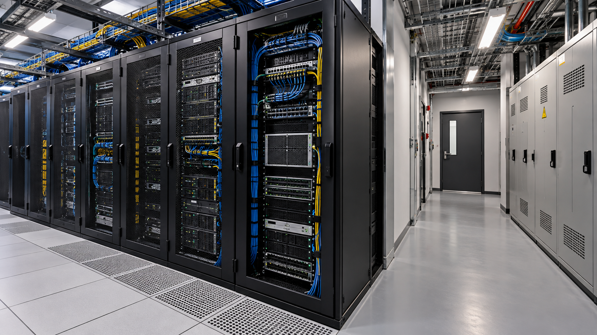

# Condiciones para estudiar un centro de datos o alojamiento de capacidad

**Estado:** borrador local para revisión. **Versión:** 2026-10-14-v6. **Fecha de redacción:** 2026-10-14. No publicado ni aprobado para subir.

## TL;DR

*Ilustración conceptual generada con IA; no es una captura ni prueba de uso.*

- **Propósito:** Comparar alquiler de suelo, alojamiento de equipos y capacidad propia como actividades distintas.
- **Aportación y enfoque:** Javier plantea vías de participación sin asumir construcción y explotación completas; separa uso del lugar, técnica y operación.
- **Trabajo y evidencia:** Estudios, consultas y anteproyecto conceptual, con incógnitas registradas.
- **Resultados y límites:** No son presupuesto, tasación ni viabilidad cerrada. Falta acreditar suministro, fibra, derechos, operador y financiación; los datos familiares permanecen privados.

## Punto de partida y pregunta de esta línea

La línea de investigación compara actividades que pueden parecer próximas —alquilar suelo, alojar equipos y ofrecer capacidad propia— pero requieren responsabilidades distintas. El problema es identificar qué condiciones de suministro, acceso, demanda y operación tendrían que conocerse antes de evaluar cada opción. La descripción de un emplazamiento o una tarifa de mercado no demuestra que una instalación sea viable.

## Origen y propósito

La documentación disponible permite describir esta línea, pero no reconstruye de forma confirmada qué observación, publicación o experiencia la inició. El punto de partida puede ser una idea, una hipótesis, una aplicación o una práctica con herramientas; no se presupone que exista un problema que resolver. Si se recupera una referencia de origen, se distinguirán lo que plantea esa fuente y la adaptación realizada por Javier.

## Enfoque del proyecto y propuesta de esta versión

El enfoque documentado separa derechos de uso, condiciones técnicas y modelo de operación. Javier plantea comparar vías de participación y no asumir automáticamente construcción y explotación completas. El análisis puede organizar requisitos verificables por opción: quién financia, quién opera, qué servicio se presta y qué dependencia tiene del lugar. Los datos familiares y de la propiedad concreta permanecen en las fuentes privadas y no se trasladan a esta ficha.

## Desarrollo y evidencia disponible

Existen estudios, preguntas pendientes, fuentes y un anteproyecto conceptual. Los documentos declaran que no son presupuesto, tasación o viabilidad cerrada. Un complemento posterior documenta un ensayo geométrico en el que algunas configuraciones no encajan en las reservas previstas bajo los supuestos ensayados. Ese límite afecta a esas configuraciones y no demuestra imposibilidad de otras soluciones. No se ha reproducido el cálculo en esta revisión ni validado la instalación completa. Las consultas registradas y los indicios públicos no acreditan potencia o fibra disponibles para la parcela, interés de un operador o financiación concedida. La tesis muestra el proceso de delimitar incógnitas sin convertir las hipótesis en una oferta de inversión.

## Preguntas y límites que permanecen abiertos

La disponibilidad provincial o de un punto de red no resuelve por sí sola un suministro específico. El rendimiento de una GPU no equivale a demanda contratada ni margen operativo. La recepción de una consulta no es respuesta técnica. Un cálculo de costes requiere condiciones y alcance definidos. Las normas y programas de financiación citados en antecedentes no se consideran vigentes o aplicables sin revisar sus requisitos actuales.

## Cómo podría comprobarse

Se propone una secuencia de comprobación antes de comprometer recursos: derechos y representación, suministro, conectividad, actividad admitida, operación y demanda accesible. Cada respuesta debería indicar fuente, fecha y condiciones. Las alternativas se compararían con escenarios y puntos de abandono explícitos. Esta preparación no abre expedientes, solicita presupuestos, contacta operadores o autoriza compras; esas actuaciones requieren un encargo distinto.

## Del emplazamiento a tres actividades diferentes

La comparación conservada en los estudios permite plantear una primera decisión: qué papel tendría Javier en la actividad. Alquilar un terreno, ofrecer espacio acondicionado para equipos y vender capacidad de cálculo son tres objetos de estudio. Para el primero habría que conocer las condiciones del uso y qué obligaciones asumiría cada parte. Para el segundo, el servicio se describiría mediante espacio, suministro, conectividad y tareas de operación acordadas. Para el tercero se añadirían equipos, software, acceso de usuarios, gestión de tareas y una forma de entregar capacidad utilizable. Ninguna de esas capas aparece demostrada solo por disponer de un lugar.

El desarrollo metodológico propuesto aquí consiste en escribir una ficha de responsabilidades por opción. Su utilidad sería identificar qué preguntas dependen realmente del emplazamiento y cuáles del servicio. Un mismo dato, como la potencia necesaria, puede cambiar según el número y la configuración de equipos o según quién los aporte. Comparar las tres opciones con una única cifra de inversión ocultaría esas diferencias. La elección de una opción tampoco demostraría que las otras estuvieran descartadas de forma definitiva: quedaría registrada como decisión condicionada por la información disponible.

## Una respuesta técnica debe corresponder al lugar estudiado

La investigación conserva búsquedas sobre suministros, conectividad y otros condicionantes del emplazamiento. El paso siguiente propuesto es convertir cada indicio en una pregunta específica. Una referencia municipal a fibra serviría para orientar la búsqueda, pero la pregunta de una instalación sería qué conexión puede entregarse en el punto concreto y bajo qué condiciones. De forma semejante, una tabla territorial sobre electricidad no sustituye la respuesta sobre un suministro determinado. El dato buscado se definiría antes de tomar una referencia general como solución.

La ficha de evidencia podría distinguir identificación del punto, solicitante autorizado, alcance de la consulta, respuesta recibida y vigencia de sus condiciones. También permitiría dejar preguntas sin resolver: una consulta enviada acredita ese envío, no disponibilidad; una respuesta preliminar puede depender de estudios posteriores. La ausencia de respuesta no demuestra imposibilidad técnica. Este registro evitaría que el mismo antecedente terminara presentado de tres maneras diferentes en un informe, un cálculo y una propuesta comercial. Aquí no se divulgan identificadores de propiedad, representación ni contactos de las fuentes privadas.

## Capacidad de cálculo y servicio que alguien podría utilizar

Si se estudiara ofrecer capacidad propia, el caso de uso tendría que preceder a la selección del equipo. Como ejemplo de investigación, podría definirse una tarea ficticia de cálculo con entrada, salida, duración admitida, software y condiciones de acceso. Con ella se compararía qué recursos requiere cada configuración. Es una propuesta de estudio, no una carga de trabajo contratada ni una prueba ya ejecutada. El rendimiento declarado de una tarjeta tampoco permite conocer por sí solo el uso que recibiría durante una semana.

El recorrido del servicio incluiría solicitud, disponibilidad, ejecución, entrega del resultado, atención de incidencias y cierre de acceso. Cada etapa plantea responsabilidades diferentes de las de arrendar un espacio. Los antecedentes sobre canales de capacidad pueden ayudar a formular preguntas sobre condiciones de participación; no acreditan admisión de una instalación concreta ni demanda futura. La explicación pública puede mostrar cómo se transforma una idea sobre infraestructura en una especificación de servicio, conservando como pendientes los datos técnicos y comerciales que todavía no existen.

## Comparar escenarios sin convertirlos en una previsión

La continuación propuesta usaría escenarios definidos por sus entradas: alcance de obras, recursos incluidos, tareas de operación, periodos de utilización y tratamiento de las interrupciones. Cambiar una entrada produciría un escenario nuevo, identificado por fecha y fuente. Los resultados de ese ejercicio serían consecuencias de supuestos, no un presupuesto o una oferta. La comparación debería incluir qué partidas quedan fuera; por ejemplo, estudiar equipos sin conocer la instalación necesaria no permite sumar ambos conceptos como si estuvieran cerrados.

Un criterio de avance posible sería disponer de información suficiente para comparar al menos dos alternativas con el mismo alcance. Un criterio para detener una alternativa sería que una condición indispensable siga sin una vía de comprobación proporcionada al estudio. Detenerla no equivale a declarar inviable el conjunto. La propuesta busca que las siguientes consultas resuelvan decisiones concretas y que Javier pueda explicar por qué conserva, modifica o aparca cada vía. No incorpora un compromiso de gasto ni una recomendación de inversión.

## Qué muestra esta investigación en el portfolio

La aportación documentada es una investigación que distingue activo, infraestructura y servicio, y organiza las dependencias entre ellos. Los estudios existentes y sus preguntas pendientes son la evidencia de trabajo disponible. No se presenta una instalación construida, una empresa operadora ni un cliente confirmado. Las matrices y el ejemplo de tarea añadidos en esta versión son propuestas del asistente para desarrollar el método, pendientes de aceptación de Javier.

Una actualización posterior podría incorporar una respuesta técnica, cambiar el alcance de una alternativa o retirar un supuesto. La versión explicaría qué decisión cambia y por qué, sin reproducir documentos privados completos. Así el portfolio permitiría observar la evolución del razonamiento aunque el proyecto permanezca en estudio. La fecha del documento conservado sigue siendo un hito documental; el origen exacto de la idea no se reconstruye a partir de ella.

## Uso de inmueble compartido y documentación pendiente

Esta sublínea estudia cómo relacionar una inversión en instalaciones con las condiciones de uso de un inmueble compartido. La comparación requiere documentación de derechos, valoración específica y acuerdos de las partes; no se presupone ninguno. Se mantienen como preguntas aportación económica, uso, mantenimiento y destino posterior de las mejoras. Son criterios de estudio propuestos por el asistente, no cláusulas aceptadas. El coste de una mejora no se utiliza como revalorización demostrada, y estudiar un centro de datos no concede disponibilidad sobre un inmueble ni autoriza trámites o inversiones.

## Procedencia de las posiciones

Comparación planteada en los estudios del proyecto; secuencia de comprobación sintetizada como propuesta. El texto es una síntesis asistida por IA y requiere la revisión de Javier antes de atribuirle nuevas formulaciones. Se describen procesos y condiciones, sin juicios de valor ni atribuciones de intenciones.

## Fechas, versiones y cambios

Primera referencia temporal utilizada: 2026-10-09. Fecha de referencia del estudio conservado; no inicio acreditado de toda la idea.

Se añaden los desarrollos: Del emplazamiento a tres actividades diferentes; Una respuesta técnica debe corresponder al lugar estudiado; Capacidad de cálculo y servicio que alguien podría utilizar; Comparar escenarios sin convertirlos en una previsión; Qué muestra esta investigación en el portfolio. Las propuestas nuevas se atribuyen al asistente y se registra el modelo de este turno sin alterar las atribuciones anteriores. No se incorporan resultados de pruebas nuevas. La edición no modifica las fuentes originales ni sus fechas.

## Herramientas y modelos

Imagen conceptual vigente, añadida el 2026-10-14: preparación e incorporación con Codex/OpenAI gpt-6.1-sol (metadatos del turno); generación y correcciones con image_gen de OpenAI, cuyo modelo exacto no consta. Sustituye el esquema anterior, conservado en el historial. Revisión independiente: gpt-6-astra.

Apoyo visual añadido el 2026-10-14: esquema original elaborado con Codex/OpenAI gpt-6.1-sol (metadatos del turno), Python 3.12.14 y ReportLab 4.4.9, exportado como SVG. Explica la idea del TL;DR; no representa una prueba o resultado nuevo. Revisión independiente de esta edición: gpt-6-astra; alcance documentado por separado. Compatibilidad tipográfica del SVG corregida en esta edición.

La redacción anterior se preparó con Codex/OpenAI gpt-6.1-sol. La revisión y las correcciones de esta versión, fechadas el 2026-10-14, utilizan Codex/OpenAI gpt-6-astra, identificado en los metadatos del turno. Las atribuciones y versiones anteriores se conservan con su evidencia original. Se usaron Python para organización y comprobación local, y herramientas de lectura y edición de archivos. La revisión editorial independiente se encargó a un agente separado con gpt-6-astra; su alcance y resultado se registran fuera del dossier, sin equivaler a validación integral del proyecto. No se han configurado integraciones o actualización continua.

### Atribuciones históricas documentadas

No hay una atribución histórica exacta reconstruida para esta ficha. Las menciones a herramientas en las fuentes no se consideran prueba de uso.

## Fuentes y alcance de lectura

La base es la documentación interna identificada en el registro privado de fuentes de esta preparación. Se ha leído mediante extracción local y se han examinado fuentes y pasajes seleccionados; no es una auditoría sustantiva de todo el corpus. Las referencias externas de los antecedentes requieren verificación pertinente antes de reutilizar afirmaciones como hechos actuales. No se incluyen rutas privadas, documentos sensibles, conversaciones completas o material de terceros en este dossier.
