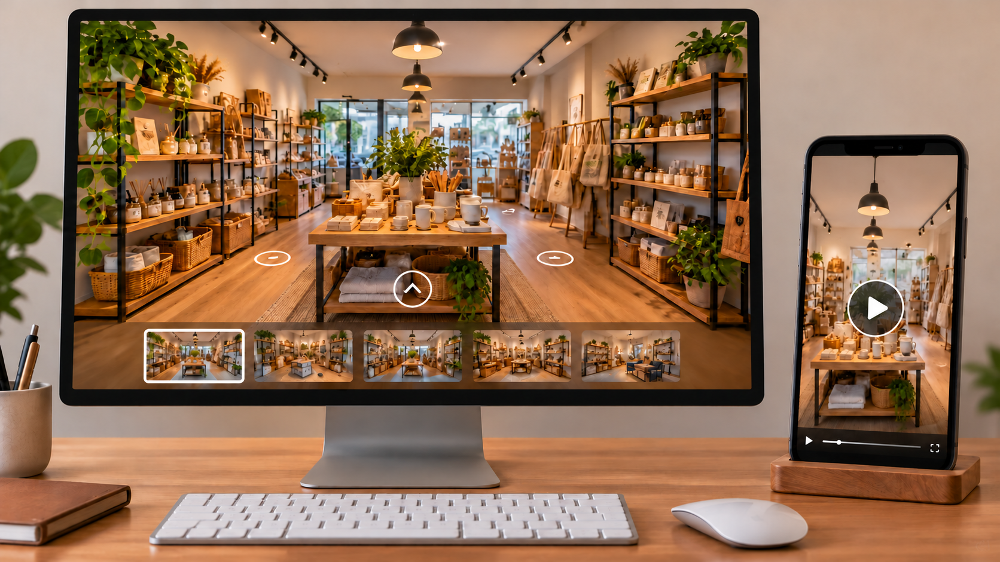

# Comercio local virtual y presentación audiovisual de un negocio

**Estado:** borrador local para revisión. **Versión:** 2026-10-14-v5. **Fecha de redacción:** 2026-10-14. No publicado ni aprobado para subir.

## TL;DR

*Ilustración conceptual generada con IA; no es una captura ni prueba de uso.*

- **Propósito:** Relacionar una representación digital de un negocio local con una presentación audiovisual.
- **Aportación y enfoque:** Javier propone esa conexión; el asistente distingue funciones de representación y vídeo para estudiar un piloto acotado.
- **Trabajo y evidencia:** Conversación con el concepto, recorrido del anfitrión y preguntas sobre apoyo.
- **Resultados y límites:** No hay negocios participantes, contratos, grabaciones finales o financiación acreditados. Falta definir utilidad, formato y permisos; nombres mencionados no equivalen a clientes.

## Punto de partida y pregunta de esta línea

Javier plantea conectar una representación digital de un negocio local con una pieza audiovisual de presentación. La idea puede estudiarse como aplicación de herramientas y como posible servicio, sin asumir que un comercio tenga un problema observado de visibilidad. La pregunta es qué recorrido permitiría conocer el entorno y la actividad, y cómo distinguir una demostración visual de un resultado útil para el negocio.

## Origen y propósito

La conversación del 10 de octubre de 2026 permite distinguir tres hitos, en horario Europe/Madrid: a las 01:13:48.695 Javier relaciona la conversación con su idea de entorno digital urbano; a las 01:22:42.103 describe publicidad de negocios mediante locales digitales y conexión a sus redes; a las 01:50:47.851 plantea el anfitrión, la entrada grabada al negocio y la transición audiovisual. Las fechas acreditan esos mensajes, no el inicio del proyecto urbano previo ni la primera publicación de la idea.

## Enfoque del proyecto y propuesta de esta versión

La propuesta de Javier relaciona representación digital y vídeo de presentación. Esta edición propone estudiar sus funciones por separado y después comprobar cómo se enlazan. La representación podría permitir explorar un lugar; la pieza audiovisual podría introducir quién ofrece una actividad y cómo acceder a ella. Se trata de usos a investigar, no de prestaciones validadas. La decisión sobre formato, alcance y finalidad sigue correspondiendo a Javier.

## Desarrollo y evidencia disponible

La conversación conserva el concepto, la descripción del recorrido del anfitrión y preguntas sobre un piloto y vías de apoyo. No acredita negocios participantes, contratos, permisos de imagen, grabaciones finales o financiación. La ficha no convierte nombres mencionados en clientes. Esta línea se mantiene relacionada con la exploración de entornos digitales, pero tiene una pregunta propia sobre presentación y conexión con un negocio.

## Preguntas y límites que permanecen abiertos

Una visualización puede mostrar un espacio sin permitir realizar una acción útil; habría que definir qué debería poder hacer quien la consulta. Una pieza atractiva no demuestra visitas o ventas. El uso de imagen, voz, espacios, contenido comercial y música requiere comprobar derechos y autorizaciones antes de producir o publicar una muestra real. Las ayudas citadas en antecedentes no se consideran concedidas, vigentes o aplicables por aparecer en la conversación.

## Cómo podría comprobarse

Se propone comenzar por una escena ficticia y un guion de recorrido, separando comprensión, navegación y acciones posteriores. Un piloto con un negocio exigiría un alcance y permisos definidos, además de una autorización específica. El registro distinguiría la función de cada pieza y las evidencias realmente obtenidas. La preparación actual no contacta negocios, graba personas, solicita ayudas ni publica contenidos.

## Precisar qué permite conocer y qué permite hacer

La representación digital se podría estudiar con dos preguntas. La primera sería qué información necesita una persona para comprender el lugar y la actividad. La segunda sería qué acción puede realizar después, si esa acción forma parte del alcance. Como ejemplo ficticio, podría explorar una entrada, localizar una descripción y encontrar una vía de consulta. No se afirma que exista hoy esa funcionalidad implementada ni que todos los negocios necesiten el mismo recorrido.

La pieza audiovisual tendría una ficha propia: a quién se dirige, qué presenta y cómo enlaza con la representación o con otra información. El recorrido del anfitrión planteado por Javier aporta una forma narrativa posible, pendiente de definir y probar. La comparación no empezaría atribuyendo ventajas al vídeo o al entorno digital; estudiaría si cada pieza cumple su función y si el paso entre ambas resulta comprensible. Las acciones comerciales, si se incluyeran, necesitarían su propia especificación y evidencia.

## Un guion permite probar la idea sin atribuir participantes

La propuesta de esta edición es elaborar primero un guion con un negocio ficticio y una escena creada para la muestra. Se describirían llegada, presentación, entrada y transición visual. Cada paso indicaría qué información aparece, qué recurso necesita y qué debería entender quien lo ve. El guion no representa una grabación realizada ni una aceptación de personas mencionadas en la conversación. Permite estudiar la estructura antes de utilizar imagen de un establecimiento real.

Si se utilizara una voz, un personaje o material generado con IA, se indicaría cómo se produjo y qué revisión recibió. No se presentaría una imagen sintética como un interior fotografiado ni una intervención generada como testimonio de una persona. La herramienta y el modelo quedarían registrados por aportación. La estética propuesta podría cambiar al comprobar comprensión o disponibilidad de recursos, sin que el cambio altere retrospectivamente lo que Javier describió en la conversación original.

## Preparar una muestra real exige delimitar el contenido

Una posible muestra con un negocio requeriría definir qué se presenta, dónde se utilizará y quién puede aprobar el contenido antes de publicarlo. La ficha de trabajo identificaría recursos necesarios y autorizaciones que deben comprobarse: espacios, imagen, voz, signos comerciales, música y otros elementos. Esta lista es una estructura propuesta para revisar derechos, no una afirmación jurídica sobre un material concreto. La preparación actual no presume permisos a partir de una relación personal o de información visible en internet.

También se definiría quién mantiene horarios, descripción y vías de contacto si esos datos se incluyen. Una escena puede conservar interés visual mientras la información práctica cambia; el estudio debería decidir qué contenido necesita fecha y revisión. Las fuentes privadas aportarían los datos autorizados para ese alcance, sin publicarse completas. No se incluyen contactos reales en el ejemplo. El método busca que una posible entrega pueda revisarse como un conjunto definido, en lugar de confundir una idea general con una publicación lista para usar.

## Separar comprensión, navegación y resultados posteriores

Un ensayo conceptual podría observar si una persona entiende qué actividad se presenta y cómo encontrar la información prevista. Otro podría estudiar el paso entre la pieza audiovisual y la representación. Los criterios se establecerían antes de interpretar las respuestas: tarea propuesta, recorrido y datos necesarios. La comprensión de una escena no demostraría visitas al negocio, y una visita al contenido no equivaldría a una consulta o compra. Esta versión no afirma que esos ensayos se hayan ejecutado.

Si hubiera autorización para un piloto posterior, se conservarían las condiciones del contenido y del periodo observado. Los resultados se atribuirían al alcance de esa prueba, sin convertirlos automáticamente en mejora comercial. La decisión de incluir una acción posterior, como una consulta, requeriría definir también su mantenimiento. El registro podría mostrar una parte que funciona y otra que sigue abierta. Ese resultado parcial sería información útil para cambiar el diseño, sin declarar validado todo el servicio.

## Del concepto a una entrega y una evolución documentadas

La posible entrega se describiría por piezas: guion, representación, vídeo, enlace y documentación de actualización, según el alcance que se elija. No se considera que todas sean necesarias ni que estén construidas. Un piloto y una vía de apoyo se estudiarían separadamente: el primero necesita una pregunta y unas condiciones de participación; la segunda requiere comprobar su situación y requisitos específicos. La existencia de preguntas sobre financiación en el antecedente no acredita concesión o elegibilidad.

La aportación actual es la recuperación de la idea de Javier y una estructura propuesta para desarrollarla. El portfolio puede mostrar cómo enlaza una observación sobre representación digital con una aplicación local y una forma de presentación. Una versión posterior añadiría el guion, una muestra o un contraste realmente efectuados con sus fechas y herramientas. Mientras no existan, la línea permanece como investigación y concepto, manteniendo privados los contactos y evitando atribuir relaciones comerciales.

## Procedencia de las posiciones

Concepto de enlace audiovisual y recorrido del anfitrión atribuidos a Javier según sus mensajes. La descomposición funcional, los ejemplos y los criterios de prueba son propuestas del asistente. El texto es una síntesis asistida por IA y requiere la revisión de Javier antes de atribuirle nuevas formulaciones. Se describen procesos y condiciones, sin juicios de valor ni atribuciones de intenciones.

## Fechas, versiones y cambios

Primera referencia temporal utilizada: 2026-10-10. Los hitos documentados se distinguen en Origen y propósito: alusión al entorno digital, publicidad de locales y recorrido audiovisual. No fijan el inicio de otros proyectos urbanos.

En esta primera versión se recuperan el origen y las propuestas de Javier; se añaden los desarrollos: Precisar qué permite conocer y qué permite hacer; Un guion permite probar la idea sin atribuir participantes; Preparar una muestra real exige delimitar el contenido; Separar comprensión, navegación y resultados posteriores; Del concepto a una entrega y una evolución documentadas. Se distinguen los ejemplos nuevos del asistente y las pruebas pendientes. No se incorporan resultados de pruebas nuevas. La edición no modifica las fuentes originales ni sus fechas.

## Herramientas y modelos

Revisión y correcciones de esta versión (2026-10-14): Codex/OpenAI gpt-6-astra, identificado en los metadatos del turno; revisión independiente por otro agente con gpt-6-astra. Se conservan las atribuciones históricas siguientes.

Imagen conceptual vigente, añadida el 2026-10-14: preparación e incorporación con Codex/OpenAI gpt-6.1-sol (metadatos del turno); generación y correcciones con image_gen de OpenAI, cuyo modelo exacto no consta. Sustituye el esquema anterior, conservado en el historial. Revisión independiente: gpt-6-astra.

Apoyo visual añadido el 2026-10-14: esquema original elaborado con Codex/OpenAI gpt-6.1-sol (metadatos del turno), Python 3.12.14 y ReportLab 4.4.9, exportado como SVG. Explica la idea del TL;DR; no representa una prueba o resultado nuevo. Revisión independiente de esta edición: gpt-6-astra; alcance documentado por separado. Compatibilidad tipográfica del SVG corregida en esta edición.

La redacción de esta versión utiliza Codex/OpenAI con el modelo gpt-6.1-sol. La identificación consta en los metadatos del turno de esta edición; no se hereda automáticamente para versiones futuras. Se usaron Python para organización y comprobación local, y herramientas de lectura y edición de archivos. La revisión editorial independiente se encargó a un agente separado con gpt-6-astra; su alcance y resultado se registran fuera del dossier, sin equivaler a validación integral del proyecto. No se han configurado integraciones o actualización continua.

### Atribuciones históricas documentadas

- Codex/OpenAI en la conversación original: gpt-6.1-sol. Modelo identificado en los metadatos turn_context de la conversación del 10 de octubre de 2026; corresponde a sus intervenciones, no a las herramientas externas mencionadas.

## Fuentes y alcance de lectura

La base es la documentación interna identificada en el registro privado de fuentes de esta preparación. Se ha leído mediante extracción local y se han examinado fuentes y pasajes seleccionados; no es una auditoría sustantiva de todo el corpus. Las referencias externas de los antecedentes requieren verificación pertinente antes de reutilizar afirmaciones como hechos actuales. No se incluyen rutas privadas, documentos sensibles, conversaciones completas o material de terceros en este dossier.
