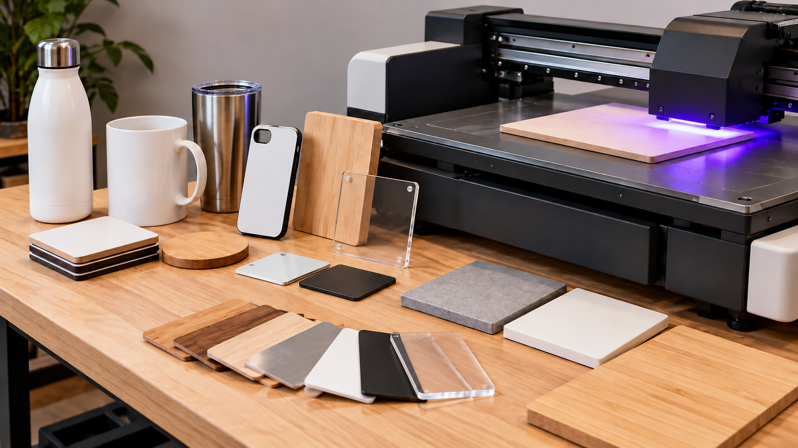

# Personalización con impresión UV y comparación de formas de servicio

**Estado:** borrador local para revisión. **Versión:** 2026-10-14-v6. **Fecha de redacción:** 2026-10-14. No publicado ni aprobado para subir.

## TL;DR

*Ilustración conceptual generada con IA; no es una captura ni prueba de uso.*

- **Propósito:** Explorar personalización y componentes, incluidos usos vinculados a juegos.
- **Aportación y enfoque:** Javier plantea entregar piezas que el destinatario monte y estudiar servicio o alquiler, sin asumir necesariamente montaje completo.
- **Trabajo y evidencia:** Conversación original recuperada con preguntas y variantes; el vídeo de origen se revisó solo en sus metadatos.
- **Resultados y límites:** No hay máquina comprada, ensayo físico, pedido ni acuerdo acreditados. Falta comprobar producción, seguridad, responsabilidades y derechos de diseños.

## Punto de partida y pregunta de esta línea

Javier comparte un vídeo y plantea estudiar posibles aplicaciones de personalización y prototipado. Entre las ideas de la conversación aparecen componentes de juegos e ideas de otras personas. El propósito es investigar qué se podría ofrecer y cómo organizarlo, sin suponer un problema previo en un cliente. La exploración reúne producto, servicio y posible alquiler de equipo; no hay una compra o modalidad comercial confirmadas.

## Origen y propósito

La referencia de origen conservada es un [vídeo de YouTube](https://www.youtube.com/watch?v=vMwV4AKXI8c) compartido por Javier. El primer mensaje identificado corresponde al 10 de octubre de 2026 en horario de Madrid. Esa fecha acredita el mensaje, no cuándo conoció por primera vez la idea. Según el catálogo, la lectura histórica del vídeo se limitó a metadatos, sin visionado completo. Esta recuperación contrasta los mensajes originales; no añade visionado audiovisual ni verificación actual del contenido del vídeo.

## Enfoque del proyecto y propuesta de esta versión

Javier propone explorar personalización y componentes que el destinatario pueda montar, en lugar de asumir necesariamente el montaje completo. También considera formas de operar con otras personas, incluido un posible servicio o alquiler del equipo. Esta versión propone comparar esas modalidades por encargo, tareas, entrega y responsabilidades. El vínculo con juegos es una aplicación explorada, no prueba de demanda ni de derechos para reproducir diseños ajenos.

## Desarrollo y evidencia disponible

La conversación original permite recuperar preguntas, variantes y una referencia de origen. No acredita adquisición de máquina, espacio contratado, ensayo físico, cliente, venta o alquiler. La identificación del producto como eufyMake E1 aparece en la intervención histórica del asistente; no se utiliza aquí como verificación de prestaciones actuales. El dossier conserva la investigación y añade un método propuesto para precisar sus aplicaciones.

## Preguntas y límites que permanecen abiertos

Las preguntas de Javier sobre tamaño, uso y exposición durante la operación no quedan resueltas por recuperar la conversación. Las condiciones técnicas y de seguridad requieren documentación pertinente de equipo, materiales y entorno antes de una prueba física. Una muestra digital no demuestra calidad de impresión. Tampoco el interés de un participante potencial constituye un acuerdo, ni una referencia pública acredita derecho de reproducción.

## Cómo podría comprobarse

Se propone definir un encargo ficticio y comparar producir internamente, recurrir a un servicio externo o estudiar el alquiler de equipo, sin elegir una compra. El registro distinguiría diseño, operación, acabado, montaje y entrega. Las comprobaciones técnicas y el posible contraste de interés tendrían evidencias separadas. No se ejecuta una impresión, se contacta a terceros ni se contrata una modalidad en esta preparación.

## Del objeto mostrado a una entrega definida

Para desarrollar la idea se propone describir una entrega antes de elegir el medio de producción. Un ejemplo ficticio sería un conjunto de componentes personalizados para una actividad de juego, con un diseño propio y una parte que cambia entre unidades. La ficha del encargo recogería qué recibe el destinatario, qué debe montar y qué materiales o elementos quedan fuera. No representa un pedido real ni se identifica una marca de juego como cliente o como contenido autorizado.

La variante planteada por Javier sobre entregar componentes introduce una diferencia de alcance: producir una pieza y entregar un conjunto completamente montado requieren tareas distintas. La comparación debería conservar qué trabajo asume el destinatario y qué información necesita para hacerlo. Las instrucciones, el embalaje y el resultado esperado formarían parte del estudio. No se afirma que esa modalidad sea preferida por un comprador; se documenta como una opción que permite formular preguntas concretas sobre la entrega.

## Comparar producción propia, servicio externo y alquiler

La conversación contempla varias formas de organizar la actividad. La propuesta de esta versión es describir cada una mediante las mismas funciones: recibir el diseño, prepararlo, producir, comprobar, completar la entrega y atender incidencias. En producción propia habría que identificar quién realiza cada tarea y con qué condiciones. En un servicio externo se comprobaría qué incluye el encargo. En alquiler se preguntaría quién puede operar el equipo, qué documentación necesita y cómo se resuelve una incidencia. Son preguntas para investigar, no condiciones de un acuerdo existente.

El análisis no presupone que otra persona disponga de un espacio autorizado o acepte una colaboración. Tampoco interpreta las menciones de lugares de la conversación como propiedad de Javier. Cada modalidad tendría un alcance definido antes de comparar costes o tiempos. Así se podría distinguir una actividad centrada en diseño y entrega de otra centrada en operación del equipo. La elección de una vía seguiría siendo una decisión del promotor, condicionada por datos todavía pendientes.

## Preguntas técnicas que deben preceder a una prueba física

La investigación necesita precisar equipo, superficie, materiales y condiciones de uso. Esta ficha no afirma qué puede imprimirse con un modelo concreto, qué dimensiones admite ni qué protección requiere. Esas respuestas tendrían que proceder de documentación pertinente y comprobarse para el caso. Las preguntas sobre exposición durante la operación se conservan expresamente como abiertas: no se deduce seguridad de un vídeo o de una descripción promocional.

Una futura muestra autorizada tendría un diseño identificado, condiciones registradas y criterios previos de comprobación. Podrían observarse correspondencia con el diseño, acabado y comportamiento pertinente para la entrega, siempre dentro del alcance técnico que se haya resuelto. Se distinguiría una muestra seleccionada de la repetición de una serie. Ninguno de esos resultados está disponible en esta preparación. La propuesta permite planear un ensayo sin convertirlo en una demostración de compatibilidad, durabilidad o aptitud para cualquier uso.

## Prototipar una idea ajena exige delimitar su uso

La posibilidad de trabajar sobre ideas de otras personas introduce preguntas sobre qué se recibe y qué se puede compartir. El registro propuesto identificaría autoría declarada, finalidad del encargo, elementos propios y referencias de terceros. No afirmaría derechos a partir de que un archivo o una imagen sean accesibles en internet. Antes de incluir una muestra pública habría que comprobar las condiciones pertinentes y obtener autorizaciones cuando correspondan. Esta versión no reproduce diseños del vídeo ni de juegos ajenos.

El ejemplo ficticio puede realizarse con una geometría y un diseño creados para la práctica, claramente identificados como tales. Eso permitiría explicar el recorrido sin atribuir una relación comercial o utilizar contenido no comprobado. La ayuda de IA en un diseño quedaría registrada por herramienta, modelo y fecha, distinguiendo generación, edición y comprobación física. Un archivo producido por un asistente no demostraría que la pieza haya sido fabricada o que cumpla las condiciones de la aplicación propuesta.

## Qué evidencia mostraría la evolución de la idea

La ficha conserva la secuencia de la conversación: referencia compartida, aplicaciones exploradas, variante de componentes para montar y modalidades de operación. Esa secuencia permite explicar cómo Javier adapta un contenido encontrado a usos que le interesan, incluso sin una actividad comercial posterior. El desarrollo propuesto añadiría primero un encargo definido y una comparación de responsabilidades. Un posible ensayo físico o contraste de interés se registraría después como evidencia nueva, si llega a realizarse.

El resultado actual es investigación documental. No se atribuyen participantes, ingresos, permisos o financiación. Una versión posterior indicaría qué pregunta se ha resuelto y qué cambios introduce, conservando la referencia original y los modelos que intervinieron realmente. La conversación completa sigue privada; la ficha pública candidata recoge las ideas necesarias y sus límites, sin nombres de contactos o posibles colaboradores. La nueva redacción requiere revisión de Javier antes de considerarla su formulación definitiva.

## Usos propuestos para entretenimiento y lectura de la referencia

La recopilación añade que Javier quiere explorar productos y accesorios relacionados con juegos de mesa para uso o venta en un local de entretenimiento. La señalización se recoge aquí como posible aplicación propuesta por el asistente. Son aplicaciones propuestas y una referencia comercial potencial; no consta acuerdo, pedido ni compra de equipo. El catálogo describe la revisión del vídeo detonante como lectura de metadatos, sin visionado completo. La investigación de producción y competidores tiene su propio alcance y no se acredita por esa lectura. Esta edición propone identificar una pieza y su función antes de elegir técnica, conservando como preguntas las cantidades, condiciones de uso y procedencia de diseños. Las referencias a juegos o franquicias tampoco acreditan autorización para reproducir su material.

## Procedencia de las posiciones

Las aplicaciones y modalidades se atribuyen a mensajes originales de Javier. Los ejemplos de encargo y las matrices de comparación de esta edición son propuestas del asistente. El texto es una síntesis asistida por IA y requiere la revisión de Javier antes de atribuirle nuevas formulaciones. Se describen procesos y condiciones, sin juicios de valor ni atribuciones de intenciones.

## Fechas, versiones y cambios

Primera referencia temporal utilizada: 2026-10-10. Mensaje original identificado a las 00:07:57.587 del 10 de octubre de 2026, Europe/Madrid; no demuestra el primer pensamiento.

En esta primera versión se recuperan el origen y las propuestas de Javier; se añaden los desarrollos: Del objeto mostrado a una entrega definida; Comparar producción propia, servicio externo y alquiler; Preguntas técnicas que deben preceder a una prueba física; Prototipar una idea ajena exige delimitar su uso; Qué evidencia mostraría la evolución de la idea. Se distinguen los ejemplos nuevos del asistente y las pruebas pendientes. No se incorporan resultados de pruebas nuevas. La edición no modifica las fuentes originales ni sus fechas.

## Herramientas y modelos

Revisión y correcciones de esta versión (2026-10-14): Codex/OpenAI gpt-6-astra, identificado en los metadatos del turno; revisión independiente por otro agente con gpt-6-astra. Se conservan las atribuciones históricas siguientes.

Imagen conceptual vigente, añadida el 2026-10-14: preparación e incorporación con Codex/OpenAI gpt-6.1-sol (metadatos del turno); generación y correcciones con image_gen de OpenAI, cuyo modelo exacto no consta. Sustituye el esquema anterior, conservado en el historial. Revisión independiente: gpt-6-astra.

Apoyo visual añadido el 2026-10-14: esquema original elaborado con Codex/OpenAI gpt-6.1-sol (metadatos del turno), Python 3.12.14 y ReportLab 4.4.9, exportado como SVG. Explica la idea del TL;DR; no representa una prueba o resultado nuevo. Revisión independiente de esta edición: gpt-6-astra; alcance documentado por separado. Compatibilidad tipográfica del SVG corregida en esta edición.

La redacción de esta versión utiliza Codex/OpenAI con el modelo gpt-6.1-sol. La identificación consta en los metadatos del turno de esta edición; no se hereda automáticamente para versiones futuras. Se usaron Python para organización y comprobación local, y herramientas de lectura y edición de archivos. La revisión editorial independiente se encargó a un agente separado con gpt-6-astra; su alcance y resultado se registran fuera del dossier, sin equivaler a validación integral del proyecto. No se han configurado integraciones o actualización continua.

### Atribuciones históricas documentadas

- Codex/OpenAI en la conversación original: gpt-6.1-sol. Modelo identificado en los metadatos turn_context de la conversación del 10 de octubre de 2026; corresponde a sus intervenciones, no a las herramientas externas mencionadas.

## Fuentes y alcance de lectura

La base es la documentación interna identificada en el registro privado de fuentes de esta preparación. Se ha leído mediante extracción local y se han examinado fuentes y pasajes seleccionados; no es una auditoría sustantiva de todo el corpus. Las referencias externas de los antecedentes requieren verificación pertinente antes de reutilizar afirmaciones como hechos actuales. No se incluyen rutas privadas, documentos sensibles, conversaciones completas o material de terceros en este dossier.
