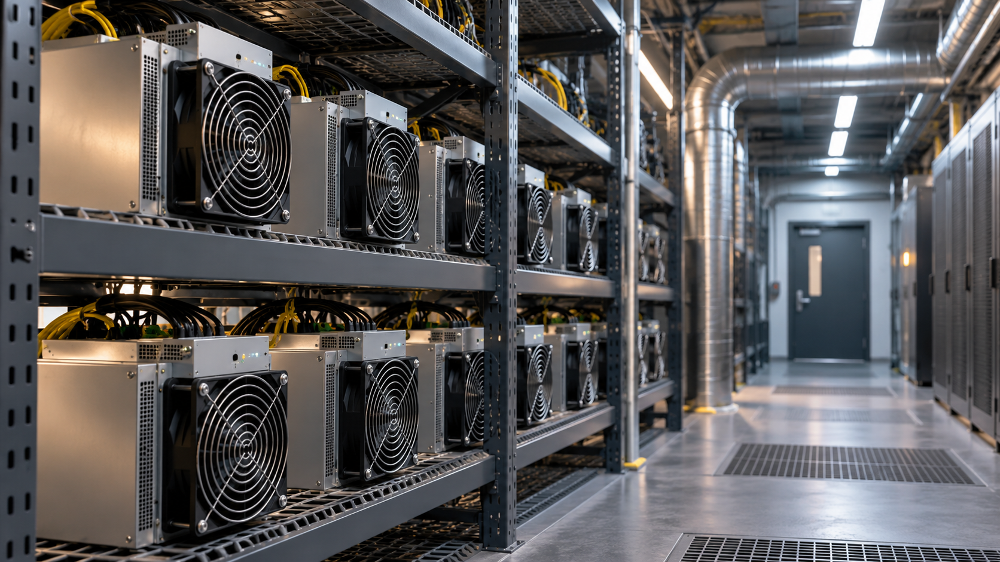

# Comparar instalación propia y alojamiento externo de equipos ASIC

**Estado:** borrador local para revisión. **Versión:** 2026-10-14-v6. **Fecha de redacción:** 2026-10-14. No publicado ni aprobado para subir.

## TL;DR

*Ilustración conceptual generada con IA; no es una captura ni prueba de uso.*

- **Propósito:** Comparar instalación propia y alojamiento externo de equipos de minería.
- **Aportación y enfoque:** Javier explora alternativas; la ficha separa requisitos, suministro y operación y mantiene minería distinta de capacidad de IA.
- **Trabajo y evidencia:** Contexto y comparaciones preliminares sobre instalación, alojamiento y rendimiento; no se acredita aquí una nueva instalación.
- **Resultados y límites:** No se comprobó funcionamiento físico ni ampliación o cambio de firmware ejecutados. Falta verificar condiciones y responsabilidades; ubicaciones, contratos y cantidades permanecen privados.

## Punto de partida y pregunta de esta línea

Esta línea explora dónde y bajo qué condiciones alojar equipos de minería. No presupone una avería o una deficiencia del servicio existente: compara formas de organizar una actividad y responsabilidades. Instalar equipos propios, contratar alojamiento y prestar alojamiento a terceros son opciones distintas. La pregunta es qué información permitiría compararlas sin dar por demostrado su coste, continuidad o resultado.

## Origen y propósito

El contexto conservado recoge el interés por comparar instalación y alojamiento. No identifica una publicación concreta que iniciara la idea ni permite fijar su primera fecha. La ficha presenta esa exploración sin atribuirle un origen en una plataforma.

## Enfoque del proyecto y propuesta de esta versión

El contexto conservado plantea estudiar una instalación y alternativas de alojamiento. La propuesta editorial es separar requisitos de los equipos, suministro, ventilación, operación y mantenimiento, y asignar cada responsabilidad a quien la asumiría. La minería se mantiene como línea propia: no se transforma en capacidad de IA por compartir un emplazamiento. Las alternativas se describen sin publicar ubicaciones de equipos, inventarios personales, contratos o cantidades.

## Desarrollo y evidencia disponible

El contexto y los estudios contienen comparaciones preliminares y preguntas técnicas. Su existencia acredita investigación documental, no una nueva instalación operativa, un contrato de hosting o una ampliación ejecutada. Esta ficha no reproduce escenarios privados como presupuestos ni convierte la búsqueda de proveedores en un servicio confirmado. No se ha comprobado en esta preparación el funcionamiento físico de equipos o instalaciones.

## Preguntas y límites que permanecen abiertos

Una potencia declarada necesita relacionarse con el modelo, configuración y condiciones de uso. La disponibilidad de un local no resuelve suministro, refrigeración o mantenimiento. Una oferta comercial requiere alcance, condiciones y fecha antes de compararse con otra alternativa. La capacidad de prestar un servicio a terceros debe estudiarse de forma separada de alojar equipos propios. La ficha no estima rentabilidad ni recomienda una compra.

## Cómo podría comprobarse

Se propone una matriz de alternativas con requisitos documentados, responsabilidades, costes comparables y datos ausentes. Una prueba técnica autorizada podría registrar consumo, continuidad y respuesta a incidencias de una configuración concreta. Los datos medidos y las estimaciones quedarían diferenciados. Los cambios de equipo o servicio generarían versiones nuevas. Esta fase no opera máquinas, contrata alojamiento ni contacta proveedores.

## La comparación empieza por quién asume cada tarea

El contexto plantea estudiar instalación y alojamiento de equipos de minería. Para desarrollar esa exploración, esta versión propone describir tres alternativas: alojar equipos propios en una instalación bajo control del promotor, contratar espacio y operación de un proveedor, o prestar alojamiento a otras personas. La comparación se haría por responsabilidades y alcance. En la primera habría que identificar quién mantiene el entorno y atiende los equipos; en la segunda, qué incluye exactamente el servicio; en la tercera, cómo se gestionaría una obligación frente a un tercero.

Un proveedor localizado no es todavía una alternativa comparable. Haría falta conocer qué equipos admite, qué servicio ofrece, cuáles son las exclusiones y cómo se resuelven las incidencias. De igual modo, describir una instalación propia sin definir quién realizará las tareas dejaría incompleto su alcance. La matriz propuesta tendría una fila por alternativa y una columna por función: suministro, ventilación, conexión, acceso, vigilancia técnica, reparación y devolución. Su objetivo es hacer visibles diferencias de servicio antes de comparar cifras privadas, que no se incluyen aquí.

## Relacionar configuración y condiciones de alojamiento

La unidad de estudio sería una configuración identificada por su documentación y condiciones de uso, evitando extrapolar de un modelo a todos los equipos ASIC. Un registro podría reunir características declaradas, ajustes previstos y requisitos del entorno que deban comprobarse. Los datos del fabricante se distinguirían de mediciones propias. Si cambiara la configuración, la comparación conservaría ese cambio: una diferencia de consumo o funcionamiento no debería atribuirse al lugar cuando también se han modificado los ajustes del equipo.

La revisión documental del entorno incluiría las preguntas sobre suministro, evacuación de calor, acceso y mantenimiento. Esta ficha no dimensiona instalaciones eléctricas o de ventilación y no acredita que un emplazamiento cumpla esos requisitos. Propone identificar qué profesional o documento tendría que resolver cada cuestión para una instalación concreta. Los antecedentes de centro de datos pueden compartir algunas preguntas sobre el lugar, pero la carga de trabajo y el servicio son distintos. La minería no se presenta como capacidad utilizable para IA por el simple hecho de emplear equipos informáticos.

## Una comparación también necesita un recorrido de incidencias

Además del funcionamiento previsto, se propone estudiar qué sucedería cuando un equipo deja de responder, requiere mantenimiento o debe retirarse. El recorrido hipotético registraría detección, aviso, diagnóstico autorizado, actuación, comprobación y cierre. En alojamiento externo se buscaría quién puede realizar cada paso y qué información recibe el propietario. En una instalación propia se identificarían disponibilidad y recursos necesarios para atenderlo. No se afirma que ese procedimiento exista hoy ni que se haya observado una incidencia real.

El mismo recorrido ayudaría a distinguir reparación, sustitución y simple alojamiento. Una oferta puede incluir una de esas tareas y dejar las otras fuera; habría que comprobarlo antes de compararla con otra opción. También se definiría cómo documentar una intervención sin publicar credenciales, direcciones de acceso ni identificadores personales. La utilidad del análisis sería relacionar una condición de servicio con sus consecuencias prácticas, en lugar de suponer continuidad a partir de una descripción comercial.

## Diseño de una comprobación futura y su alcance

Una prueba autorizada podría limitarse a una configuración y un periodo definidos. Se propondría registrar tiempo disponible, interrupciones, consumo medido cuando exista un medio adecuado, tareas de mantenimiento e intervención requerida. Antes de comenzar se indicaría qué observaciones pertenecen al equipo y cuáles al servicio de alojamiento. La documentación de medición tendría sus propios límites: observar un periodo corto no permite afirmar continuidad durante todos los periodos posteriores. Esta preparación no ejecuta esa prueba ni accede a máquinas.

El resultado serviría para corregir la matriz técnica y operativa. Una estimación económica posterior necesitaría supuestos identificados y una fecha; esta ficha no calcula rentabilidad ni elige una inversión. Para comparar servicios se utilizaría un alcance equivalente, distinguiendo pago por alojamiento, tareas adicionales y exclusiones que consten. Si faltara un dato imprescindible, se mantendría sin confirmar en vez de sustituirlo por una cifra de otra instalación. La propuesta facilita formular una consulta precisa, pero no autoriza contratar ni comunicar datos a proveedores.

## Separar la investigación de la actividad privada

El portfolio puede explicar el método sin detallar inventario personal, ubicaciones, resultados económicos o contratos. Lo que acredita esta línea es la exploración conservada sobre alternativas de instalación y alojamiento. No se utiliza la ficha para demostrar una instalación nueva en funcionamiento ni un servicio de hosting ofrecido al público. Las responsabilidades, recorridos y métricas descritos en esta ampliación son propuestas del asistente para que Javier decida cómo continuar.

Cada actualización debería indicar si añade un documento, una observación medida o una decisión del promotor. Una respuesta comercial conservaría su fecha y alcance en el registro privado; la edición pública recogería únicamente la conclusión que pueda comunicarse. El origen de la idea permanece sin una publicación inicial confirmada. Esta distinción permite mostrar el razonamiento técnico y organizativo sin convertir la exposición del proyecto en una divulgación de la actividad financiera privada.

## Comparación de operación y preguntas de rendimiento

La investigación compara proveedores, producción estimada y observada y posibilidades de optimización como cuestiones distintas de instalar o ampliar capacidad. El interés por observar condiciones de red y rendimiento no demuestra un sistema de monitorización funcionando. También se estudia firmware; no se acredita aquí la ejecución de un piloto. La edición propone conservar por separado medición, estimación y cambios de configuración, sin divulgar la actividad financiera, inventario, ubicaciones, contratos o ingresos de una persona. No aplica firmware ni convierte escenarios en rentabilidad acreditada.

## Procedencia de las posiciones

Línea de instalación y alojamiento recogida en el contexto de Javier; matriz y prueba descritas como propuestas del asistente. El texto es una síntesis asistida por IA y requiere la revisión de Javier antes de atribuirle nuevas formulaciones. Se describen procesos y condiciones, sin juicios de valor ni atribuciones de intenciones.

## Fechas, versiones y cambios

Primera referencia temporal utilizada: 2026-10-09. Fecha indicada en el contexto conservado; no demuestra el inicio de esta exploración.

En esta versión se añade una síntesis del problema, se separa lo existente de las propuestas de comprobación y se redacta la exposición sin juicios de valor. No se incorporan resultados de pruebas nuevas. La edición no modifica las fuentes originales ni sus fechas.

## Herramientas y modelos

Imagen conceptual vigente, añadida el 2026-10-14: preparación e incorporación con Codex/OpenAI gpt-6.1-sol (metadatos del turno); generación y correcciones con image_gen de OpenAI, cuyo modelo exacto no consta. Sustituye el esquema anterior, conservado en el historial. Revisión independiente: gpt-6-astra.

Apoyo visual añadido el 2026-10-14: esquema original elaborado con Codex/OpenAI gpt-6.1-sol (metadatos del turno), Python 3.12.14 y ReportLab 4.4.9, exportado como SVG. Explica la idea del TL;DR; no representa una prueba o resultado nuevo. Revisión independiente de esta edición: gpt-6-astra; alcance documentado por separado. Compatibilidad tipográfica del SVG corregida en esta edición.

La redacción anterior se preparó con Codex/OpenAI gpt-6.1-sol. La revisión y las correcciones de esta versión, fechadas el 2026-10-14, utilizan Codex/OpenAI gpt-6-astra, identificado en los metadatos del turno. Las atribuciones y versiones anteriores se conservan con su evidencia original. Se usaron Python para organización y comprobación local, y herramientas de lectura y edición de archivos. La revisión editorial independiente se encargó a un agente separado con gpt-6-astra; su alcance y resultado se registran fuera del dossier, sin equivaler a validación integral del proyecto. No se han configurado integraciones o actualización continua.

### Atribuciones históricas documentadas

No hay una atribución histórica exacta reconstruida para esta ficha. Las menciones a herramientas en las fuentes no se consideran prueba de uso.

## Fuentes y alcance de lectura

La base es la documentación interna identificada en el registro privado de fuentes de esta preparación. Se ha leído mediante extracción local y se han examinado fuentes y pasajes seleccionados; no es una auditoría sustantiva de todo el corpus. Las referencias externas de los antecedentes requieren verificación pertinente antes de reutilizar afirmaciones como hechos actuales. No se incluyen rutas privadas, documentos sensibles, conversaciones completas o material de terceros en este dossier.
