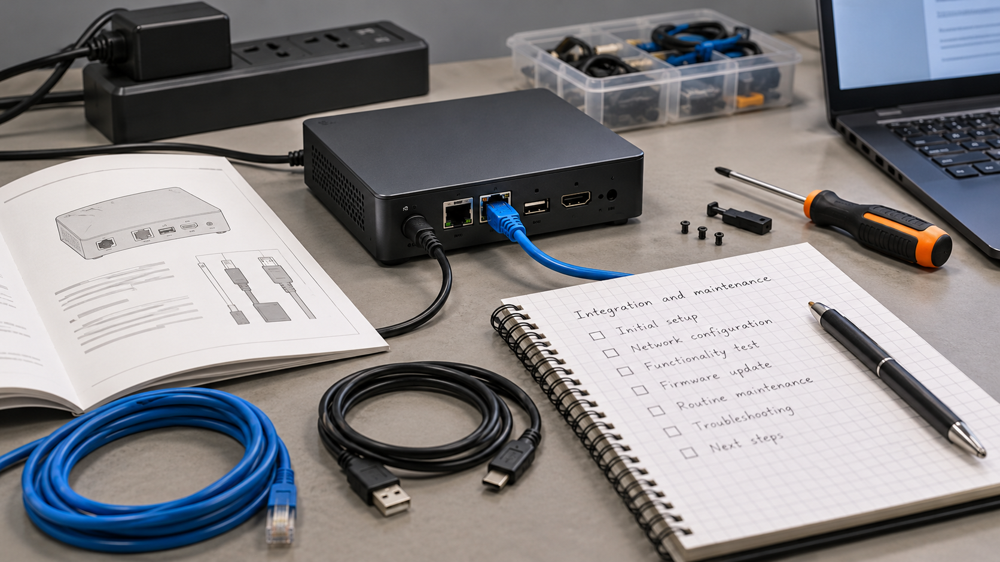

# Condiciones de integración de tecnología entre mercados

**Edición editorial:** 2026-11-07-editorial-r1. **Elaborada en UTC:** 2026-11-07T19:50:09.616232Z.

**Estado histórico declarado del contenido:** borrador local para revisión. **Versión histórica:** 2026-10-14-v4. **Fecha de redacción histórica declarada:** 2026-10-14. La fuente histórica estaba disponible públicamente en el commit consultado; su publicación no valida el contenido.

**Alcance de esta edición:** corrección administrativa del estado documental. El desarrollo y las atribuciones que siguen se reproducen de la [versión histórica](https://github.com/NovusMotus/portfolio-tesis/blob/2cd2acbd44ae01f98481e383af2368bce2973b43/negocios/tecnologia-china-espana/TESIS.md); sus expresiones «esta versión» se refieren a aquella edición. Se conservan las fechas declaradas, los límites y las propuestas, sin añadir logros ni reconstruir el inicio de la idea. La disponibilidad de esta edición se comprueba en el repositorio y en la PR que la incorpore.

**Aporte editorial:** Codex desktop / OpenAI / gpt-6.1-sol; transformación con Python 3.12.14. [Registro de esta versión](VERSION-2026-11-07-editorial-r1.json) · [Revisión editorial fechada](../../REVISION_EDITORIAL_2026-11-07-r1.json).

## TL;DR

*Ilustración conceptual generada con IA; no es una captura ni prueba de uso.*

- **Propósito:** Explorar aplicaciones en España de tecnologías procedentes de China.
- **Aportación y enfoque:** La edición propone pasar de categorías amplias a producto, versión y tarea identificables; no presenta esa propuesta como decisión ya adoptada por Javier.
- **Trabajo y evidencia:** Informe con aplicaciones sanitarias y de otros ámbitos.
- **Resultados y límites:** No hay integración o importación acreditadas. Falta comprobar prestaciones, documentación, derechos, mantenimiento y condiciones del entorno elegido.

## Punto de partida y pregunta de esta línea

El informe antecedente explora tecnologías procedentes de China y posibles aplicaciones en España, tanto sanitarias como de otros ámbitos. Esta ficha desarrolla la pregunta de qué condiciones debe documentar un producto para incorporarse a un uso y a un servicio determinados. La procedencia orienta la investigación, pero no acredita calidad, demanda o viabilidad. Las puntuaciones y apuestas del informe no se adoptan como recomendaciones actuales ni como decisiones confirmadas de Javier.

## Origen y propósito

La documentación disponible permite describir esta línea, pero no reconstruye de forma confirmada qué observación, publicación o experiencia la inició. El punto de partida puede ser una idea, una hipótesis, una aplicación o una práctica con herramientas; no se presupone que exista un problema que resolver. Si se recupera una referencia de origen, se distinguirán lo que plantea esa fuente y la adaptación realizada por Javier.

## Enfoque del proyecto y propuesta de esta versión

El enfoque editorial propuesto es comparar producto, integración, mantenimiento, derechos, documentación y requisitos aplicables. Para cada variable habría que especificar qué dato se busca, qué fuente podría acreditarlo y qué decisión depende de él. Las alternativas deben referirse a la misma tarea y condiciones, para que una diferencia no proceda solo de comparar productos o situaciones distintos. Este método se ofrece como ayuda para desarrollar el dossier: Javier revisará qué parte corresponde a su enfoque y qué propuestas nuevas desea conservar.

## Desarrollo y evidencia disponible

Existe un informe de investigación conservado en la carpeta de trabajo. En esta fase se ha leído mediante extracción local y se han inspeccionado pasajes seleccionados; no se ha revalidado su bibliografía completa ni reproducido todas las comprobaciones que declara. El dossier es una síntesis inicial del problema y de cómo investigarlo. No acredita una actividad comercial, candidatura, inversión o implantación por la existencia de ese informe. Los datos personales y proyecciones del documento permanecen privados.

## Preguntas y límites que permanecen abiertos

Los datos pueden depender de una fecha, un producto o una muestra concreta. Una página comercial describe lo que declara su proveedor y no aporta por sí sola prueba de demanda, funcionamiento o resultado. Los cálculos necesitan entradas y supuestos identificados. Una fuente no localizada no demuestra que una actividad no exista. Las afirmaciones jurídicas, fiscales, médicas o de rendimiento requieren verificación pertinente antes de presentarse en una edición pública como hechos.

## Cómo podría comprobarse

El siguiente contraste propuesto es un caso de uso y documentación de un producto específico, sin generalizar viabilidad por país o por categoría de proveedor. La prueba debe registrar condiciones, fuentes y criterios de comparación antes de interpretar el resultado. Si faltan datos, se mantiene la pregunta abierta y se indica qué cambiaría la decisión. Las versiones posteriores explicarán qué se añadió, corrigió o retiró y qué herramienta o modelo intervino. Ninguna prueba futura se describe en esta ficha como ejecutada.

## De una categoría de tecnología a un caso identificable

El antecedente agrupa tecnologías sanitarias y no sanitarias y plantea posibles vías de aplicación. Para continuar con rigor se propone seleccionar un caso identificable: producto y versión, tarea que se pretende realizar, entorno de uso y resultado esperado. La comparación dejaría de depender de etiquetas amplias sobre un país o un sector. Si la documentación no permite identificar la versión, ese límite se conservaría antes de atribuir al producto una capacidad observada en otra variante.

Como ejemplo ficticio de trabajo, podría estudiarse un dispositivo que recoge una señal y la entrega a una aplicación existente. La ficha definiría qué señal interesa, cómo se recibiría y qué acción depende de ella. No representa una instalación ni un producto concreto validado. El ejemplo sirve para formular las preguntas de integración. La procedencia del equipo no responde a esas preguntas y tampoco permite trasladar resultados de una categoría industrial a una aplicación clínica. Cada uso necesitaría su propia documentación y alcance de comprobación.

## Separar funciones declaradas e integración comprobable

La propuesta de análisis distinguiría la función que declara el proveedor, el medio para conectarla al entorno y el comportamiento que puede comprobarse en una muestra. Se registrarían documentación, formatos, versiones y dependencias que consten. Un catálogo podría iniciar la búsqueda, mientras que una demostración acotada permitiría observar una parte concreta del recorrido. Ninguna de esas evidencias se presentaría como garantía de todos los usos posibles.

El ensayo conceptual podría recorrer entrada, transferencia, interpretación y salida. Si fallara un paso, se identificaría cuál y bajo qué condiciones, evitando declarar que toda la tecnología es apta o inadecuada a partir de un resultado parcial. En un uso sanitario, una conexión funcional seguiría siendo una evidencia de conexión: no demostraría beneficio clínico, seguridad de una decisión o autorización aplicable. Esta ficha no recomienda productos ni considera revalidada la documentación regulatoria que los antecedentes pudieran mencionar.

## El servicio comprende documentación y continuidad

La posible incorporación también se estudiaría por las tareas posteriores a la muestra: instalación, configuración, formación, mantenimiento, actualizaciones y resolución de incidencias. Para cada tarea se preguntaría qué parte podría asumir el promotor, qué parte corresponde al proveedor y qué necesita un especialista. La matriz propuesta no acredita que Javier preste hoy esos servicios. Busca distinguir la venta de un objeto de una propuesta que incluye su integración y continuidad.

Un recorrido ficticio de actualización ayudaría a definir la dependencia: qué cambia, quién lo comunica, cómo se comprueba que la función necesaria sigue disponible y qué alternativa existe si deja de estarlo. También se identificarían condiciones documentadas de acceso a software, piezas o soporte, sin inventarlas. La pregunta sobre continuidad se formularía igual para un proveedor de cualquier procedencia. El criterio de estudio sería la información pertinente para el caso, evitando atribuir capacidades o riesgos únicamente a su localización.

## Contrastar la aplicación y la propuesta comercial

La continuación propuesta tendría dos planos. Primero, comprobar si un producto identificado responde a la tarea bajo condiciones descritas. Segundo, estudiar qué trabajo necesita una persona u organización para incorporarlo y quién podría ofrecerlo. Una demostración técnica no sustituye el segundo plano. Tampoco una conversación sobre interés acredita contratación. Antes de contrastar la propuesta con terceros habría que definirla y obtener la autorización correspondiente; esta ficha no realiza contactos.

La comparación de alternativas incluiría mantener el procedimiento existente, usar otra tecnología o acotar el caso a una práctica de aprendizaje. Para cada opción se registraría qué información sostiene la comparación y qué dato falta. Los costes, disponibilidad y condiciones actuales requerirían consulta específica si pasaran a influir en una decisión. Aquí no se reproducen estimaciones de informes previos como ofertas ni se considera que una categoría puntuada en el antecedente esté validada para comercialización.

## Qué razonamiento aporta la línea al portfolio

La línea permite mostrar cómo una búsqueda amplia de tecnologías puede transformarse en una pregunta sobre uso, integración y servicio. El informe conservado acredita investigación documental, con pasajes leídos y afirmaciones aún sin revalidar íntegramente. La nueva estructura propone avanzar hacia un caso específico antes de ampliar conclusiones. Los ejemplos de señal, actualización y contraste son aportaciones del asistente para revisión de Javier, no proyectos ejecutados.

Una versión posterior podría identificar una referencia de origen, incorporar documentación de un producto o describir una demostración real. Registraría fecha, alcance, herramienta y modelo de las aportaciones, manteniendo separadas las conclusiones antiguas. No hace falta publicar puntuaciones privadas, proveedores valorados o datos personales para mostrar el proceso. La tesis conserva la exploración entre mercados como interés de investigación y delimita qué evidencias permitirían convertir una posibilidad en una aplicación documentada.

## Procedencia de las posiciones

Pregunta derivada del tema del informe; método de contraste propuesto por el asistente, pendiente de aceptación o modificación por Javier. El texto es una síntesis asistida por IA y requiere la revisión de Javier antes de atribuirle nuevas formulaciones. Se describen procesos y condiciones, sin juicios de valor ni atribuciones de intenciones.

## Fechas, versiones y cambios

Primera referencia temporal utilizada: no confirmada. Fecha del antecedente e inicio real pendientes de reconstrucción; no se usa mtime como fecha de autoría.

Se añaden los desarrollos: De una categoría de tecnología a un caso identificable; Separar funciones declaradas e integración comprobable; El servicio comprende documentación y continuidad; Contrastar la aplicación y la propuesta comercial; Qué razonamiento aporta la línea al portfolio. Las propuestas nuevas se atribuyen al asistente y se registra el modelo de este turno sin alterar las atribuciones anteriores. No se incorporan resultados de pruebas nuevas. La edición no modifica las fuentes originales ni sus fechas.

## Herramientas y modelos

Imagen conceptual vigente, añadida el 2026-10-14: preparación e incorporación con Codex/OpenAI gpt-6.1-sol (metadatos del turno); generación y correcciones con image_gen de OpenAI, cuyo modelo exacto no consta. Sustituye el esquema anterior, conservado en el historial. Revisión independiente: gpt-6-astra.

Apoyo visual añadido el 2026-10-14: esquema original elaborado con Codex/OpenAI gpt-6.1-sol (metadatos del turno), Python 3.12.14 y ReportLab 4.4.9, exportado como SVG. Explica la idea del TL;DR; no representa una prueba o resultado nuevo. Revisión independiente de esta edición: gpt-6-astra; alcance documentado por separado. Compatibilidad tipográfica del SVG corregida en esta edición.

La redacción de esta versión utiliza Codex/OpenAI con el modelo gpt-6.1-sol. Su identificación consta en los metadatos del turno utilizado para esta edición; las atribuciones de versiones anteriores se conservan con su evidencia original. Se usaron Python para organización y comprobación local, y herramientas de lectura y edición de archivos. La revisión editorial independiente se encargó a un agente separado con gpt-6-astra; su alcance y resultado se registran fuera del dossier, sin equivaler a validación integral del proyecto. No se han configurado integraciones o actualización continua.

### Atribuciones históricas documentadas

No hay una atribución histórica exacta reconstruida para esta ficha. Las menciones a herramientas en las fuentes no se consideran prueba de uso.

## Fuentes y alcance de lectura

La base es la documentación interna identificada en el registro privado de fuentes de esta preparación. Se ha leído mediante extracción local y se han examinado fuentes y pasajes seleccionados; no es una auditoría sustantiva de todo el corpus. Las referencias externas de los antecedentes requieren verificación pertinente antes de reutilizar afirmaciones como hechos actuales. No se incluyen rutas privadas, documentos sensibles, conversaciones completas o material de terceros en este dossier.
