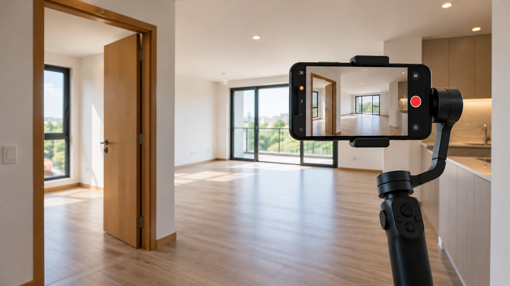

# Uso de vídeo en presentación inmobiliaria y límites de la observación

**Edición editorial:** 2026-11-07-editorial-r1. **Elaborada en UTC:** 2026-11-07T19:50:09.616232Z.

**Estado histórico declarado del contenido:** borrador local para revisión. **Versión histórica:** 2026-10-14-v5. **Fecha de redacción histórica declarada:** 2026-10-14. La fuente histórica estaba disponible públicamente en el commit consultado; su publicación no valida el contenido.

**Alcance de esta edición:** corrección administrativa del estado documental. El desarrollo y las atribuciones que siguen se reproducen de la [versión histórica](https://github.com/NovusMotus/portfolio-tesis/blob/2cd2acbd44ae01f98481e383af2368bce2973b43/negocios/video-inmobiliario/TESIS.md); sus expresiones «esta versión» se refieren a aquella edición. Se conservan las fechas declaradas, los límites y las propuestas, sin añadir logros ni reconstruir el inicio de la idea. La disponibilidad de esta edición se comprueba en el repositorio y en la PR que la incorpore.

**Aporte editorial:** Codex desktop / OpenAI / gpt-6.1-sol; transformación con Python 3.12.14. [Registro de esta versión](VERSION-2026-11-07-editorial-r1.json) · [Revisión editorial fechada](../../REVISION_EDITORIAL_2026-11-07-r1.json).

## TL;DR

*Ilustración conceptual generada con IA; no es una captura ni prueba de uso.*

- **Propósito:** Explorar vídeo para presentar inmuebles, incluida generación desde fotografías.
- **Aportación y enfoque:** La ficha distingue práctica audiovisual y posible servicio; el asistente propone revisar la muestra antes de inferir demanda.
- **Trabajo y evidencia:** Informe con páginas observadas, comparadores y límites de muestreo.
- **Resultados y límites:** No son estimaciones nacionales ni prueba de clientes. Falta ensayar fidelidad de escenas, utilidad y condiciones de entrega; no hay servicio contratado acreditado.

## Punto de partida y pregunta de esta línea

Esta línea de investigación plantea cómo medir la presencia de un formato y estudiar qué necesidad podría resolver en un anuncio. El problema se formula como una pregunta que puede contrastarse, sin valorar personas, instituciones o sectores. Los antecedentes reúnen afirmaciones de naturaleza diferente: observaciones, datos declarados, cálculos e hipótesis. La ficha organiza la pregunta y evita presentar las conclusiones de un informe antiguo como hechos actuales. Tampoco transforma una preferencia privada del promotor en una recomendación general.

## Origen y propósito

La documentación disponible permite describir esta línea, pero no reconstruye de forma confirmada qué observación, publicación o experiencia la inició. El punto de partida puede ser una idea, una hipótesis, una aplicación o una práctica con herramientas; no se presupone que exista un problema que resolver. Si se recupera una referencia de origen, se distinguirán lo que plantea esa fuente y la adaptación realizada por Javier.

## Enfoque del proyecto y propuesta de esta versión

El enfoque editorial propuesto es comparar tipo de anuncio, selección de muestra, anunciante, tarea del usuario y alternativas de presentación. Para cada variable habría que especificar qué dato se busca, qué fuente podría acreditarlo y qué decisión depende de él. Las alternativas deben referirse a la misma tarea y condiciones, para que una diferencia no proceda solo de comparar productos o situaciones distintos. Este método se ofrece como ayuda para desarrollar el dossier: Javier revisará qué parte corresponde a su enfoque y qué propuestas nuevas desea conservar.

## Desarrollo y evidencia disponible

Existe un informe de investigación conservado en la carpeta de trabajo. En esta fase se ha leído mediante extracción local y se han inspeccionado pasajes seleccionados; no se ha revalidado su bibliografía completa ni reproducido todas las comprobaciones que declara. El dossier es una síntesis inicial del problema y de cómo investigarlo. No acredita una actividad comercial, candidatura, inversión o implantación por la existencia de ese informe. Los datos personales y proyecciones del documento permanecen privados.

## Preguntas y límites que permanecen abiertos

Los datos pueden depender de una fecha, un producto o una muestra concreta. Una página comercial describe lo que declara su proveedor y no aporta por sí sola prueba de demanda, funcionamiento o resultado. Los cálculos necesitan entradas y supuestos identificados. Una fuente no localizada no demuestra que una actividad no exista. Las afirmaciones jurídicas, fiscales, médicas o de rendimiento requieren verificación pertinente antes de presentarse en una edición pública como hechos.

## Cómo podría comprobarse

El siguiente contraste propuesto es un muestreo documentado y una comparación de tareas, sin extrapolar porcentajes nacionales desde páginas seleccionadas. La prueba debe registrar condiciones, fuentes y criterios de comparación antes de interpretar el resultado. Si faltan datos, se mantiene la pregunta abierta y se indica qué cambiaría la decisión. Las versiones posteriores explicarán qué se añadió, corrigió o retiró y qué herramienta o modelo intervino. Ninguna prueba futura se describe en esta ficha como ejecutada.

## Qué aplicación se está explorando

El antecedente estudia presentar inmuebles mediante vídeo, incluida la posibilidad de producir una pieza a partir de fotografías. Esa aplicación puede investigarse como servicio o como práctica de generación audiovisual. Los criterios cambian con el propósito: para practicar interesa comprender el control de las escenas y sus errores; para un servicio también habría que conocer el uso que alguien daría al resultado. No se presume que una proporción baja de anuncios con vídeo constituya por sí sola una necesidad comercial.

Conviene separar tres objetos: una grabación de un recorrido, una animación de fotografías y una visita virtual que permite explorar puntos de una representación. Pueden compartir imágenes del inmueble y servir a tareas diferentes. Esta separación es una propuesta de la redacción actual; no afirma cuáles son las funcionalidades actuales de un portal. Permite definir qué se construiría antes de comparar resultados.

## Qué enseña el antecedente y qué no permite concluir

El informe conserva observaciones de páginas de anuncios, comparaciones de servicios y discusiones sobre etiquetas multimedia. Sus propios límites incluyen páginas elegidas sin muestreo aleatorio y categorías que agrupan formatos. Esta versión no reproduce porcentajes ni los presenta como una estimación nacional. Lo aprovechable para el dossier es el método: identificar qué se contó, en qué conjunto y qué significado tenía la etiqueta.

La unidad de observación también importa. Si una agencia aplica el mismo formato a muchos anuncios, cada anuncio no representa necesariamente una decisión independiente. Una concentración en una página puede describir a un anunciante o al orden de resultados antes que una preferencia general del sector. La existencia de un formato tampoco acredita que produzca una venta. Habría que distinguir presencia, atención del visitante, comprensión del espacio y resultado comercial. Las afirmaciones históricas del informe sobre plataformas, normativa o precios quedan pendientes de verificación específica, sin trasladar sus veredictos a esta ficha.

## Cómo desarrollaría una muestra de esta aplicación

Como propuesta del asistente, una muestra inicial podría utilizar fotografías propias o autorizadas de un espacio ficticio o no identificable. Antes de generar el vídeo se definirían elementos que deben conservarse: relación entre puertas y ventanas, distribución visible, superficies y límites de lo que cada fotografía muestra. La evaluación compararía las escenas con esas entradas y registraría cambios introducidos por el modelo. Un movimiento de cámara verosímil no acreditaría que el recorrido resultante corresponde al espacio.

La pieza podría acompañarse de una explicación del proceso: qué entradas se utilizaron, qué efectos se solicitaron y qué escenas se descartaron. No se atribuirían medidas, vistas o características que la fuente no permite conocer. La identificación del contenido generado formaría parte del diseño de comunicación; las obligaciones aplicables requerirían una revisión independiente antes de un uso comercial. Esta propuesta no equivale a una demo ya realizada.

## Qué aportación mostraría en el portfolio

El caso permitiría mostrar la transición entre una posibilidad técnica y una aplicación delimitada: elegir una tarea, distinguir formatos, preparar entradas, detectar errores y revisar la utilidad del resultado. Puede conservar valor como ejercicio de herramientas aunque no termine en negocio. Tampoco necesita declarar que los anunciantes carecen de un recurso o que un mercado ha elegido definitivamente un formato.

Para estudiar un servicio, el siguiente paso propuesto sería comprobar una tarea concreta con personas autorizadas y alternativas comparables: por ejemplo, si entienden mejor una característica visible o si la pieza les ayuda a formular una pregunta. Una medida de comprensión no se convertiría en una promesa de contactos o ventas. El origen exacto de la idea, las decisiones que Javier aceptó y los modelos utilizados en los experimentos históricos siguen pendientes de reconstrucción. Se registrarán por separado del modelo que redacta esta ampliación.

## Procedencia de las posiciones

Pregunta derivada del tema del informe; método de contraste propuesto por el asistente, pendiente de aceptación o modificación por Javier. El texto es una síntesis asistida por IA y requiere la revisión de Javier antes de atribuirle nuevas formulaciones. Se describen procesos y condiciones, sin juicios de valor ni atribuciones de intenciones.

## Fechas, versiones y cambios

Referencias temporales del antecedente: La tabla inicial del informe atribuye mediciones al 31 de julio de 2026. Es fecha declarada de esas observaciones, no fecha global de redacción o inicio de la idea; las mediciones no se reprodujeron en esta revisión. No se utiliza mtime como fecha de autoría.

Se amplía la aplicación concreta, el análisis del antecedente y los ejemplos de desarrollo. Los ejemplos nuevos son propuestas del asistente, no pruebas realizadas o decisiones ya aceptadas por Javier. No se incorporan resultados de pruebas nuevas. La edición no modifica las fuentes originales ni sus fechas.

## Herramientas y modelos

Imagen conceptual vigente, añadida el 2026-10-14: preparación e incorporación con Codex/OpenAI gpt-6.1-sol (metadatos del turno); generación y correcciones con image_gen de OpenAI, cuyo modelo exacto no consta. Sustituye el esquema anterior, conservado en el historial. Revisión independiente: gpt-6-astra.

Apoyo visual añadido el 2026-10-14: esquema original elaborado con Codex/OpenAI gpt-6.1-sol (metadatos del turno), Python 3.12.14 y ReportLab 4.4.9, exportado como SVG. Explica la idea del TL;DR; no representa una prueba o resultado nuevo. Revisión independiente de esta edición: gpt-6-astra; alcance documentado por separado. Compatibilidad tipográfica del SVG corregida en esta edición.

La redacción anterior se preparó con Codex/OpenAI gpt-6.1-sol. La revisión y las correcciones de esta versión, fechadas el 2026-10-14, utilizan Codex/OpenAI gpt-6-astra, identificado en los metadatos del turno. Las atribuciones y versiones anteriores se conservan con su evidencia original. Se usaron Python para organización y comprobación local, y herramientas de lectura y edición de archivos. La revisión editorial independiente se encargó a un agente separado con gpt-6-astra; su alcance y resultado se registran fuera del dossier, sin equivaler a validación integral del proyecto. No se han configurado integraciones o actualización continua.

### Atribuciones históricas documentadas

No hay una atribución histórica exacta reconstruida para esta ficha. Las menciones a herramientas en las fuentes no se consideran prueba de uso.

## Fuentes y alcance de lectura

La base es la documentación interna identificada en el registro privado de fuentes de esta preparación. Se ha leído mediante extracción local y se han examinado fuentes y pasajes seleccionados; no es una auditoría sustantiva de todo el corpus. Las referencias externas de los antecedentes requieren verificación pertinente antes de reutilizar afirmaciones como hechos actuales. No se incluyen rutas privadas, documentos sensibles, conversaciones completas o material de terceros en este dossier.
