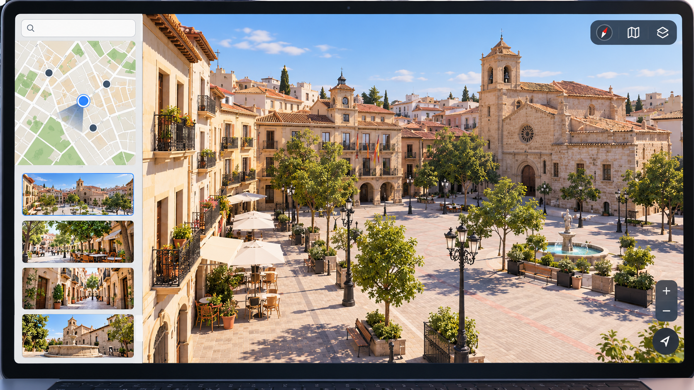

# Una representación urbana navegable con procedencia de datos

**Estado:** borrador local para revisión. **Versión:** 2026-10-14-v6. **Fecha de redacción:** 2026-10-14. No publicado ni aprobado para subir.

## TL;DR

*Ilustración conceptual generada con IA de una interfaz urbana genérica; no reproduce la geografía exacta de Albacete ni una captura de la demo.*

- **Propósito:** Representar una ciudad de forma navegable y relacionar lugares con información.
- **Aportación y enfoque:** Javier define la experiencia y sus revisiones; IA y transformación de datos apoyan la construcción.
- **Trabajo y evidencia:** Demo local descrita en el README, con fuentes y comprobaciones del desarrollo; no reejecutadas aquí.
- **Resultados y límites:** No acredita contrato municipal ni servicios actualizados. Falta revisar escena, procedencia, derechos y mantenimiento de datos antes de publicar.

## Punto de partida y pregunta de esta línea

El proyecto plantea cómo convertir datos de una ciudad en una representación navegable que permita reconocer lugares y consultar información relacionada. El problema de diseño incluye integrar geometría, nombres, texturas y servicios sin perder la relación con su fuente. La representación se plantea como demostración; no se presupone que sea un inventario municipal completo o una simulación de la ciudad.

## Origen y propósito

El README del proyecto atribuye su origen a un [vídeo de DotCSV](https://www.youtube.com/watch?v=j906Pf7n7Sg), con un localizador en el minuto 24:05. Según ese documento, el referente muestra una representación de otra ciudad y sirve de antecedente para la exploración de Albacete. Esta preparación ha leído esa atribución local; no ha consultado el vídeo ni verificado sus fechas o la descripción de su contenido. Los modelos y horarios atribuidos al trabajo de otra persona no se trasladan al uso de Javier. La referencia de origen declarada no fija por sí sola cuándo comenzó su proyecto.

## Enfoque del proyecto y propuesta de esta versión

El enfoque documentado reúne datos y una interfaz de navegación con una presentación visual estilizada. Javier define el alcance de la experiencia y las revisiones; la construcción se apoya en IA y herramientas de transformación de datos. Cada elemento debería indicar qué procede de una fuente externa, qué se deriva y qué es una decisión visual. Las capas de agenda o servicios necesitan su propia fecha de consulta y mecanismo de actualización.

## Desarrollo y evidencia disponible

El README identifica una demo local sin uso comercial. Describe fuentes y comprobaciones automáticas o visuales realizadas en el desarrollo, con límites de revisión. Esta redacción no ha vuelto a ejecutar el pipeline ni verificado toda la escena. La existencia de un modelo y recursos no acredita contrato municipal, disponibilidad actual de servicios o integración con sistemas de una administración.

## Preguntas y límites que permanecen abiertos

Los datos externos pueden estar incompletos, desactualizados o requerir atribución. Una textura o geometría derivada no sustituye una medición del lugar. La apariencia estilizada puede introducir diferencias que conviene distinguir de errores de datos. La capacidad del dispositivo condiciona la experiencia. Los archivos masivos de recursos y las imágenes no se trasladan al repositorio teórico sin revisar sus derechos y contenido.

## Cómo podría comprobarse

Se propone un recorrido con lugares y tareas definidos que compruebe correspondencia geográfica, información mostrada y legibilidad. La revisión debe diferenciar errores de origen, de transformación y de presentación. También puede observarse la experiencia en distintos dispositivos y condiciones de carga. Las nuevas fuentes o cambios de datos se registrarían por versión, sin dar por actualizado todo el modelo tras corregir una escena.

## Una experiencia navegable necesita una tarea definida

El README describe una demo local de representación urbana. Para desarrollar su explicación, esta versión propone elegir una tarea: reconocer un lugar, recorrer un entorno o consultar una información asociada. La tarea permite definir qué elementos necesita la escena y qué precisión importa. Una presentación visual puede resultar pertinente para un recorrido sin acreditar que todos los objetos o servicios de la ciudad estén representados.

Un ejemplo ficticio podría utilizar un conjunto reducido de geometrías y un punto de consulta con datos creados para la práctica. El recorrido describiría inicio, orientación y salida esperada. No se considera una prueba ejecutada sobre la demo ni un uso municipal aprobado. La propuesta permite revisar la relación entre la experiencia que Javier quiere construir y la información que ofrece la escena, conservando como abiertas las aplicaciones y capas que no estén comprobadas.

## Conservar la procedencia a través de las transformaciones

El método propuesto distinguiría dato de origen, transformación y decisión visual. Una geometría puede cambiar de formato o simplificarse para su presentación, mientras que un nombre o una textura puede proceder de otra fuente. Cada relación conservaría referencia, fecha pertinente y alcance. La apariencia estilizada no se utilizaría como medida del lugar y una transformación correcta en una muestra no validaría todos los recursos.

La ficha de un elemento podría indicar qué parte está documentada, qué se ha derivado y qué se ha diseñado para la escena. Si la revisión encuentra una diferencia, se preguntaría en qué etapa se produjo antes de atribuirla al dato original. Este recorrido es una propuesta del asistente; no demuestra que todo el pipeline actual conserve esas relaciones. Las condiciones de uso de fuentes y recursos necesitan revisión propia y no se deducen de que puedan consultarse públicamente.

## Navegación y capas de información tienen comprobaciones distintas

La revisión propuesta examinaría orientación, acceso a información y comportamiento de carga por separado. Una escena puede permitir desplazarse sin que una capa de servicios esté vigente. Si se incluye una agenda o información práctica, su fecha y proceso de actualización tendrían registros propios. La versión del modelo no se presentaría como fecha de todas las fuentes que aparecen en él.

Un ensayo podría retirar una capa ficticia o introducir un dato incompleto para observar cómo se explica esa ausencia. Otro compararía un recorrido en condiciones de carga definidas. El registro conservaría dispositivo y entorno pertinentes, sin extrapolar a todas las configuraciones. Esta preparación no vuelve a ejecutar el pipeline, inspecciona toda la escena ni comprueba disponibilidad actual de los servicios descritos. La documentación del desarrollo es evidencia de trabajo, distinta de una verificación realizada en esta nueva edición.

## Revisar un conjunto de lugares y cambios acotados

La prueba propuesta definiría un conjunto de referencias y tareas antes de observar resultados. Se comprobarían correspondencia del elemento mostrado, información asociada y legibilidad del recorrido, con las fuentes y condiciones que permitan ese contraste. Una diferencia se clasificaría según origen, transformación o presentación. No se utilizaría la revisión de una esquina o escena como validación de toda la ciudad.

Una actualización podría cambiar una fuente o corregir un elemento. El registro señalaría qué parte de la representación depende de ese cambio y qué permanece sin revisar. Los datos y recursos masivos no se copiarían al repositorio de tesis por estar disponibles en la carpeta. La prueba no se ha ejecutado en esta preparación. Su diseño busca que un posible resultado pueda interpretarse con su alcance, sin atribuir contrato, utilidad general o integración con una administración a partir del demostrador.

## Qué permite mostrar la demo en el portfolio

La evidencia disponible es una demo descrita por su documentación y materiales de desarrollo. La ampliación propone tareas y controles de procedencia para explicar qué se construye y cómo podría comprobarse. Javier define el alcance y revisará las sugerencias nuevas del asistente. No se acredita aquí inventario completo, simulación operativa, servicios vigentes o uso comercial.

Una próxima versión podría recuperar una comprobación acotada, corregir una relación con una fuente o documentar una revisión visual. El historial indicaría fecha, herramienta y modelo de la aportación real. La tesis puede relacionarse con los estudios de usos urbanos y comercio local sin convertir sus hipótesis en funciones implantadas. El portfolio mantendría la implementación y los recursos reservados en su destino correspondiente, mostrando solo el recorrido y material aprobado para explicar la experiencia.

## Referencias históricas recuperadas y aplicación propuesta

Entre las referencias recuperadas figuran datos de puntos de interés y herramientas de representación. La correspondencia es temática: no demuestra que el proyecto haya incorporado esas fuentes o que sus permisos resuelvan los datos ya utilizados. El asistente propone comparar una muestra identificada con su fuente, registrar transformaciones y comprobar qué condiciones exigiría una actualización. Esta incorporación conserva el estado de demo documentada y los bloqueos de procedencia, atribución y revisión visual. No se reejecutó la escena ni se validó una integración municipal.

## Procedencia de las posiciones

Demostración descrita por el proyecto; evaluación y actualización propuestas en esta ficha. El texto es una síntesis asistida por IA y requiere la revisión de Javier antes de atribuirle nuevas formulaciones. Se describen procesos y condiciones, sin juicios de valor ni atribuciones de intenciones.

## Fechas, versiones y cambios

Primera referencia temporal utilizada: no confirmada. El inicio real y las fechas de cada aportación histórica no están reconstruidos. La fecha del archivo no sustituye la fecha de la idea.

Se añaden los desarrollos: Una experiencia navegable necesita una tarea definida; Conservar la procedencia a través de las transformaciones; Navegación y capas de información tienen comprobaciones distintas; Revisar un conjunto de lugares y cambios acotados; Qué permite mostrar la demo en el portfolio. Las propuestas nuevas se atribuyen al asistente y se registra el modelo de este turno sin alterar las atribuciones anteriores. No se incorporan resultados de pruebas nuevas. La edición no modifica las fuentes originales ni sus fechas.

## Herramientas y modelos

Imagen conceptual vigente, añadida el 2026-10-14: preparación e incorporación con Codex/OpenAI gpt-6.1-sol (metadatos del turno); generación y correcciones con image_gen de OpenAI, cuyo modelo exacto no consta. Sustituye el esquema anterior, conservado en el historial. Revisión independiente: gpt-6-astra.

Apoyo visual añadido el 2026-10-14: esquema original elaborado con Codex/OpenAI gpt-6.1-sol (metadatos del turno), Python 3.12.14 y ReportLab 4.4.9, exportado como SVG. Explica la idea del TL;DR; no representa una prueba o resultado nuevo. Revisión independiente de esta edición: gpt-6-astra; alcance documentado por separado. Compatibilidad tipográfica del SVG corregida en esta edición.

La redacción de esta versión utiliza Codex/OpenAI con el modelo gpt-6.1-sol. Su identificación consta en los metadatos del turno utilizado para esta edición; las atribuciones de versiones anteriores se conservan con su evidencia original. Se usaron Python para organización y comprobación local, y herramientas de lectura y edición de archivos. La revisión editorial independiente se encargó a un agente separado con gpt-6-astra; su alcance y resultado se registran fuera del dossier, sin equivaler a validación integral del proyecto. No se han configurado integraciones o actualización continua.

### Atribuciones históricas documentadas

No hay una atribución histórica exacta reconstruida para esta ficha. Las menciones a herramientas en las fuentes no se consideran prueba de uso.

## Fuentes y alcance de lectura

La base es la documentación interna identificada en el registro privado de fuentes de esta preparación. Se ha leído mediante extracción local y se han examinado fuentes y pasajes seleccionados; no es una auditoría sustantiva de todo el corpus. Las referencias externas de los antecedentes requieren verificación pertinente antes de reutilizar afirmaciones como hechos actuales. No se incluyen rutas privadas, documentos sensibles, conversaciones completas o material de terceros en este dossier.
