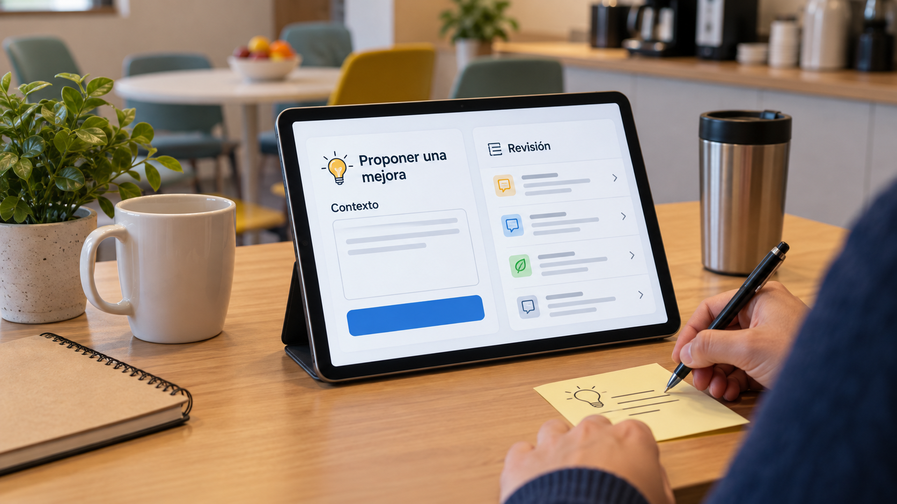

# Propuestas de trabajadores y elaboración de análisis trazables

**Estado:** borrador local para revisión. **Versión:** 2026-10-14-v4. **Fecha de redacción:** 2026-10-14. No publicado ni aprobado para subir.

## TL;DR

*Ilustración conceptual generada con IA; no es una captura ni prueba de uso.*

- **Propósito:** Transformar sugerencias de trabajadores en análisis que una organización pueda valorar.
- **Aportación y enfoque:** El material plantea protección de identidad y dossiers con coste, alternativas e impacto; no identifica todos los descartes personales de Javier.
- **Trabajo y evidencia:** Estudio de mercado fechado y documentación conceptual.
- **Resultados y límites:** No hay clientes, canal ni efectos medidos acreditados. Falta comprobar confidencialidad y utilidad; precios y demanda históricos no son oportunidades actuales confirmadas.

## Punto de partida y pregunta de esta línea

Esta línea examina el recorrido entre una sugerencia de un trabajador y un análisis que pueda ser valorado por una organización. El problema se expresa como una separación de tareas: recibir una iniciativa, comprenderla, identificar alternativas y devolver una evaluación. No se atribuye falta de escucha o de capacidad a una institución sin observación específica.

## Origen y propósito

La documentación disponible permite describir esta línea, pero no reconstruye de forma confirmada qué observación, publicación o experiencia la inició. El punto de partida puede ser una idea, una hipótesis, una aplicación o una práctica con herramientas; no se presupone que exista un problema que resolver. Si se recupera una referencia de origen, se distinguirán lo que plantea esa fuente y la adaptación realizada por Javier.

## Enfoque del proyecto y propuesta de esta versión

El material plantea una entrada de propuestas con protección de identidad y preparación de un dossier estructurado de coste, alternativas e impacto. La hipótesis es que la elaboración asistida podría facilitar el tratamiento de iniciativas y hacer visibles las lagunas de información. La organización conserva las decisiones y responsabilidades que correspondan. El diseño se relaciona con Council y con la propuesta institucional, pero no son el mismo producto ni tienen idéntico estado.

## Desarrollo y evidencia disponible

Hay un estudio de mercado fechado y documentación conceptual. Sus afirmaciones de hueco competitivo, precios o demanda son antecedentes que necesitan contraste actual; no se reproducen como una oportunidad disponible demostrada. La tesis describe la pregunta de producto y el método para evaluarla. No acredita clientes, canal de ventas, funcionamiento institucional o efectos medidos de un buzón con IA.

## Preguntas y límites que permanecen abiertos

La identidad puede reaparecer a través del contenido de una sugerencia aunque se retire el nombre. El resumen puede cambiar el sentido de lo propuesto o introducir supuestos sobre coste. El procedimiento debe dejar visibles la propuesta original, las correcciones del proponente y los motivos de evaluación. Un informe anonimizado no es automáticamente imparcial. Los contenidos confidenciales de trabajadores o entidades no forman parte de esta versión pública candidata.

## Cómo podría comprobarse

Se propone un ensayo con iniciativas ficticias o expresamente autorizadas para observar fidelidad del resumen, datos identificables residuales y criterios de priorización. Los participantes deberían poder señalar cambios de sentido y aportar información faltante. La utilidad operativa y la demanda comercial se probarían por separado. El resultado debería describir tiempo, incidencias y límites del procedimiento, sin interpretar una muestra pequeña como solución general.

## Conservar una iniciativa antes de convertirla en informe

La línea de producto relaciona una propuesta de un trabajador con un análisis estructurado de alternativas, condiciones e impacto. El aporte que se estudia no es solo recibir texto, sino ayudar a formular qué se solicita y qué haría falta conocer para valorarlo. Una sugerencia puede contener una observación local y una explicación tentativa; el proceso debería conservar la diferencia. La organización de la información no demuestra que la iniciativa sea viable ni que el informe la represente con fidelidad.

El estudio documenta un interés por proteger la identidad al elaborar el análisis. Esa decisión de diseño no requiere describir a una organización concreta como incapaz de escuchar. La hipótesis es que el recorrido puede centrarse en el contenido y facilitar su revisión. Javier tendría que confirmar qué condiciones de protección y seguimiento quiere adoptar en cada aplicación. El asistente desarrolla aquí preguntas de diseño, sin adjudicar una implantación, usuarios o demanda al material de investigación existente.

## Qué se puede resumir y qué necesita volver al proponente

Un ejemplo editorial podría partir de una iniciativa ficticia para cambiar la ubicación de un material de uso frecuente. El sistema distinguiría observación, propuesta y resultado esperado. Para elaborar alternativas necesitaría conocer restricciones de espacio, acceso, reposición y uso. Si esa información no se aporta, el informe tendría que formular preguntas y evitar asignar un coste o ahorro no sustentado. La propuesta original permanecería disponible para comprobar el resumen.

Antes de continuar, el proponente podría indicar que una frase cambia el alcance o que una condición ha sido supuesta. Esa devolución forma parte del diseño propuesto, no una capacidad ya verificada del producto. El proceso registraría qué se añadió por la persona y qué por la herramienta. Una variante de la iniciativa podría compartir el objetivo y cambiar el mecanismo, sin presentarse como decisión de quien la inició. La revisión observaría qué alternativas responden a la petición y cuáles plantean otra tarea.

## Proteger identidad es más que retirar un nombre

Una propuesta puede hacer reconocible a una persona por un turno, una función o un incidente, aunque no incluya su nombre. El diseño necesitaría definir qué datos requiere cada función y qué partes se pueden generalizar sin perder significado. La información que permite volver a contactar con el proponente tendría un acceso distinto del contenido utilizado para elaborar el análisis. No se declara anonimato garantizado por omitir un identificador.

Como ensayo propuesto por el asistente, un conjunto de sugerencias inventadas podría incluir referencias singulares y observar si los resúmenes las conservan. La revisión identificaría qué detalle aporta a la tarea y cuál expone identidad sin contribuir al análisis. También comprobaría que eliminarlo no cambia la interpretación. El dossier público utilizaría únicamente esos ejemplos ficticios y explicaciones del mecanismo. El procedimiento real de acceso, conservación y participación exige su definición específica; esta preparación no recibe comunicaciones de trabajadores ni envía propuestas a instituciones.

## Valoración de mejoras y otras comunicaciones tienen alcances distintos

El antecedente estudia varias categorías de herramientas y explora una relación con canales internos. Esa comparación no convierte todas las entradas en el mismo tipo de comunicación. Una iniciativa de mejora, un relato de una incidencia y una comunicación sobre un posible incumplimiento pueden necesitar tratamientos, responsables y límites diferentes. La ficha no usa la existencia de una obligación normativa como prueba de demanda para este producto ni afirma que el mecanismo propuesto cumpla un régimen concreto.

El asistente propone definir el alcance de entrada antes de elaborar un informe. Una comunicación fuera de ese alcance tendría que seguir el procedimiento que corresponda y no transformarse automáticamente en una sugerencia de negocio. El mecanismo de clasificación sería una función por comprobar, especialmente cuando el texto admite varias lecturas. El estudio de mercado conserva comparaciones históricas y estimaciones que requieren actualización; no se presentan como precios disponibles o ausencia acreditada de competidores. La propuesta puede explorar una aplicación sin declarar que cubre una categoría comercial libre.

## Qué mostraría una comprobación del recorrido

Una prueba ficticia podría seguir tres entradas: una iniciativa clara, otra con información ausente y otra cuyo resumen inicial altera el objetivo. El registro mostraría recepción, preguntas, corrección del proponente, alternativas e informe. Se observaría qué datos se añadieron, qué identidad pudo inferirse y qué criterios se usaron para ordenar opciones. La revisión no evaluaría solo si el informe suena convincente; comprobaría que conserva la petición y sus condiciones.

La utilidad para una organización requeriría conocer quién revisa, cómo responde y qué ocurre con una propuesta pendiente. La existencia de una salida no demuestra que alguien la haya aplicado o que produzca un ahorro. Para estudiar el producto, esas observaciones operativas y una eventual investigación de demanda tendrían criterios separados. El portfolio mostraría cómo se convierte una idea de participación en un proceso revisable, con la aportación de Javier distinguida de los ensayos añadidos por el asistente. Las decisiones institucionales, contratos y resultados permanecen sin atribuir hasta disponer de sus evidencias.

## Procedencia de las posiciones

Línea de producto del material Council; preguntas de privacidad y contraste propuestas en esta síntesis. El texto es una síntesis asistida por IA y requiere la revisión de Javier antes de atribuirle nuevas formulaciones. Se describen procesos y condiciones, sin juicios de valor ni atribuciones de intenciones.

## Fechas, versiones y cambios

Primera referencia temporal utilizada: 2026-08. Mes declarado en el estudio de mercado; día e inicio exacto no constan.

Se desarrolla el mecanismo específico, sus aplicaciones y ejemplos de comprobación. Las nuevas propuestas del asistente se mantienen diferenciadas de las decisiones de Javier. Se registra el modelo de este turno con su evidencia, sin cambiar las atribuciones anteriores. No se incorporan resultados de pruebas nuevas. La edición no modifica las fuentes originales ni sus fechas.

## Herramientas y modelos

Imagen conceptual vigente, añadida el 2026-10-14: preparación e incorporación con Codex/OpenAI gpt-6.1-sol (metadatos del turno); generación y correcciones con image_gen de OpenAI, cuyo modelo exacto no consta. Sustituye el esquema anterior, conservado en el historial. Revisión independiente: gpt-6-astra.

Apoyo visual añadido el 2026-10-14: esquema original elaborado con Codex/OpenAI gpt-6.1-sol (metadatos del turno), Python 3.12.14 y ReportLab 4.4.9, exportado como SVG. Explica la idea del TL;DR; no representa una prueba o resultado nuevo. Revisión independiente de esta edición: gpt-6-astra; alcance documentado por separado. Compatibilidad tipográfica del SVG corregida en esta edición.

La redacción de esta versión utiliza Codex/OpenAI con el modelo gpt-6.1-sol. Su identificación consta en los metadatos del turno utilizado para esta edición; las atribuciones de versiones anteriores se conservan con su evidencia original. Se usaron Python para organización y comprobación local, y herramientas de lectura y edición de archivos. La revisión editorial independiente se encargó a un agente separado con gpt-6-astra; su alcance y resultado se registran fuera del dossier, sin equivaler a validación integral del proyecto. No se han configurado integraciones o actualización continua.

### Atribuciones históricas documentadas

No hay una atribución histórica exacta reconstruida para esta ficha. Las menciones a herramientas en las fuentes no se consideran prueba de uso.

## Fuentes y alcance de lectura

La base es la documentación interna identificada en el registro privado de fuentes de esta preparación. Se ha leído mediante extracción local y se han examinado fuentes y pasajes seleccionados; no es una auditoría sustantiva de todo el corpus. Las referencias externas de los antecedentes requieren verificación pertinente antes de reutilizar afirmaciones como hechos actuales. No se incluyen rutas privadas, documentos sensibles, conversaciones completas o material de terceros en este dossier.
