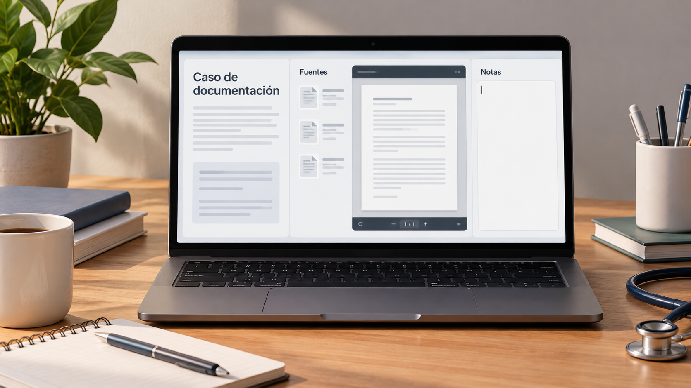

# Caso de estudio de Council para clínica digital y documentación

**Edición editorial:** 2026-11-07-editorial-r1. **Elaborada en UTC:** 2026-11-07T19:50:09.616232Z.

**Estado histórico declarado del contenido:** borrador local para revisión. **Versión histórica:** 2026-10-14-v5. **Fecha de redacción histórica declarada:** 2026-10-14. La fuente histórica estaba disponible públicamente en el commit consultado; su publicación no valida el contenido.

**Alcance de esta edición:** corrección administrativa del estado documental. El desarrollo y las atribuciones que siguen se reproducen de la [versión histórica](https://github.com/NovusMotus/portfolio-tesis/blob/2cd2acbd44ae01f98481e383af2368bce2973b43/tecnologicos/caso-documentacion-clinica/TESIS.md); sus expresiones «esta versión» se refieren a aquella edición. Se conservan las fechas declaradas, los límites y las propuestas, sin añadir logros ni reconstruir el inicio de la idea. La disponibilidad de esta edición se comprueba en el repositorio y en la PR que la incorpore.

**Aporte editorial:** Codex desktop / OpenAI / gpt-6.1-sol; transformación con Python 3.12.14. [Registro de esta versión](VERSION-2026-11-07-editorial-r1.json) · [Revisión editorial fechada](../../REVISION_EDITORIAL_2026-11-07-r1.json).

## TL;DR

*Ilustración conceptual generada con IA; no es una captura ni prueba de uso.*

- **Propósito:** Delimitar un caso de análisis sobre clínica digital y documentación.
- **Aportación y enfoque:** El asistente propone comparar brief, fuentes y alternativas; no atribuye a Javier todos los motivos o descartes de las salidas.
- **Trabajo y evidencia:** Entradas y salidas conservadas en Council, con lectura documental parcial y sin repetir el caso.
- **Resultados y límites:** No prueban contrato ni intervención para una entidad. Falta verificar alcance y trazabilidad; materiales identificables y resultados de terceros quedan privados.

## Punto de partida y pregunta de esta línea

Esta línea de investigación plantea cómo delimitar un análisis de clínica digital y documentación y conservar sus fuentes, restricciones y preguntas. El problema se formula como una pregunta que puede contrastarse, sin valorar personas, instituciones o sectores. Los antecedentes reúnen afirmaciones de naturaleza diferente: observaciones, datos declarados, cálculos e hipótesis. La ficha organiza la pregunta y evita presentar las conclusiones de un informe antiguo como hechos actuales. Tampoco transforma una preferencia privada del promotor en una recomendación general.

## Origen y propósito

La documentación disponible permite describir esta línea, pero no reconstruye de forma confirmada qué observación, publicación o experiencia la inició. El punto de partida puede ser una idea, una hipótesis, una aplicación o una práctica con herramientas; no se presupone que exista un problema que resolver. Si se recupera una referencia de origen, se distinguirán lo que plantea esa fuente y la adaptación realizada por Javier.

## Enfoque del proyecto y propuesta de esta versión

El enfoque editorial propuesto es comparar alcance del brief, información aportada, fuentes públicas, alternativas y criterios de revisión. Para cada variable habría que especificar qué dato se busca, qué fuente podría acreditarlo y qué decisión depende de él. Las alternativas deben referirse a la misma tarea y condiciones, para que una diferencia no proceda solo de comparar productos o situaciones distintos. Este método se ofrece como ayuda para desarrollar el dossier: Javier revisará qué parte corresponde a su enfoque y qué propuestas nuevas desea conservar.

## Desarrollo y evidencia disponible

La carpeta de Council conserva material de caso, entradas y salidas relacionadas. Un encabezado de encargo o una respuesta generada no demuestra una relación contractual o intervención para la entidad citada. La revisión actual ha leído documentación y pasajes seleccionados, sin reproducir la ejecución completa de cada caso. Los materiales identificables o potencialmente reservados permanecen en las fuentes privadas. Esta ficha describe el problema metodológico y no acredita resultados para un cliente.

## Preguntas y límites que permanecen abiertos

Los datos pueden depender de una fecha, un producto o una muestra concreta. Una página comercial describe lo que declara su proveedor y no aporta por sí sola prueba de demanda, funcionamiento o resultado. Los cálculos necesitan entradas y supuestos identificados. Una fuente no localizada no demuestra que una actividad no exista. Las afirmaciones jurídicas, fiscales, médicas o de rendimiento requieren verificación pertinente antes de presentarse en una edición pública como hechos.

## Cómo podría comprobarse

El siguiente contraste propuesto es un brief ficticio o autorizado con contradicciones y datos ausentes, sin presentarlo como colaboración con la entidad citada. La prueba debe registrar condiciones, fuentes y criterios de comparación antes de interpretar el resultado. Si faltan datos, se mantiene la pregunta abierta y se indica qué cambiaría la decisión. Las versiones posteriores explicarán qué se añadió, corrigió o retiró y qué herramienta o modelo intervino. Ninguna prueba futura se describe en esta ficha como ejecutada.

## Cambiar de destinatario cambia la pregunta de revisión

El caso conservado examina una capa que ayuda a una persona a comprender información clínica procedente de un profesional. Esa pregunta difiere de preparar un texto para quien posee conocimiento clínico y puede revisar su contenido. Esta edición propone estudiar qué entiende el destinatario, qué información conserva la salida y cómo se detecta una transformación que añade significado. La organización identificable del antecedente no se presenta como cliente de Javier.

Un ejemplo ficticio podría contener un documento inventado con términos definidos y un límite explícito. Una reformulación tendría que conservar ambos. El ejercicio no usaría informes de pacientes ni incluiría decisiones de tratamiento. La prueba distinguiría fidelidad al documento, comprensión de su explicación y posibles interpretaciones añadidas. La propuesta del asistente describe un modo de desarrollar el caso; no demuestra una función implantada, precisión clínica o utilidad medida para pacientes.

## Relacionar cada afirmación de salida con su entrada

El análisis propuesto organizaría la salida por afirmaciones y su apoyo en el documento. Un término reformulado, una información omitida y una conclusión nueva tendrían estados distintos. La ausencia de un dato se mantendría visible, sin completarse como si fuera parte del informe. Esta estructura no acredita que el motor actual de Council implemente esa comprobación o que las salidas históricas la cumplan.

En el ejemplo ficticio se podría incluir una fecha, una condición y un fragmento ambiguo. La revisión observaría si la reformulación conserva la condición y señala la ambigüedad. Un lector podría comprender mejor una frase aunque otra se haya transformado incorrectamente; los resultados se registrarían por parte. La aprobación de una salida requeriría el alcance y los criterios que se definan para la prueba. No se deduce seguridad asistencial de una correspondencia textual en un documento inventado.

## Situar revisión y responsabilidades dentro del recorrido

La pregunta del caso incluye dónde interviene una persona antes de que una salida llegue a su destinatario. Esta edición propone describir lectura de fuentes, generación, comprobación, aprobación y entrega como pasos separados. La posibilidad de redactar un texto no concede permiso para enviarlo o incorporarlo a un sistema. Una revisión humana tendría que indicar qué comprueba y qué información necesita, en lugar de considerarse realizada por aparecer como una etapa del diseño.

Para un ensayo conceptual, los pasos se representarían sin conexiones reales. Si falta una fuente o el texto excede el alcance acordado, se registraría como condición no resuelta. La comparación estudiaría si el recorrido hace visible esa condición. Los requisitos de un uso real necesitan evaluación pertinente y fuentes actuales; esta ficha no determina clasificación regulatoria o cumplimiento. No se accede a historias clínicas, contacta destinatarios ni configura entregas con este trabajo documental.

## Comprobar fidelidad y comprensión por separado

El conjunto ficticio propuesto tendría salidas esperadas y variantes con omisiones, cambios de condición o interpretaciones añadidas. Antes de revisar resultados se definiría cómo identificar cada diferencia. Un ensayo de fidelidad preguntaría qué se conserva; otro de comprensión preguntaría qué entiende el lector. Una respuesta clara no demostraría fidelidad, y una salida fiel podría seguir siendo difícil de interpretar. Ninguno de estos ensayos está ejecutado aquí.

El contraste permitiría revisar una formulación o una regla de presentación con evidencia delimitada. La muestra, instrucciones y condiciones se conservarían para que una versión posterior explique qué cambió. La evaluación de uso sanitario real sería distinta y no se sustituye por el ejercicio. Los criterios nuevos pertenecen al asistente y requieren revisión de Javier. Las afirmaciones del antecedente sobre una organización, producto o audiencia no se revalidan como hechos actuales en esta ficha.

## Una muestra de razonamiento con procedencia explícita

La evidencia conservada es un caso documental con preguntas, contexto y un formato de salida esperado. No acredita que Javier haya recibido un encargo de la entidad mencionada, entregado una solución o validado resultados. La ficha pública candidata describe la cuestión metodológica y utiliza ejemplos nuevos, manteniendo reservadas las identidades y los detalles del brief. La existencia de información pública en el contexto tampoco autoriza copiar todo el material al repositorio.

Una actualización podría incorporar una ejecución con documentos ficticios, una revisión de salida o una fuente pertinente. La fecha y los modelos se registrarían por intervención real. El modelo propuesto en un diseño no se atribuiría a una respuesta histórica sin evidencia. El portfolio puede mostrar cómo se descompone una pregunta sobre comprensión, trazabilidad y responsabilidades, sin convertir el caso en una colaboración externa o presentar un ejercicio documental como aplicación clínica validada.

## Procedencia de las posiciones

Caso documental existente; identidad y detalles del brief reservados. La explicación metodológica y el ensayo siguiente son propuestas editoriales. El texto es una síntesis asistida por IA y requiere la revisión de Javier antes de atribuirle nuevas formulaciones. Se describen procesos y condiciones, sin juicios de valor ni atribuciones de intenciones.

## Fechas, versiones y cambios

Primera referencia temporal utilizada: no confirmada. Fecha del antecedente e inicio real pendientes de reconstrucción; no se usa mtime como fecha de autoría.

Se añaden los desarrollos: Cambiar de destinatario cambia la pregunta de revisión; Relacionar cada afirmación de salida con su entrada; Situar revisión y responsabilidades dentro del recorrido; Comprobar fidelidad y comprensión por separado; Una muestra de razonamiento con procedencia explícita. Las propuestas nuevas se atribuyen al asistente y se registra el modelo de este turno sin alterar las atribuciones anteriores. No se incorporan resultados de pruebas nuevas. La edición no modifica las fuentes originales ni sus fechas.

## Herramientas y modelos

Imagen conceptual vigente, añadida el 2026-10-14: preparación e incorporación con Codex/OpenAI gpt-6.1-sol (metadatos del turno); generación y correcciones con image_gen de OpenAI, cuyo modelo exacto no consta. Sustituye el esquema anterior, conservado en el historial. Revisión independiente: gpt-6-astra.

Apoyo visual añadido el 2026-10-14: esquema original elaborado con Codex/OpenAI gpt-6.1-sol (metadatos del turno), Python 3.12.14 y ReportLab 4.4.9, exportado como SVG. Explica la idea del TL;DR; no representa una prueba o resultado nuevo. Revisión independiente de esta edición: gpt-6-astra; alcance documentado por separado. Compatibilidad tipográfica del SVG corregida en esta edición.

La redacción de esta versión utiliza Codex/OpenAI con el modelo gpt-6.1-sol. Su identificación consta en los metadatos del turno utilizado para esta edición; las atribuciones de versiones anteriores se conservan con su evidencia original. Se usaron Python para organización y comprobación local, y herramientas de lectura y edición de archivos. La revisión editorial independiente se encargó a un agente separado con gpt-6-astra; su alcance y resultado se registran fuera del dossier, sin equivaler a validación integral del proyecto. No se han configurado integraciones o actualización continua.

### Atribuciones históricas documentadas

No hay una atribución histórica exacta reconstruida para esta ficha. Las menciones a herramientas en las fuentes no se consideran prueba de uso.

## Fuentes y alcance de lectura

La base es la documentación interna identificada en el registro privado de fuentes de esta preparación. Se ha leído mediante extracción local y se han examinado fuentes y pasajes seleccionados; no es una auditoría sustantiva de todo el corpus. Las referencias externas de los antecedentes requieren verificación pertinente antes de reutilizar afirmaciones como hechos actuales. No se incluyen rutas privadas, documentos sensibles, conversaciones completas o material de terceros en este dossier.
