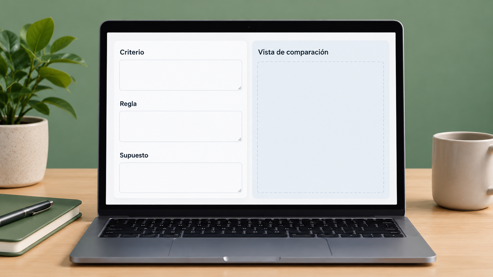

# Caso de estudio de Council para organización de criterios de puntuación

**Edición editorial:** 2026-11-07-editorial-r1. **Elaborada en UTC:** 2026-11-07T19:50:09.616232Z.

**Estado histórico declarado del contenido:** borrador local para revisión. **Versión histórica:** 2026-10-14-v5. **Fecha de redacción histórica declarada:** 2026-10-14. La fuente histórica estaba disponible públicamente en el commit consultado; su publicación no valida el contenido.

**Alcance de esta edición:** corrección administrativa del estado documental. El desarrollo y las atribuciones que siguen se reproducen de la [versión histórica](https://github.com/NovusMotus/portfolio-tesis/blob/2cd2acbd44ae01f98481e383af2368bce2973b43/tecnologicos/caso-scoring/TESIS.md); sus expresiones «esta versión» se refieren a aquella edición. Se conservan las fechas declaradas, los límites y las propuestas, sin añadir logros ni reconstruir el inicio de la idea. La disponibilidad de esta edición se comprueba en el repositorio y en la PR que la incorpore.

**Aporte editorial:** Codex desktop / OpenAI / gpt-6.1-sol; transformación con Python 3.12.14. [Registro de esta versión](VERSION-2026-11-07-editorial-r1.json) · [Revisión editorial fechada](../../REVISION_EDITORIAL_2026-11-07-r1.json).

## TL;DR

*Ilustración conceptual generada con IA; no es una captura ni prueba de uso.*

- **Propósito:** Hacer explícitos criterios y supuestos en un caso de puntuación.
- **Aportación y enfoque:** La edición propone relacionar alcance del brief y reglas de revisión; no infiere criterios personales definitivos de Javier.
- **Trabajo y evidencia:** Material de caso y salidas conservadas en Council, con lectura parcial.
- **Resultados y límites:** No prueba clasificación validada ni efectos sobre una organización. Falta comprobar reglas, datos y estabilidad de los resultados; material identificable permanece privado.

## Punto de partida y pregunta de esta línea

Esta línea de investigación plantea cómo delimitar un análisis de organización de criterios de puntuación y conservar sus fuentes, restricciones y preguntas. El problema se formula como una pregunta que puede contrastarse, sin valorar personas, instituciones o sectores. Los antecedentes reúnen afirmaciones de naturaleza diferente: observaciones, datos declarados, cálculos e hipótesis. La ficha organiza la pregunta y evita presentar las conclusiones de un informe antiguo como hechos actuales. Tampoco transforma una preferencia privada del promotor en una recomendación general.

## Origen y propósito

La documentación disponible permite describir esta línea, pero no reconstruye de forma confirmada qué observación, publicación o experiencia la inició. El punto de partida puede ser una idea, una hipótesis, una aplicación o una práctica con herramientas; no se presupone que exista un problema que resolver. Si se recupera una referencia de origen, se distinguirán lo que plantea esa fuente y la adaptación realizada por Javier.

## Enfoque del proyecto y propuesta de esta versión

El enfoque editorial propuesto es comparar alcance del brief, información aportada, fuentes públicas, alternativas y criterios de revisión. Para cada variable habría que especificar qué dato se busca, qué fuente podría acreditarlo y qué decisión depende de él. Las alternativas deben referirse a la misma tarea y condiciones, para que una diferencia no proceda solo de comparar productos o situaciones distintos. Este método se ofrece como ayuda para desarrollar el dossier: Javier revisará qué parte corresponde a su enfoque y qué propuestas nuevas desea conservar.

## Desarrollo y evidencia disponible

La carpeta de Council conserva material de caso, entradas y salidas relacionadas. Un encabezado de encargo o una respuesta generada no demuestra una relación contractual o intervención para la entidad citada. La revisión actual ha leído documentación y pasajes seleccionados, sin reproducir la ejecución completa de cada caso. Los materiales identificables o potencialmente reservados permanecen en las fuentes privadas. Esta ficha describe el problema metodológico y no acredita resultados para un cliente.

## Preguntas y límites que permanecen abiertos

Los datos pueden depender de una fecha, un producto o una muestra concreta. Una página comercial describe lo que declara su proveedor y no aporta por sí sola prueba de demanda, funcionamiento o resultado. Los cálculos necesitan entradas y supuestos identificados. Una fuente no localizada no demuestra que una actividad no exista. Las afirmaciones jurídicas, fiscales, médicas o de rendimiento requieren verificación pertinente antes de presentarse en una edición pública como hechos.

## Cómo podría comprobarse

El siguiente contraste propuesto es un brief ficticio o autorizado con contradicciones y datos ausentes, sin presentarlo como colaboración con la entidad citada. La prueba debe registrar condiciones, fuentes y criterios de comparación antes de interpretar el resultado. Si faltan datos, se mantiene la pregunta abierta y se indica qué cambiaría la decisión. Las versiones posteriores explicarán qué se añadió, corrigió o retiró y qué herramienta o modelo intervino. Ninguna prueba futura se describe en esta ficha como ejecutada.

## El caso aportado y la actividad de Javier son referencias distintas

La fuente relata desde la perspectiva de un participante un encargo de descubrimiento, clasificación y puntuación de perfiles digitales. Ese relato se conserva como material aportado; no acredita que Javier sea ese participante, tenga una relación contractual con las entidades o haya realizado el trabajo. La tesis pública describe el problema metodológico sin identidades, cadena comercial o criterios reservados del brief. Los ejemplos siguientes son nuevos e inventados.

La pregunta de análisis es cómo relacionar criterios, datos observados y una clasificación reproducible. Identificar una presencia pública, medir una característica y valorar pertinencia para una finalidad son operaciones diferentes. La puntuación necesita un significado definido antes de utilizarse. Esta ficha no atribuye autoridad profesional, calidad personal o fiabilidad clínica a personas reales y no publica una lista de perfiles puntuados.

## Definir qué observa cada criterio y qué deja fuera

La propuesta de esta edición es describir cada criterio por dato necesario, fuente, regla y alcance. Si el dato falta, ese estado debe diferenciarse de un valor bajo o de una característica ausente. Una suma de criterios no crea automáticamente una medida válida de influencia o conocimiento. Tampoco un dato público acredita todos sus posibles usos. Los requisitos pertinentes de una aplicación real necesitan comprobación específica; esta ficha no determina permisos o bases normativas.

Un ejemplo ficticio podría usar publicaciones inventadas y una regla que identifica si tratan un tema definido. La clasificación respondería únicamente a ese tema y conjunto. No mediría la capacidad profesional del autor inventado, y menos la de una persona real. El ejercicio permitiría examinar si las entradas corresponden al criterio anunciado. Se conservarían casos ambiguos y fuentes no disponibles en lugar de completar la información con una inferencia presentada como observación.

## Separar descubrimiento, comprobación y clasificación

Localizar un posible perfil puede producir un candidato para revisión; no demuestra que cumpla el criterio. La continuación propuesta organizaría búsqueda, identificación de la fuente, extracción del dato y aplicación de la regla por separado. El registro indicaría qué está observado, qué ha sido interpretado y qué necesita comprobación. No se considera que ese recorrido exista en las salidas históricas por describirlo en esta edición.

Para el conjunto ficticio se podría incluir una entrada duplicada, una publicación sin fecha y dos textos de significado parecido. La prueba preguntaría si se conservan procedencia, duplicados y dudas antes de clasificar. La salida tendría que poder revisarse respecto a la entrada, sin inventar una identidad o unir perfiles por semejanza. Esta preparación no recopila actividad de personas, conecta cuentas o ejecuta herramientas de descubrimiento. Los ejemplos no reproducen datos del encargo original.

## Estudiar sensibilidad y discrepancias sin fijar una puntuación real

Un ensayo conceptual podría comparar una regla inicial con otra que cambia un peso o umbral en un conjunto inventado. Se observaría qué clasificaciones cambian y qué parte de la diferencia depende del diseño. El contraste no determinaría una puntuación adecuada para personas reales ni demostraría que una suma represente influencia. Cada interpretación conservaría la finalidad y el alcance del criterio. No se han ejecutado cálculos en esta preparación.

También se podrían registrar desacuerdos entre dos revisiones del mismo texto ficticio. La pregunta sería si proceden de una definición ambigua, falta de datos o aplicación diferente de la regla. Una resolución requeriría conservar el motivo y la evidencia, sin elegir automáticamente la valoración más alta o un promedio. El modelo y las instrucciones de cada intervención quedarían registrados. El ejemplo pertenece al asistente y su uso posterior necesitaría alcance elegido y revisión de Javier.

## Una clasificación necesita un historial de procedencia

La propuesta de registro relacionaría versión del criterio, entrada, fuente, interpretación, resultado y corrección. Si cambia una regla, se distinguiría la clasificación anterior de la recalculada. Una fecha de recuperación de datos no sustituiría a la fecha de la actividad descrita. Si no se conoce una atribución histórica o un modelo, permanecería sin confirmar. La versión actual no reconstruye una cronología completa del encargo.

La aportación disponible es un caso aportado y una explicación metodológica derivada. No acredita contrato, entrega aceptada, validación de puntuaciones o resultados comerciales de Javier. El portfolio puede mostrar cómo examina una pregunta sobre criterios y trazabilidad con ejemplos propios. Las identidades, datos de perfiles, relaciones comerciales y reglas reservadas quedan en las fuentes privadas o fuera de cualquier entrega hasta su revisión. Una actualización incluiría solo los ejercicios y contrastes realmente realizados, con sus límites y herramientas identificadas.

## Procedencia de las posiciones

Caso documental existente; identidad y detalles del brief reservados. La explicación metodológica y el ensayo siguiente son propuestas editoriales. El texto es una síntesis asistida por IA y requiere la revisión de Javier antes de atribuirle nuevas formulaciones. Se describen procesos y condiciones, sin juicios de valor ni atribuciones de intenciones.

## Fechas, versiones y cambios

Primera referencia temporal utilizada: no confirmada. Fecha del antecedente e inicio real pendientes de reconstrucción; no se usa mtime como fecha de autoría.

Se añaden los desarrollos: El caso aportado y la actividad de Javier son referencias distintas; Definir qué observa cada criterio y qué deja fuera; Separar descubrimiento, comprobación y clasificación; Estudiar sensibilidad y discrepancias sin fijar una puntuación real; Una clasificación necesita un historial de procedencia. Las propuestas nuevas se atribuyen al asistente y se registra el modelo de este turno sin alterar las atribuciones anteriores. No se incorporan resultados de pruebas nuevas. La edición no modifica las fuentes originales ni sus fechas.

## Herramientas y modelos

Imagen conceptual vigente, añadida el 2026-10-14: preparación e incorporación con Codex/OpenAI gpt-6.1-sol (metadatos del turno); generación y correcciones con image_gen de OpenAI, cuyo modelo exacto no consta. Sustituye el esquema anterior, conservado en el historial. Revisión independiente: gpt-6-astra.

Apoyo visual añadido el 2026-10-14: esquema original elaborado con Codex/OpenAI gpt-6.1-sol (metadatos del turno), Python 3.12.14 y ReportLab 4.4.9, exportado como SVG. Explica la idea del TL;DR; no representa una prueba o resultado nuevo. Revisión independiente de esta edición: gpt-6-astra; alcance documentado por separado. Compatibilidad tipográfica del SVG corregida en esta edición.

La redacción de esta versión utiliza Codex/OpenAI con el modelo gpt-6.1-sol. Su identificación consta en los metadatos del turno utilizado para esta edición; las atribuciones de versiones anteriores se conservan con su evidencia original. Se usaron Python para organización y comprobación local, y herramientas de lectura y edición de archivos. La revisión editorial independiente se encargó a un agente separado con gpt-6-astra; su alcance y resultado se registran fuera del dossier, sin equivaler a validación integral del proyecto. No se han configurado integraciones o actualización continua.

### Atribuciones históricas documentadas

No hay una atribución histórica exacta reconstruida para esta ficha. Las menciones a herramientas en las fuentes no se consideran prueba de uso.

## Fuentes y alcance de lectura

La base es la documentación interna identificada en el registro privado de fuentes de esta preparación. Se ha leído mediante extracción local y se han examinado fuentes y pasajes seleccionados; no es una auditoría sustantiva de todo el corpus. Las referencias externas de los antecedentes requieren verificación pertinente antes de reutilizar afirmaciones como hechos actuales. No se incluyen rutas privadas, documentos sensibles, conversaciones completas o material de terceros en este dossier.
