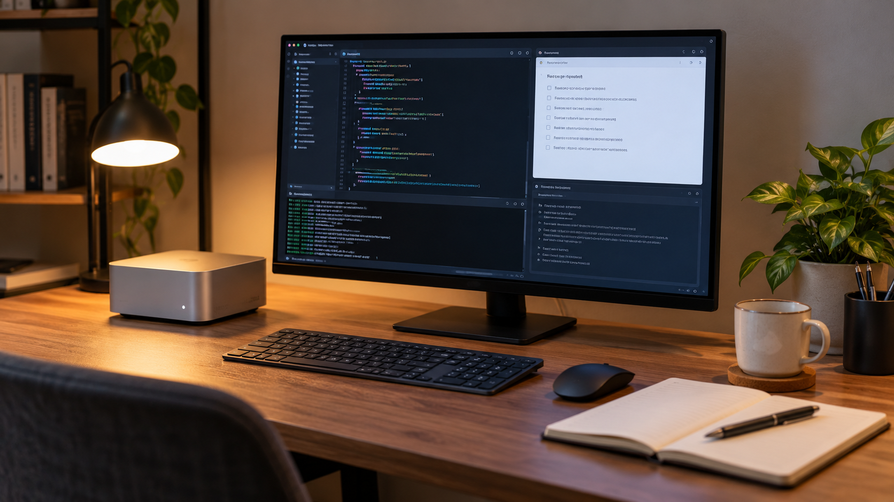

# Exploración de agentes y servidor personal

**Edición editorial:** 2026-11-07-editorial-r1. **Elaborada en UTC:** 2026-11-07T19:50:09.616232Z.

**Estado histórico declarado del contenido:** borrador local para revisión. **Versión histórica:** 2026-10-14-v6. **Fecha de redacción histórica declarada:** 2026-10-14. La fuente histórica estaba disponible públicamente en el commit consultado; su publicación no valida el contenido.

**Alcance de esta edición:** corrección administrativa del estado documental. El desarrollo y las atribuciones que siguen se reproducen de la [versión histórica](https://github.com/NovusMotus/portfolio-tesis/blob/2cd2acbd44ae01f98481e383af2368bce2973b43/tecnologicos/practica-agentes-servidor-personal/TESIS.md); sus expresiones «esta versión» se refieren a aquella edición. Se conservan las fechas declaradas, los límites y las propuestas, sin añadir logros ni reconstruir el inicio de la idea. La disponibilidad de esta edición se comprueba en el repositorio y en la PR que la incorpore.

**Aporte editorial:** Codex desktop / OpenAI / gpt-6.1-sol; transformación con Python 3.12.14. [Registro de esta versión](VERSION-2026-11-07-editorial-r1.json) · [Revisión editorial fechada](../../REVISION_EDITORIAL_2026-11-07-r1.json).

## TL;DR

*Ilustración conceptual generada con IA de un equipo compacto; no es una fotografía del Mac mini ni prueba de ejecución de agentes en él.*

- **Propósito:** Conservar la exploración de agentes y la intención de usar un Mac mini como servidor propio.
- **Aportación y enfoque:** Javier declara práctica desde Clawdbot y compra para esa finalidad; el asistente propone reconstruir ensayos y cambios por herramienta.
- **Trabajo y evidencia:** Compra documentada el 27 de enero de 2026, envío y notificación posteriores, sin examinar el equipo.
- **Resultados y límites:** Compra no acredita servidor operativo. Faltan primer uso, configuración, registros y modelos históricos; las tareas de ChatGPT no prueban ejecución local.

## Punto de partida y pregunta de esta línea

Javier declara que lleva practicando con agentes desde la etapa en que apareció Clawdbot y que compró un Mac mini con la intención de usarlo como servidor propio. Quiere que esta experiencia figure en el portfolio aunque no esté recogida en las carpetas de proyectos. La línea permite explicar su interés por experimentar con herramientas y por disponer de un entorno propio, sin atribuir de antemano servicios desplegados o una finalidad empresarial.

## Origen y propósito

Los mensajes de Javier del 13 y 14 de octubre de 2026 sitúan el interés por agentes y el equipo. Su aclaración posterior permite describir el comienzo recordado con Clawdbot a finales de enero de 2026, alrededor del cambio de nombre a Moltbot. La confirmación de pedido de Amazon está fechada el 27 de enero. El pedido y la cronología declarada se explican por separado: no prueban el primer uso exacto ni la configuración de un servidor.

## Enfoque del proyecto y propuesta de esta versión

Esta edición propone documentar la experiencia por ensayos: qué quería aprender o conseguir, qué herramientas empleó, qué configuró, qué ocurrió y qué cambió después. El equipo se describe por la intención declarada de tener un servidor propio. Su modelo, programas instalados, disponibilidad y uso efectivo siguen sin verificar. La propuesta organiza una futura reconstrucción; no afirma que todos los proyectos dependan del Mac mini ni que haya un sistema compartido por agentes ya operativo.

## Desarrollo y evidencia disponible

Está documentada la declaración de Javier sobre su práctica, una confirmación de pedido del Mac mini del 27 de enero de 2026, el correo de envío del día siguiente y una notificación de inicio de sesión de Apple del día 29. No se han examinado el equipo, sus programas o registros de servicio. La lista histórica de agentes, herramientas y modelos sigue incompleta. Las tareas observadas en ChatGPT tienen su propia ficha y no demuestran que se ejecuten en el Mac mini o estén conectadas a él.

## Preguntas y límites que permanecen abiertos

La compra de un equipo para una finalidad no demuestra que esa finalidad se haya implementado. Practicar con agentes no acredita por sí solo desarrollo autónomo de software, servicios en producción, disponibilidad continua o resultados para clientes. Esta versión no accede al servidor, publica su configuración ni presupone conexiones entre plataformas. El primer uso exacto, los ensayos y el alcance de cada herramienta siguen necesitando evidencia adicional; los recuerdos de Javier se identifican como tales, y la fecha del pedido tiene su propia evidencia documental.

## Cómo podría comprobarse

Se propone reconstruir primero un ensayo concreto que Javier recuerde y contrastarlo con un registro disponible, si lo hay. La ficha distinguiría objetivo, configuración, ejecución, salida y aprendizaje. Una futura demostración con materiales ficticios requeriría un alcance elegido por Javier y evidencia del resultado; no se ejecuta aquí. Los detalles de conexión y los accesos se mantendrían fuera del portfolio, incluso si posteriormente se confirma un servicio propio.

## Describir la práctica a través de un ensayo concreto

Una experiencia con agentes puede describirse mediante una tarea acotada. Como ejemplo ficticio, un agente podría ayudar a clasificar unas notas creadas para la prueba y otro a revisar si la clasificación conserva su significado. Antes de ejecutarlo se definirían las entradas y la salida esperada. Ese ejemplo ilustra una posible forma de documentar el trabajo; no representa un flujo realizado por Javier ni una capacidad comprobada de una plataforma concreta.

En la reconstrucción histórica interesaría conservar qué pidió Javier, qué decisiones tomó y qué parte aportó cada herramienta. El resultado incluiría también las dificultades y los cambios de enfoque que pueda confirmar. No se inventa un aprendizaje a partir del hecho de haber adquirido un equipo. Si solo se recuerda la finalidad de un ensayo, se registraría como recuerdo atribuido y se distinguiría de un archivo o una ejecución fechados. Así podría mostrarse la evolución sin convertirla en una cronología precisa que no está disponible.

## La intención de servidor propio y su uso comprobable

Tener un entorno propio es la intención declarada de la compra del Mac mini. Para desarrollar esa parte se propone describir qué funciones se querían alojar y cuáles llegaron a configurarse. Un equipo encendido, un programa instalado y un servicio que responde son evidencias diferentes. Esta ficha no dispone de esas comprobaciones y no atribuye al equipo un modelo, capacidad, rendimiento o disponibilidad concretos.

Un registro posterior podría identificar un servicio, su finalidad y una prueba delimitada de funcionamiento, sin publicar direcciones o accesos. También podría mostrar que el equipo se utilizó para experimentar o que una configuración quedó pendiente. Esas posibilidades no se eligen aquí como hechos. La explicación del portfolio debería corresponder al uso que Javier pueda confirmar, conservando aparte los detalles técnicos necesarios para comprobarlo. El inventario de archivos actual no se utiliza como prueba de todo lo que existe o ocurrió en ese equipo.

## Relacionar herramientas y agentes sin afirmar conexiones

Javier quiere poder incorporar distintas ayudas de IA a su trabajo. Esa intención puede documentarse separando uso de conversaciones, acceso a archivos, ejecución de herramientas y coordinación entre agentes. Una respuesta copiada de una plataforma a otra no demostraría una conexión automática. Del mismo modo, compartir una carpeta de proyectos no acredita que todos los agentes tengan los mismos permisos o que puedan utilizar un servidor. Las conexiones requieren comprobaciones propias.

Para un ensayo futuro se propone elegir primero una tarea y después describir qué información necesita cada participante. Podría compararse una revisión independiente con una secuencia de redacción y revisión, usando materiales preparados para el ejemplo. La comparación debería conservar instrucciones y resultados, sin asumir que añadir agentes mejora la calidad. No se crea una cuenta compartida, se entregan credenciales ni se configura acceso remoto en esta preparación. El portfolio podría explicar la intención de colaboración junto a los ensayos que lleguen a estar realmente documentados.

## Qué evidencia permite explicar un resultado o un límite

El registro propuesto conservaría la pregunta del ensayo, las condiciones relevantes y la salida obtenida. Una respuesta correcta en un caso no demostraría un funcionamiento general; una incidencia aislada tampoco explicaría por sí sola su causa. Si el ensayo fuera de clasificación, se necesitaría un criterio para contrastar las categorías. Si fuera de ejecución, habría que distinguir una propuesta de acción de una acción efectivamente realizada. Estos criterios son nuevos y no resultados históricos de Javier.

También se documentaría dónde intervino una persona: preparación de entradas, selección de herramientas, corrección y decisión final. Esa separación permite mostrar cómo Javier dirige una práctica asistida, sin convertir el código o el texto producido por una IA en autoría autónoma de todas sus partes. El portfolio puede incluir preguntas abiertas y pruebas que no llegaron a completarse cuando existan antecedentes. Esta versión no deduce fallos, logros o mejoras que Javier no haya contado y que no estén respaldados por materiales.

## Una cronología con herramientas y modelos identificados

La futura cronología distinguiría recuerdos, mensajes, archivos y pruebas. Si Javier solo puede situar un ensayo en un mes o una etapa, esa precisión limitada se mantendría. No se le asignaría el día de lanzamiento de una herramienta. Los cambios de configuración o de objetivo tendrían sus propias fechas cuando estén disponibles. La fecha de este dossier indica cuándo se documentó esta línea, sin desplazar al presente el inicio de su práctica.

Por aportación se registraría herramienta, proveedor y modelo exacto si existe evidencia. El nombre de un agente o de una aplicación no sustituye esa identificación, y un modelo usado actualmente no se trasladaría a ensayos anteriores. Una herramienta sin modelo generativo se anotaría de forma pertinente, sin inventarle uno. Si Claude u otro agente redactan una versión, deberán identificar el modelo de esa intervención. Las versiones previas conservarían sus atribuciones y cambios para que el lector pueda seguir tanto la experiencia de Javier como las ayudas utilizadas para explicarla.

## Cronología recuperada de la práctica y del equipo

Javier aclara que empezó con Clawdbot uno o dos días antes de que cambiara al segundo nombre y después confirma enero. La [historia oficial del proyecto](https://docs.openclaw.ai/start/lore) sitúa el cambio a Moltbot el 27 de enero de 2026. Esto permite situar aproximadamente su recuerdo a finales de enero; no acredita el día exacto de su primera ejecución. No se atribuye a Javier el modelo del creador del proyecto ni el comienzo de uso desde su lanzamiento.

La confirmación de pedido de Amazon del 27 de enero de 2026 identifica un Mac mini, y otro correo comunica el envío el día 28. El pedido aporta evidencia más precisa que el recuerdo inicial de marzo, que se conserva en el historial. Una notificación de Apple del día 29 informa de un inicio de sesión con un Mac mini; tampoco demuestra que hubiera agentes o un servidor configurados. Los correos, datos de cuenta, importe y enlaces de pedido permanecen privados.

Javier también sitúa su práctica con una herramienta llamada Hermes hace unos tres meses: aproximadamente julio de 2026 respecto a su mensaje de octubre. Esa fecha es un recuerdo, y la herramienta exacta, sus versiones, modelos y tareas siguen por documentar. Esta ampliación registra el recorrido declarado sin inventar aprendizajes, despliegues o resultados.

## Procedencia de las posiciones

El periodo relativo de práctica y la compra para uso como servidor son declaraciones de Javier. La división por ensayos, los criterios de comprobación y los ejemplos siguientes son propuestas nuevas del asistente. El texto requiere su revisión para recoger sus aprendizajes reales sin inventarlos. El texto es una síntesis asistida por IA y requiere la revisión de Javier antes de atribuirle nuevas formulaciones. Se describen procesos y condiciones, sin juicios de valor ni atribuciones de intenciones.

## Fechas, versiones y cambios

Primera declaración recuperada para esta ficha: 13 de octubre de 2026. La aclaración del día 14 sitúa el inicio recordado con Clawdbot a finales de enero de 2026 y Hermes aproximadamente en julio. La confirmación de pedido del Mac mini acredita el 27 de enero de 2026; no acredita cuándo quedó configurado. Las fechas de creación y revisión de este dossier figuran en su historial. La nueva edición añade estas referencias y sus límites, sin cambiar fechas ni contenido de versiones anteriores.

## Herramientas y modelos

Imagen conceptual vigente, añadida el 2026-10-14: preparación e incorporación con Codex/OpenAI gpt-6.1-sol (metadatos del turno); generación y correcciones con image_gen de OpenAI, cuyo modelo exacto no consta. Sustituye el esquema anterior, conservado en el historial. Revisión independiente: gpt-6-astra.

Apoyo visual añadido el 2026-10-14: esquema original elaborado con Codex/OpenAI gpt-6.1-sol (metadatos del turno), Python 3.12.14 y ReportLab 4.4.9, exportado como SVG. Explica la idea del TL;DR; no representa una prueba o resultado nuevo. Revisión independiente de esta edición: gpt-6-astra; alcance documentado por separado. Compatibilidad tipográfica del SVG corregida en esta edición.

La redacción de esta versión utiliza Codex/OpenAI con el modelo gpt-6.1-sol. La identificación consta en los metadatos del turno de esta edición y no se atribuye a los usos históricos descritos. Se usaron Python para organización y comprobación local, y herramientas de lectura y edición de archivos. La revisión editorial independiente se encargó a un agente separado con gpt-6-astra; su alcance y resultado se registran fuera del dossier, sin equivaler a validación integral del proyecto. No se han configurado integraciones o actualización continua. En la recuperación de esta cronología se utilizaron los conectores Gmail y Outlook Email para búsquedas y lectura delimitada, y web.run para consultar la referencia oficial del cambio de nombre. Esas herramientas no identifican los modelos de los agentes históricos; sus versiones y modelos permanecen sin confirmar cuando no hay evidencia.

### Atribuciones históricas documentadas

No hay una atribución histórica exacta reconstruida para esta ficha. Las menciones a herramientas en las fuentes no se consideran prueba de uso.

## Fuentes y alcance de lectura

La base es la documentación interna identificada en el registro privado de fuentes de esta preparación. Se ha leído mediante extracción local y se han examinado fuentes y pasajes seleccionados; no es una auditoría sustantiva de todo el corpus. Las referencias externas de los antecedentes requieren verificación pertinente antes de reutilizar afirmaciones como hechos actuales. No se incluyen rutas privadas, documentos sensibles, conversaciones completas o material de terceros en este dossier.
